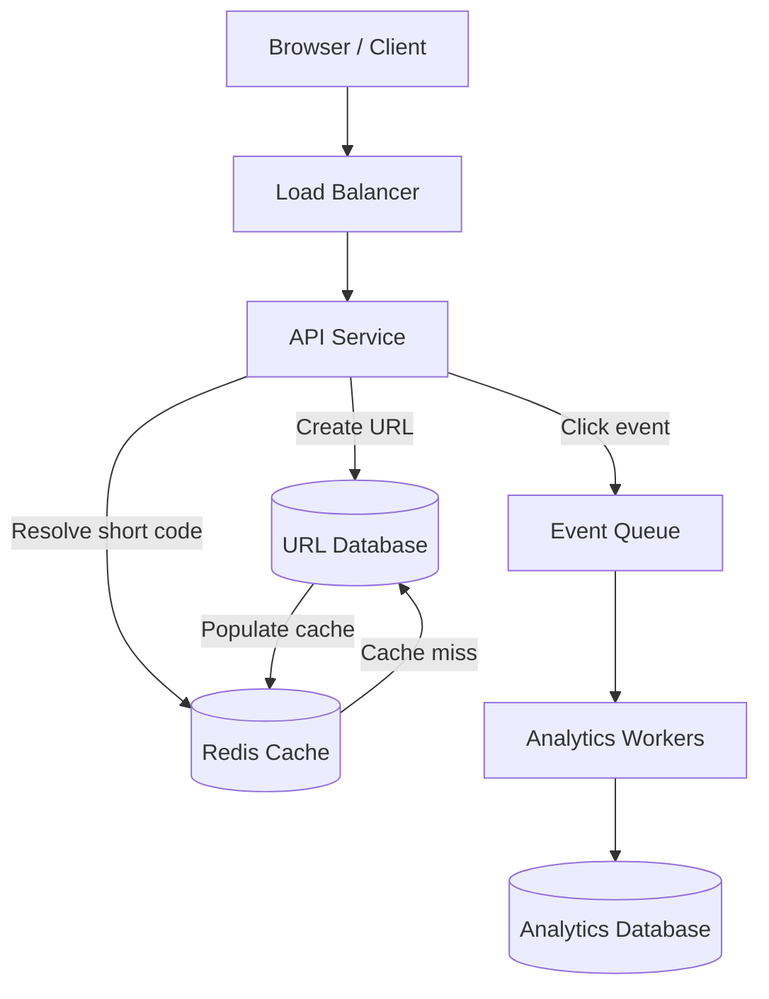
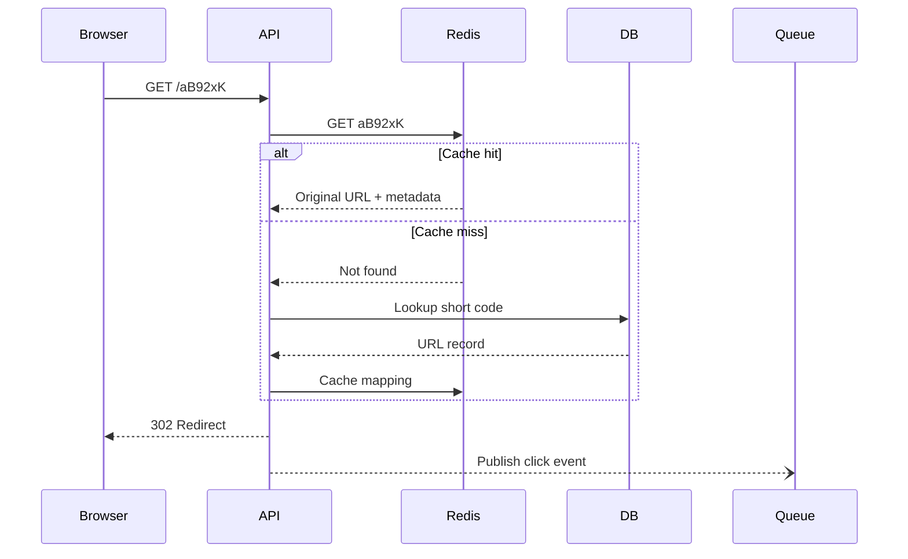
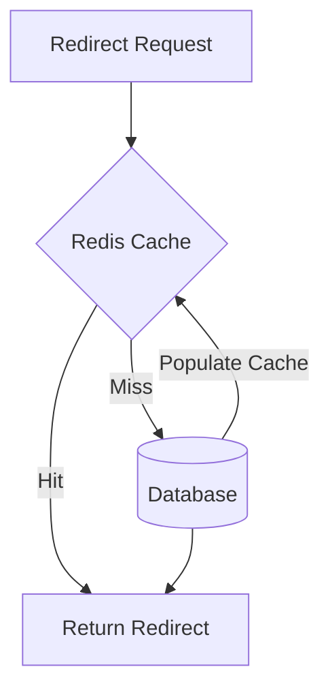
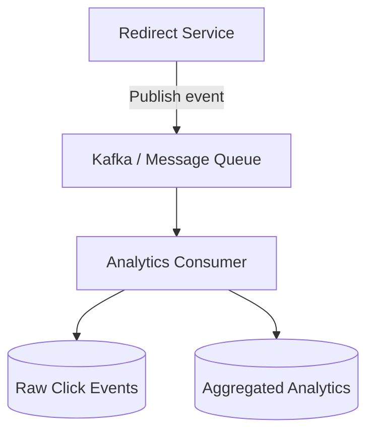
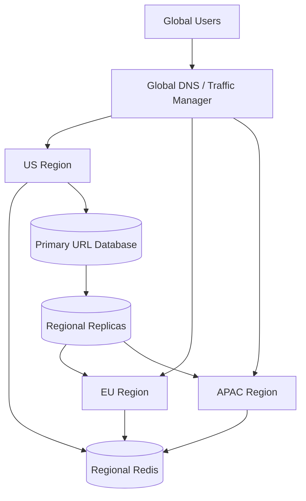
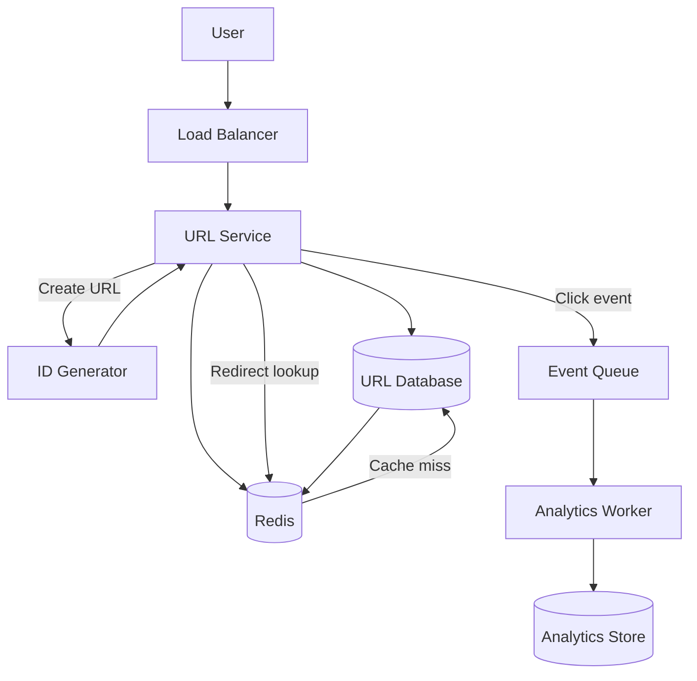

# Lesson 33 — System Design of a URL Shortener
## Hashing, ID Generation, Redirection, Caching, and Analytics

A URL shortener looks like a simple application: provide a long URL and receive a short link. But designing it at scale introduces several interesting system design challenges.

The system must generate globally unique short codes, redirect users with very low latency, handle significantly more reads than writes, cache popular links, collect analytics without slowing down redirects, and protect itself from malicious URLs.

In this lesson, we'll design a production-ready URL shortener similar to Bitly or TinyURL, exploring the architectural decisions and trade-offs behind it.

---

## 1. Problem Statement

Design a URL shortening service that converts long URLs into short, shareable URLs.

**Example:**

```text
Original:
https://example.com/products/electronics/mobile-phones/iphone-17-pro?campaign=summer2026

Short:
https://sho.rt/aB92xK
```

When someone visits the short URL, the system redirects them to the original URL.

### Core functionality

1. Create a short URL from a long URL.
2. Redirect users from a short URL to the original URL.
3. Support custom aliases.
4. Support URL expiration.
5. Collect click analytics.
6. Prevent malicious or abusive URL creation.

---

## 2. Functional Requirements

| Requirement | Description |
|---|---|
| URL creation | Generate a unique short code |
| Redirection | Resolve short code to original URL |
| Custom alias | Allow users to specify a preferred code |
| Expiration | Support links that expire |
| Analytics | Track clicks, timestamps, and relevant metadata |
| URL management | Allow owners to deactivate or delete links |
| Abuse prevention | Detect malicious and spam URLs |

### Non-functional requirements

| Requirement | Goal |
|---|---|
| Low latency | Redirects should be extremely fast |
| High availability | Redirect service should remain available |
| Scalability | Handle high read traffic |
| Durability | Created URLs should not be lost |
| Uniqueness | Avoid duplicate short codes |
| Security | Prevent phishing, malware, and abuse |

**Important:** Redirection is the most performance-sensitive operation. Analytics can tolerate some delay and eventual consistency.

---

## 3. Capacity Estimation

Let's assume:

- 10 million new URLs created every month.
- 100 redirects per URL creation, on average.
- 30 days per month.
- Peak traffic is 10 times average traffic.

### Write traffic

```text
10,000,000 / (30 × 24 × 60 × 60)

= 3.86 URL creations per second
```

Average write traffic is approximately 4 requests per second.

### Read traffic

```text
10,000,000 × 100
= 1,000,000,000 redirects per month
```

```text
1,000,000,000 / (30 × 24 × 60 × 60)

= 386 redirects per second
```

Average read traffic is approximately 386 redirects per second.

At a 10x peak factor:

```text
Peak reads  = 3,860 requests/second
Peak writes = 39 requests/second
```

### Key observation

This is a read-heavy system.

We should optimize the architecture for:

- Fast short-code lookup.
- Efficient caching.
- Highly available redirect infrastructure.
- Asynchronous analytics processing.

---

## 4. High-Level Architecture



### Component responsibilities

| Component | Responsibility |
|---|---|
| Load balancer | Distribute incoming requests |
| API service | Create URLs and handle redirects |
| Redis | Cache short-code mappings |
| Database | Persist original URLs and metadata |
| Message queue | Buffer click events |
| Analytics workers | Process click events asynchronously |
| Analytics database | Store aggregated statistics |

### Architectural principle

The redirect path and analytics path should be independent.

A failure in analytics processing should not prevent users from being redirected.

---

## 5. API Design

### Create short URL

```http
POST /api/urls
Content-Type: application/json
Authorization: Bearer <token>
```

Request:

```json
{
  "originalUrl": "https://example.com/products/123",
  "customAlias": "summer-sale",
  "expiresAt": "2026-12-31T23:59:59Z"
}
```

Response:

```json
{
  "id": "url_12345",
  "shortCode": "summer-sale",
  "shortUrl": "https://sho.rt/summer-sale",
  "originalUrl": "https://example.com/products/123",
  "expiresAt": "2026-12-31T23:59:59Z"
}
```

### Redirect

```http
GET /{shortCode}
```

Example:

```http
GET /aB92xK
```

Response:

```http
HTTP/1.1 302 Found
Location: https://example.com/products/123
```

### Analytics endpoint

```http
GET /api/urls/{shortCode}/analytics
```

Response:

```json
{
  "shortCode": "aB92xK",
  "totalClicks": 12500,
  "uniqueVisitors": 8300,
  "lastClickedAt": "2026-10-30T10:30:00Z"
}
```

The analytics endpoint should be protected by appropriate ownership and authorization checks.

---

## 6. Short Code Generation

This is one of the most important design decisions.

We need a short identifier that is:

- Unique.
- Compact.
- Fast to generate.
- Easy to use in URLs.
- Scalable across multiple application instances.

There are several approaches.

### Approach 1: Auto-increment ID + Base62

Generate a unique numeric ID and convert it into Base62.

Base62 uses:

```text
0-9  = 10 characters
a-z  = 26 characters
A-Z  = 26 characters

Total = 62 characters
```

Example:

```text
Database ID: 125789

Base62: w7E
```

The generated Base62 value becomes the short code.

#### Base62 capacity

The number of possible codes of length N is:

\[
62^N
\]

| Code length | Possible combinations |
|---|---:|
| 1 | 62 |
| 2 | 3,844 |
| 3 | 238,328 |
| 4 | 14.7 million |
| 5 | 916 million |
| 6 | 56.8 billion |
| 7 | 3.5 trillion |
| 8 | 218 trillion |

A six-character code already supports approximately 56.8 billion combinations.

#### Advantages

- No random collision problem when IDs are unique.
- Short codes are compact.
- Encoding and decoding are efficient.
- Simple to implement.

#### Disadvantages

- Codes are predictable.
- Sequential IDs can reveal approximate creation volume.
- A single database sequence can become a coordination bottleneck.

**Important:** Base62 is an encoding mechanism, not an encryption mechanism. Anyone who understands the encoding can decode the ID.

---

### Approach 2: Random ID Generation

Generate a random string of a fixed length.

Example:

```text
aB92xK
Xy71pQ
mN45zR
```

The system checks whether the generated code already exists.

```text
Generate random code
        |
        v
Check database
        |
   +----+----+
   |         |
Exists?     No
   |         |
Generate    Save
again       code
```

#### Advantages

- Difficult to predict.
- Can generate codes independently across multiple application instances.
- No centralized sequence required.

#### Disadvantages

- Collisions are possible.
- Requires collision detection and retry.
- Collision probability increases as the code space fills up.

#### Understanding collision probability

The birthday paradox helps estimate the probability of collisions.

For a code space of size \(N\), with \(k\) generated codes:

\[
P(\text{collision}) \approx 1 - e^{-\frac{k(k-1)}{2N}}
\]

This approximation is useful when \(k\) is relatively small compared with \(N\).

For a six-character Base62 code:

\[
N = 62^6 \approx 56.8 \text{ billion}
\]

As the number of generated codes grows, collision risk increases.

Use a unique database constraint even when the probability seems very small.

---

### Approach 3: Hash-Based Generation

Generate a hash from the original URL.

Example:

```text
Original URL
    |
    v
SHA-256
    |
    v
Hash output
    |
    v
Take first 6 characters
    |
    v
Short code
```

Example:

```text
URL:
https://example.com/products/123

Hash:
a8f4c2e9...

Short code:
a8f4c2
```

#### Advantages

- Same input can produce the same hash.
- Useful for deduplication strategies.
- Does not require sequential ID generation.

#### Disadvantages

- Truncating a hash introduces collision risk.
- Different URLs may produce the same short code.
- URL normalization affects whether two URLs are considered equivalent.
- Hashing does not automatically provide uniqueness.

Collision handling is still necessary.

One option is to use a longer hash segment or append a retry-specific value when a collision occurs.

---

### Approach 4: Distributed ID Generation

In a distributed system, generating IDs through one central database sequence may become a bottleneck.

An alternative is a distributed ID generator, such as Snowflake-style IDs.

A typical Snowflake ID contains:

```text
| Timestamp | Worker ID | Sequence |
```

Each component contributes to uniqueness:

- Timestamp: identifies the time of generation.
- Worker ID: identifies the generating instance.
- Sequence: distinguishes IDs generated within the same time unit.

The generated numeric ID can then be encoded using Base62.

#### Advantages

- Distributed generation.
- High throughput.
- No database round trip required for each ID.
- Time-oriented IDs can be useful operationally.

#### Disadvantages

- Requires worker ID coordination.
- Clock synchronization and clock rollback need consideration.
- Numeric IDs may reveal timing information.
- More operational complexity.

### Comparison

| Approach | Uniqueness | Predictability | Complexity |
|---|---|---|---|
| Auto-increment + Base62 | Guaranteed by unique sequence | High | Low |
| Random ID | Collision possible | Low | Medium |
| Hash-based | Collision possible | Depends on input | Medium |
| Snowflake + Base62 | Designed for distributed uniqueness | Moderate | High |

### Recommended approach

For a straightforward implementation, use a unique numeric ID encoded with Base62.

For a large distributed deployment, consider a distributed ID generator plus Base62.

If unpredictability matters, use sufficiently random codes and enforce uniqueness at the database level.

---

## 7. URL Data Model

A relational database is a reasonable starting point.

### URLs table

```sql
CREATE TABLE urls (
    id BIGINT PRIMARY KEY,
    short_code VARCHAR(32) NOT NULL UNIQUE,
    original_url TEXT NOT NULL,
    owner_id BIGINT,
    created_at TIMESTAMP NOT NULL,
    expires_at TIMESTAMP,
    status VARCHAR(20) NOT NULL DEFAULT 'active'
);
```

### Important fields

| Field | Purpose |
|---|---|
| id | Internal primary key |
| short_code | Public short identifier |
| original_url | Destination URL |
| owner_id | Link owner |
| created_at | Creation timestamp |
| expires_at | Optional expiration |
| status | Active, disabled, or expired |

### Important indexes

```sql
CREATE UNIQUE INDEX idx_urls_short_code
ON urls(short_code);

CREATE INDEX idx_urls_owner_created
ON urls(owner_id, created_at DESC);
```

The short-code lookup is the most important query.

```sql
SELECT original_url, expires_at, status
FROM urls
WHERE short_code = 'aB92xK';
```

The unique index allows efficient lookup and prevents duplicate codes.

### Custom aliases

Suppose two users request:

```text
https://sho.rt/summer-sale
```

Only one should be allowed to own that alias.

The database's unique constraint is the final authority.

Do not rely only on an application-level existence check:

```text
Check alias availability
        |
        v
Save alias
```

Two concurrent requests could both pass the check.

Instead:

1. Check availability for a friendly early response.
2. Attempt the insert.
3. Let the unique constraint reject a conflict.
4. Return `409 Conflict` when the alias is already taken.

---

## 8. Redirection Flow

The redirect path must be optimized for low latency.



### Step-by-step

1. User opens a short URL.
2. Request reaches the redirect service.
3. Service checks Redis.
4. If found, retrieve the destination URL.
5. If not found, query the database.
6. Validate status and expiration.
7. Return the redirect response.
8. Publish an analytics event asynchronously.

**Critical principle:** Do not wait for analytics processing before returning the redirect response.

---

## 9. HTTP Redirect Types: 301 vs 302 vs 307

Choosing the correct redirect status code matters.

| Status | Meaning | Method behavior |
|---|---|---|
| 301 | Permanent redirect | User agents may cache and reuse |
| 302 | Temporary redirect | Historically may change POST to GET |
| 307 | Temporary redirect | Preserves HTTP method |
| 308 | Permanent redirect | Preserves HTTP method |

### Why use 302?

For a URL shortener, 302 is often a practical default.

Reasons:

- Destination URLs may change.
- You may want requests to continue reaching your service.
- You can continue collecting click analytics.
- Browser caching is generally less permanent than with 301.

However, 302 does not guarantee every browser or intermediary will behave identically. Cache headers also matter.

### What happens with 301?

If the browser caches a permanent redirect, future requests may go directly to the destination.

That can reduce traffic to the URL shortener, but it also reduces your ability to record every click.

### Recommendation

Use 302 for a typical analytics-oriented shortener, and define explicit caching behavior with HTTP cache headers.

Use 301 or 308 when permanent redirect semantics are genuinely intended.

---

## 10. Caching Strategy

Because reads greatly outnumber writes, caching is essential.

Redis can store:

```text
Key:
url:aB92xK

Value:
{
  "originalUrl": "https://example.com/products/123",
  "status": "active",
  "expiresAt": "2026-12-31T23:59:59Z"
}
```

### Cache-aside pattern



### Cache hit

The short-code mapping exists in Redis.

```text
Request → Redis → Destination → Redirect
```

### Cache miss

The mapping is not in Redis.

```text
Request → Redis → Database → Destination
                         |
                         v
                    Update Redis
```

### Cache expiration

Use a TTL to prevent stale entries from remaining indefinitely.

Example:

```text
Redis TTL: 1 hour
```

The actual TTL should depend on link lifecycle, update frequency, and freshness requirements.

### What happens when a URL is disabled?

Suppose a link is already cached.

An administrator disables it in the database.

Without cache invalidation, the old mapping might continue working until its TTL expires.

Possible solutions:

- Delete the cache key when the URL is disabled.
- Publish an invalidation event to all relevant cache consumers.
- Use short TTLs where immediate invalidation is not required.
- Include versioning or status metadata in cached records.

For security-sensitive deactivation, cache invalidation should be reliable and tested.

---

## 11. Hot Keys and Cache Stampede

### Hot keys

A viral short URL might receive millions of requests.

Example:

```text
url:viral123
```

One Redis key receives a disproportionate amount of traffic.

Potential solutions:

- Redis replicas for read scaling.
- Local in-memory caching for very hot entries.
- CDN or edge caching where semantics allow it.
- Replicate hot data across cache nodes.
- Apply traffic controls against abusive clients.

### Cache stampede

Suppose a popular cache entry expires.

Thousands of requests arrive simultaneously.

All requests miss Redis and query the database.

```text
10,000 requests
       |
       v
Redis cache miss
       |
       v
10,000 database queries
```

Solutions:

1. Request coalescing: allow one request to refresh the cache while others wait.
2. TTL jitter: vary expiration times slightly.
3. Stale-while-revalidate: serve stale data temporarily when safe.
4. Distributed locking: coordinate refresh operations carefully.

A short URL's destination is often stable, so stale-while-revalidate may be appropriate for selected links. It should not be used when immediate deactivation is required.

---

## 12. Analytics Architecture

Analytics can become expensive if every redirect performs synchronous database writes.

Avoid this:

```text
Redirect Request
      |
      v
Update Click Counter in Database
      |
      v
Return Redirect
```

Instead, use asynchronous event processing.



### Click event example

```json
{
  "eventId": "evt_123",
  "shortCode": "aB92xK",
  "timestamp": "2026-10-30T10:30:00Z",
  "country": "IN",
  "deviceType": "mobile",
  "referrer": "https://social.example"
}
```

Do not collect more personal information than necessary.

IP addresses, precise location, and persistent identifiers can have privacy and regulatory implications.

### Analytics metrics

| Metric | Description |
|---|---|
| Total clicks | Number of recorded redirect requests |
| Unique visitors | Estimated distinct visitors |
| Country | Approximate visitor geography |
| Device type | Mobile, desktop, tablet |
| Browser | Browser category |
| Referrer | Source of incoming traffic |
| Click timeline | Clicks grouped by time |

### Unique visitors are not straightforward

A click event is not necessarily a unique human visitor.

Possible estimation methods:

- Privacy-conscious first-party identifiers.
- Short-lived pseudonymous identifiers.
- Aggregated IP and user-agent signals, subject to privacy requirements.
- Approximate distinct-count algorithms such as HyperLogLog.

Each approach has accuracy and privacy trade-offs.

### Analytics consistency

The redirect itself should not wait for analytics aggregation.

Therefore:

```text
Redirect response = synchronous
Analytics update  = asynchronous
```

Analytics may be eventually consistent.

For example, a user might click a link and see the updated count several seconds later.

That is usually acceptable.

---

## 13. Database Selection and Scaling

A relational database such as PostgreSQL is a strong starting point.

Why?

- Unique constraints for short codes.
- Transactions for URL creation.
- Indexes for fast lookups.
- Straightforward ownership and expiration management.
- Familiar operational model.

### When traffic grows

Potential scaling strategies:

1. Add read replicas.
2. Improve indexes and query plans.
3. Increase cache hit rate.
4. Partition large analytics tables.
5. Separate analytics storage from the primary URL database.
6. Shard URL records if a single database no longer meets requirements.

### Sharding strategy

A natural sharding key is `short_code`.

```text
Shard 1: a* - f*
Shard 2: g* - m*
Shard 3: n* - s*
Shard 4: t* - z*
```

However, range-based sharding can become uneven.

Hash-based distribution is another option:

```text
shard = hash(short_code) % shard_count
```

This distributes keys more evenly, but changing the shard count can require data movement unless a more flexible partitioning strategy is used.

### Read replicas

Redirect reads can be served from replicas, but replication lag introduces a possible issue:

A newly created URL might not immediately appear on a read replica.

Possible solutions:

- Route newly created link lookups to the primary briefly.
- Populate Redis during creation.
- Use a read-your-writes mechanism.
- Use synchronous replication where the availability and latency trade-offs are acceptable.

---

## 14. URL Expiration and Lifecycle

Each URL may have an expiration timestamp.

At redirect time:

```text
Lookup short code
       |
       v
Check status
       |
       v
Check expires_at
       |
   +---+---+
   |       |
Expired  Active
   |       |
404/410  Redirect
```

A scheduled background process can mark expired records.

However, expiration should also be checked during the redirect request.

Why?

Because scheduled jobs are not guaranteed to run exactly at the expiration time.

### 404 vs 410

- `404 Not Found`: the short code does not exist or the service chooses not to disclose its state.
- `410 Gone`: the resource existed but is no longer available.

The response policy should be consistent and should avoid leaking sensitive information.

---

## 15. Security and Abuse Prevention

A URL shortener can easily become a phishing or malware distribution channel.

Security is a core requirement, not an optional enhancement.

### Common threats

| Threat | Mitigation |
|---|---|
| Phishing links | URL reputation checks |
| Malware distribution | Safe browsing or malware scanning |
| Spam creation | Rate limiting and quotas |
| Brute-force enumeration | Random or sufficiently unpredictable codes |
| Alias squatting | Ownership and conflict handling |
| Open redirect abuse | Destination validation and abuse controls |
| Automated bot traffic | Bot detection and throttling |
| Malicious URL schemes | Allow only supported schemes |

### URL validation

At minimum:

- Allow `http` and `https`.
- Reject `javascript:`, `data:`, and unsupported schemes.
- Normalize and validate URLs consistently.
- Enforce maximum URL length.
- Consider DNS resolution and private-network destination checks for server-side scanners.

### SSRF considerations

If the service fetches URLs to inspect page content, it may become vulnerable to Server-Side Request Forgery (SSRF).

A malicious user could submit a URL pointing to:

```text
http://127.0.0.1/
http://169.254.169.254/
http://internal-service/
```

A scanner must block private, loopback, link-local, and otherwise restricted network destinations.

It should also revalidate DNS resolution and redirects to avoid bypasses.

### Rate limiting

Apply limits to:

- URL creation per user.
- Anonymous URL creation.
- Custom alias attempts.
- Redirect requests from abusive clients.
- Analytics API access.

Rate limiting should be applied at appropriate layers, not only inside the application process.

---

## 16. Multi-Region Architecture

For a global URL shortener, users may access links from different regions.

A possible architecture:



### Important decisions

- Where are new URLs created?
- How are IDs generated globally?
- How are records replicated?
- How quickly do changes propagate?
- What happens if the primary region fails?
- How are cache invalidations distributed?

### Multi-region trade-offs

| Strategy | Advantage | Disadvantage |
|---|---|---|
| Single write region | Simpler consistency | Cross-region write latency |
| Multi-region writes | Lower regional write latency | Conflict and coordination complexity |
| Global distributed database | Better geographic distribution | More operational complexity |
| Regional read replicas | Faster local reads | Replication lag |

For a first production design, a single write region with regional read replicas and regional caches is often a reasonable starting point.

---

## 17. Failure Scenarios

| Failure | Impact | Possible response |
|---|---|---|
| Redis unavailable | More database reads | Fall back to database with load protection |
| Database unavailable | Cache misses cannot resolve | Serve valid cached entries where possible |
| Analytics queue unavailable | Click events cannot be accepted | Use bounded buffering or drop analytics under defined policy |
| Analytics worker failure | Analytics delay | Retry and use a dead-letter queue |
| Cache contains stale mapping | Wrong destination or disabled link | Invalidate cache and enforce expiration/status checks |
| ID generator unavailable | URL creation failure | Use redundant generators or a fallback strategy |
| Region outage | Regional service disruption | Fail over to healthy region |

### Important distinction

Not every feature needs the same availability target.

For example:

- Redirect service: very high availability.
- URL creation: high availability.
- Analytics dashboard: may tolerate temporary unavailability.
- Analytics aggregation: may tolerate processing delays.

This separation helps prevent non-critical features from affecting the core redirect experience.

---

## 18. End-to-End Design Summary



### Core design decisions

| Area | Recommended starting point |
|---|---|
| ID generation | Unique numeric ID + Base62 |
| Database | PostgreSQL |
| Cache | Redis |
| Redirect | HTTP 302 |
| Analytics | Asynchronous event pipeline |
| Queue | Kafka or another durable message broker |
| Custom aliases | Unique database constraint |
| Expiration | TTL metadata + request-time validation |
| Security | URL validation, scanning, rate limits |
| Scaling | Read replicas, caching, then sharding if needed |

---

## 19. Common System Design Mistakes

1. **Using a short hash without collision handling.**  
   A truncated hash is not guaranteed to be unique.

2. **Using 301 for every redirect.**  
   Browser and intermediary caching can bypass future visits to the shortener.

3. **Updating click counts synchronously.**  
   Analytics writes can increase redirect latency and reduce availability.

4. **Depending entirely on Redis.**  
   Redis is a cache, not the only durable source of truth.

5. **Ignoring cache invalidation.**  
   Disabled or expired URLs may continue to redirect through stale cache entries.

6. **Generating IDs through a single bottleneck.**  
   A centralized generator can become a scalability limitation.

7. **Ignoring malicious URLs.**  
   URL shorteners are attractive targets for phishing and malware distribution.

8. **Assuming one click equals one unique visitor.**  
   Bots, previews, retries, and multiple devices make unique visitor counts approximate.

9. **Overengineering too early.**  
   A relational database and Redis may be enough for a substantial initial workload.

10. **Coupling analytics availability to redirect availability.**  
    A failed analytics system should not take down redirects.

---

## 20. Design Checklist

### Requirements
- [ ] URL creation and redirection defined.
- [ ] Custom aliases supported.
- [ ] Expiration behavior defined.
- [ ] Analytics requirements defined.
- [ ] Abuse prevention requirements defined.

### ID generation
- [ ] Code-generation strategy selected.
- [ ] Collision handling implemented.
- [ ] Uniqueness enforced in the database.
- [ ] Predictability considered.

### Data and caching
- [ ] Short-code lookup indexed.
- [ ] Cache-aside strategy defined.
- [ ] TTL policy defined.
- [ ] Cache invalidation handled.
- [ ] Hot-key and stampede scenarios considered.

### Analytics
- [ ] Events published asynchronously.
- [ ] Event processing is idempotent.
- [ ] Analytics storage separated from redirect storage.
- [ ] Unique visitor limitations documented.
- [ ] Privacy requirements considered.

### Reliability and security
- [ ] Redirect service independent from analytics.
- [ ] Database fallback behavior defined.
- [ ] Expiration checked at request time.
- [ ] Rate limiting implemented.
- [ ] URL schemes validated.
- [ ] Malicious URL scanning considered.

---

## 21. Revision Questions

1. Why is a URL shortener considered a read-heavy system?
2. How does Base62 encoding work?
3. How many unique codes can six Base62 characters represent?
4. Why is Base62 encoding not encryption?
5. What are the trade-offs between sequential IDs and random IDs?
6. Why does a truncated hash require collision handling?
7. How does a Snowflake-style ID generator work?
8. Why should the short-code column have a unique constraint?
9. Why is Redis useful for URL redirection?
10. What is a cache stampede?
11. Why might HTTP 302 be preferable to 301?
12. Why should analytics processing be asynchronous?
13. How would you invalidate a cached URL after it is disabled?
14. What happens if a read replica has not received a newly created URL?
15. How can a URL shortener prevent phishing and SSRF attacks?
16. How would you scale the system across multiple regions?

---

## 22. Practical Exercise

Design your own URL shortener.

Assume:

- 50 million new URLs per month.
- 200 redirects per URL on average.
- Global users.
- 99.99% redirect availability target.
- Analytics can be eventually consistent.
- Custom aliases are supported.
- URLs can expire.

### Your tasks

**Task 1 — Capacity planning**

Calculate:

- Average URL creations per second.
- Average redirects per second.
- Peak redirect traffic assuming a 10x multiplier.
- Approximate storage required for one year.

State your assumptions about record size and indexing overhead.

**Task 2 — ID generation**

Compare:

- Auto-increment + Base62.
- Random Base62.
- Snowflake + Base62.

Select one and justify your choice.

**Task 3 — Architecture**

Draw the architecture and explain:

- API service.
- Redis.
- Database.
- ID generator.
- Message queue.
- Analytics workers.

**Task 4 — Redirection**

Explain the complete redirect flow, including:

- Cache hit.
- Cache miss.
- Expired URL.
- Disabled URL.
- Database failure.

**Task 5 — Analytics**

Design a click-event pipeline that does not increase redirect latency.

Explain how you would handle duplicate events and delayed processing.

**Task 6 — Reliability**

Explain what happens if:

- Redis becomes unavailable.
- The database becomes unavailable.
- Analytics consumers stop processing.
- A region becomes unavailable.

**Task 7 — Security**

Explain how you would prevent:

- Phishing links.
- Brute-force URL enumeration.
- URL creation abuse.
- SSRF through URL scanning.

### Final challenge

A celebrity shares one short URL, and it suddenly receives 5 million requests within a few minutes.

Explain how your architecture handles:

1. The hot Redis key.
2. Redirect traffic spikes.
3. Analytics event volume.
4. Database protection.
5. Regional traffic distribution.

---

## 23. Practice Focus

The most important concepts to master in this lesson are:

1. **ID generation:** Understand why generating unique identifiers is a distributed systems problem.
2. **Base62:** Be comfortable calculating the capacity of different code lengths.
3. **Redirect optimization:** Keep the critical path short and cache frequently accessed mappings.
4. **Analytics decoupling:** Use asynchronous processing so analytics does not affect redirect availability.
5. **Cache correctness:** Understand TTLs, invalidation, hot keys, and stampedes.
6. **Security:** Treat malicious URL handling as a fundamental product requirement.

Don't just memorize the architecture. Be able to explain why each component exists and what happens when it fails.

---

## Key Takeaway

A URL shortener is not merely a string-conversion application. It is a read-heavy distributed system that combines unique ID generation, low-latency lookups, caching, redirection semantics, asynchronous event processing, and security controls.

The most important architectural decision is to keep the redirect path extremely fast and independent from non-critical workloads such as analytics.