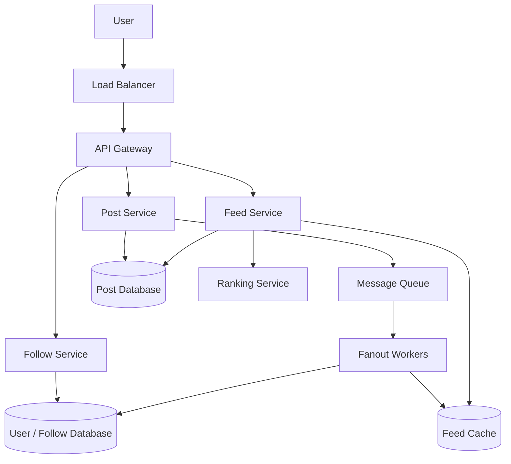
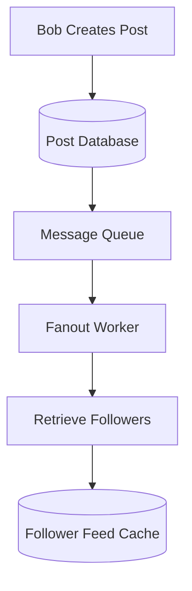
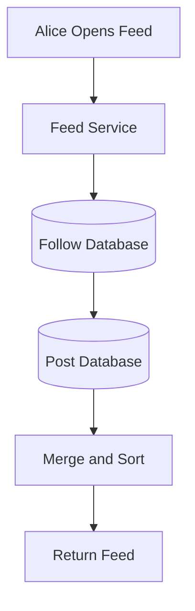
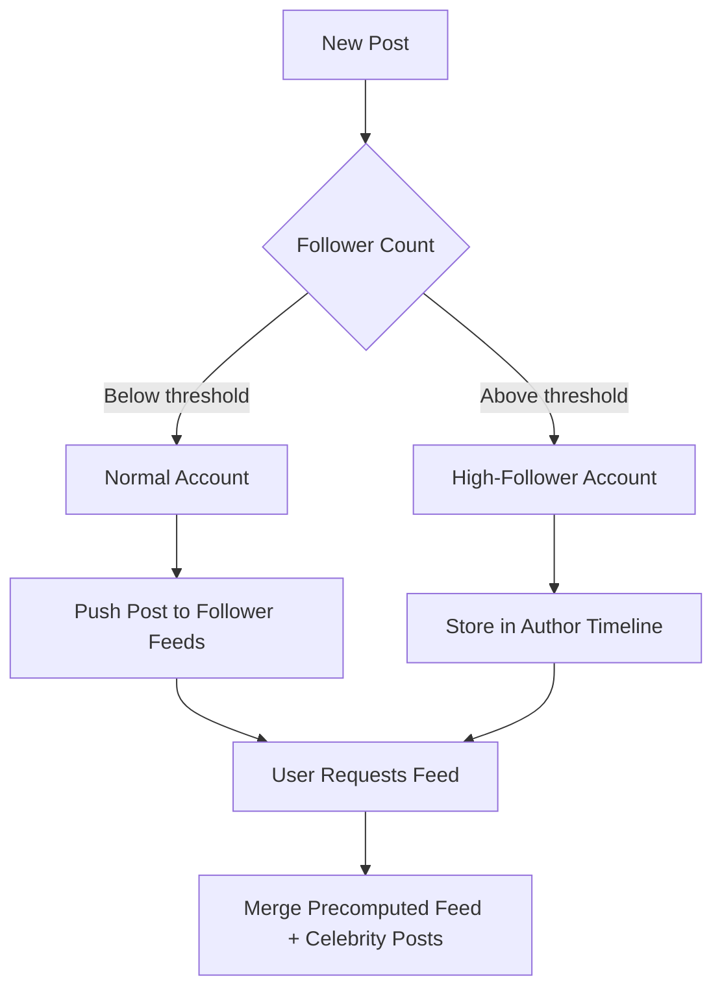
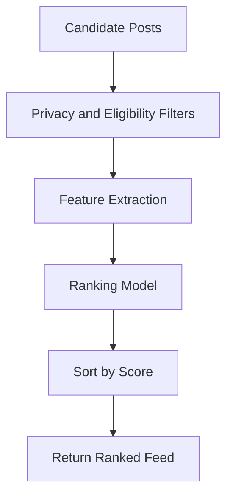
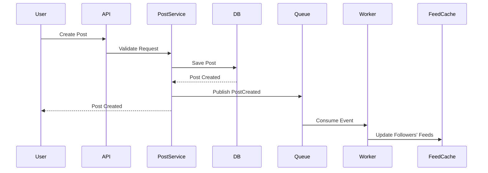
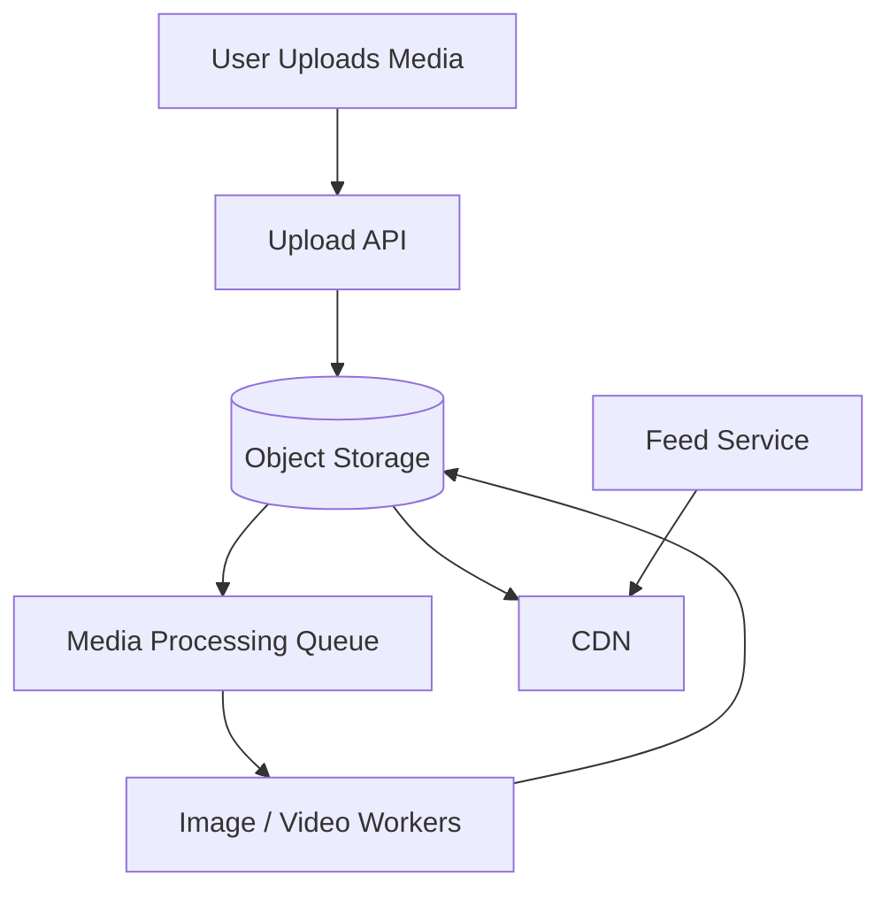
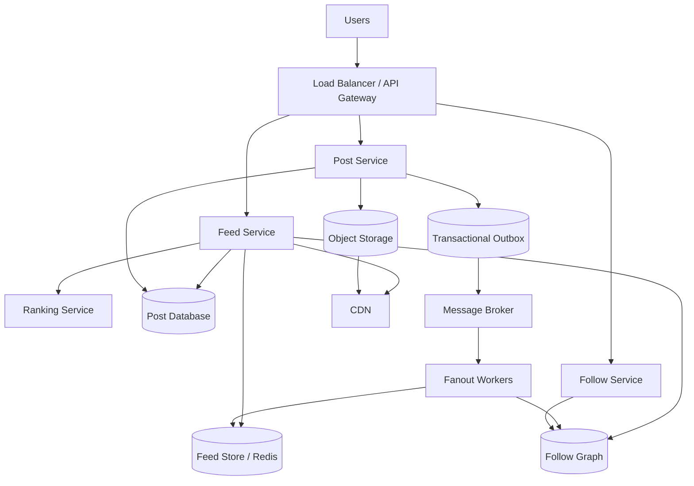

# Lesson 34 — System Design of a News Feed
## Fanout-on-Write, Fanout-on-Read, Ranking, and Timeline Generation

A news feed is one of the most interesting large-scale system design problems.

When you open a social media application, you see posts from people and pages you follow. But generating that feed is not as simple as fetching posts from a database and sorting them by timestamp.

Consider a platform with:
- 100 million registered users.
- 20 million daily active users.
- Millions of new posts every day.
- Users following hundreds or thousands of accounts.
- Some celebrities followed by millions of users.

The system must generate personalized feeds quickly, handle enormous read traffic, distribute new posts efficiently, and rank content according to relevance.

In this lesson, we'll design a scalable news feed similar to Facebook, Instagram, or X.

---

## 1. Problem Statement

Design a news feed system where users can:
- Create posts.
- Follow and unfollow other users.
- View posts from followed users.
- Like and comment on posts.
- See a personalized, ranked feed.
- Paginate through older posts.

### Functional requirements

| Requirement | Description |
|---|---|
| Create post | Publish text, images, or videos |
| Follow | Follow another user or page |
| Unfollow | Stop receiving their posts |
| Generate feed | Retrieve posts from followed accounts |
| Ranking | Sort posts based on relevance |
| Pagination | Load older posts incrementally |
| Engagement | Like, comment, and share |

### Non-functional requirements

| Requirement | Goal |
|---|---|
| Low latency | Feed should load quickly |
| High availability | Feed remains accessible |
| Scalability | Support millions of active users |
| Freshness | New posts should appear quickly |
| Consistency | Follow and privacy rules must be respected |
| Personalization | Feed should be relevant to each user |

### Scope

We'll focus primarily on:
- Post creation.
- Following relationships.
- Feed generation.
- Fanout strategies.
- Ranking.
- Caching.
- Pagination.
- Scaling and reliability.

---

## 2. Capacity Estimation

Assume the following:

| Metric | Estimate |
|---|---:|
| Registered users | 100 million |
| Daily active users | 20 million |
| Average feed requests per active user | 10/day |
| Average posts per user | 2/day |
| Average followers per user | 500 |
| Celebrity followers | 10 million |

### Feed read traffic

```text
20 million users × 10 feed requests/day

= 200 million feed requests/day
```

Requests per second:

```text
200,000,000 / 86,400

≈ 2,315 requests/second
```

Assuming a peak factor of 5:

```text
Peak feed requests

= 2,315 × 5

≈ 11,575 requests/second
```

### Post creation traffic

Assume 20 million daily active users each create 2 posts per day:

```text
20 million × 2

= 40 million posts/day
```

Average post creation rate:

```text
40,000,000 / 86,400

≈ 463 posts/second
```

These numbers are simplified estimates. Real systems must account for traffic distribution, media uploads, retries, and uneven activity.

### Important observation

The number of feed reads is significantly higher than the number of post writes.

However, one post can be distributed to thousands or millions of followers.

This creates an interesting problem:

**Should we distribute posts when they are created, or fetch them when users request their feeds?**

This leads to the two fundamental fanout strategies.

---

## 3. High-Level Architecture



### Component responsibilities

| Component | Responsibility |
|---|---|
| API Gateway | Route requests and enforce authentication |
| Post Service | Create and retrieve posts |
| Follow Service | Manage follow relationships |
| Feed Service | Generate personalized feeds |
| Message Queue | Distribute post-created events |
| Fanout Workers | Deliver post references to followers' feeds |
| Feed Cache | Store precomputed feed entries |
| Ranking Service | Order posts by relevance |

---

## 4. Data Model

We need to store users, posts, follow relationships, and feed entries.

### Users

```sql
CREATE TABLE users (
    id BIGINT PRIMARY KEY,
    username VARCHAR(100) UNIQUE NOT NULL,
    created_at TIMESTAMP NOT NULL
);
```

### Posts

```sql
CREATE TABLE posts (
    id BIGINT PRIMARY KEY,
    user_id BIGINT NOT NULL,
    content TEXT,
    media_url TEXT,
    visibility VARCHAR(20) NOT NULL DEFAULT 'public',
    created_at TIMESTAMP NOT NULL
);
```

Important index:

```sql
CREATE INDEX idx_posts_user_created
ON posts(user_id, created_at DESC);
```

### Follow relationships

```sql
CREATE TABLE follows (
    follower_id BIGINT NOT NULL,
    following_id BIGINT NOT NULL,
    created_at TIMESTAMP NOT NULL,
    PRIMARY KEY (follower_id, following_id)
);
```

This allows us to answer:

- Whom does this user follow?
- Is this user following another user?

For fanout-on-write, we also need to efficiently find followers of an account.

```sql
CREATE INDEX idx_follows_following
ON follows(following_id, follower_id);
```

### Feed entries

A feed entry can reference a post rather than copying the entire post content.

```sql
CREATE TABLE feed_entries (
    user_id BIGINT NOT NULL,
    post_id BIGINT NOT NULL,
    created_at TIMESTAMP NOT NULL,
    PRIMARY KEY (user_id, post_id)
);
```

Index:

```sql
CREATE INDEX idx_feed_user_created
ON feed_entries(user_id, created_at DESC);
```

### Why store post IDs instead of complete post objects?

Suppose one post is distributed to 100,000 followers.

If we copy the full post content into every feed, we create unnecessary storage duplication.

Instead:

```text
User Feed Entry
      |
      v
    Post ID
      |
      v
  Post Database
      |
      v
  Post Content
```

This reduces duplication and allows post content to be updated centrally.

However, it introduces additional reads when rendering feeds. Caching and batch retrieval help address that.

---

## 5. The Core Problem: Feed Generation

Imagine:

```text
Alice follows:
- Bob
- Charlie
- David
- Emma
```

Each person creates posts.

When Alice opens her feed, she should see posts from these accounts.

The simplest implementation is:

1. Fetch all users Alice follows.
2. Fetch their latest posts.
3. Combine all posts.
4. Sort by timestamp.
5. Return the first 20 posts.

Conceptually:

```sql
SELECT p.*
FROM posts p
JOIN follows f
  ON p.user_id = f.following_id
WHERE f.follower_id = 100
ORDER BY p.created_at DESC
LIMIT 20;
```

This is called a fanout-on-read approach when the system constructs the feed during the read request.

It works for smaller systems, but can become expensive when users follow thousands of accounts and many users request feeds simultaneously.

Let's explore the alternatives.

---

## 6. Fanout-on-Write

Fanout-on-write is also known as push-based feed generation.

When a user creates a post, the system distributes that post reference to the feeds of their followers.

### Example

Bob has 1,000 followers.

Bob creates a post.

The system:

1. Saves the post.
2. Publishes a `PostCreated` event.
3. A worker retrieves Bob's followers.
4. The worker inserts the post ID into each follower's feed.



### Example feed storage

Before Bob publishes:

```text
Alice Feed:
- Post 101
- Post 102
- Post 103
```

After Bob publishes Post 200:

```text
Alice Feed:
- Post 200
- Post 101
- Post 102
- Post 103
```

The feed is already prepared when Alice opens the application.

### Advantages

- Very fast feed reads.
- Less computation during feed requests.
- Good for users with ordinary follower counts.
- New posts can be distributed asynchronously.

### Disadvantages

- A single post can trigger thousands or millions of writes.
- High-follower accounts create enormous fanout workloads.
- Unnecessary writes happen even when followers are inactive.
- Follow/unfollow operations require careful feed consistency handling.

### When to use

Fanout-on-write is useful when:
- Read traffic is much higher than write traffic.
- Users have relatively small follower counts.
- Fast feed retrieval is important.

---

## 7. Fanout-on-Read

Fanout-on-read is also known as pull-based feed generation.

Instead of distributing posts when they are created, the system retrieves posts when a user requests their feed.

### Example

Alice follows:

```text
Bob
Charlie
David
Emma
```

When Alice opens her feed:

1. Retrieve the accounts Alice follows.
2. Fetch recent posts from those accounts.
3. Merge the results.
4. Sort by timestamp or ranking score.
5. Return the requested page.



### Advantages

- No need to write every post into every follower's feed.
- Lower write amplification.
- Suitable for users with extremely large follower counts.
- Newly published posts can be included in the next feed request.

### Disadvantages

- More expensive feed reads.
- Higher query and aggregation complexity.
- Latency increases with the number of followed accounts.
- Popular users' posts may need to be fetched repeatedly.

### When to use

Fanout-on-read is useful when:
- Users follow a large number of accounts.
- Writers have millions of followers.
- Write amplification is expensive.
- Feed reads can tolerate additional computation.

---

## 8. The Celebrity Problem

This is one of the most important challenges in feed architecture.

Consider a celebrity with 10 million followers.

They publish one post.

With fanout-on-write:

```text
1 post
  |
  v
10 million followers
  |
  v
10 million feed insertions
```

A single post generates 10 million writes.

This is known as the celebrity problem or hot-writer problem.

### Why not always use fanout-on-read?

Because ordinary users may have millions of feed requests, and fetching posts from every followed account during every request becomes expensive.

### Solution: Hybrid Fanout

Most large-scale feed systems use a hybrid strategy.

- Ordinary accounts: fanout-on-write.
- Celebrity or high-follower accounts: fanout-on-read.



### Example

Suppose Alice follows:

- 100 normal users.
- 3 celebrities.

When Alice opens her feed:

1. Retrieve the precomputed feed containing normal users' posts.
2. Fetch recent posts from the 3 celebrities.
3. Merge the results.
4. Apply ranking.
5. Return the final feed.

### Choosing the threshold

The threshold should not be an arbitrary fixed number.

It can depend on:
- Follower count.
- Post frequency.
- Fanout processing capacity.
- Active follower percentage.
- Storage and write costs.

**Key takeaway:** Hybrid fanout balances read performance and write amplification.

---

## 9. Feed Ranking

A chronological feed sorts posts by creation time.

But modern social networks often rank posts based on relevance.

For example:

| Post | Created | Engagement |
|---|---|---|
| Post A | 10 minutes ago | Low |
| Post B | 1 hour ago | High |
| Post C | 2 hours ago | Very high |

A chronological feed shows Post A first.

A ranked feed might show Post C first if it is more relevant.

### Ranking signals

Common ranking inputs include:

- Relationship strength.
- Post recency.
- Likes and comments.
- Shares.
- User interests.
- Content type.
- Previous interactions.
- Negative feedback such as hiding a post.
- Content quality and policy signals.

### Simple ranking formula

A simplified scoring model:

\[
Score =
w_r R +
w_e E +
w_t T +
w_i I
\]

Where:

- \(R\) = relationship score.
- \(E\) = engagement score.
- \(T\) = time decay score.
- \(I\) = interest relevance score.
- \(w\) = weight assigned to each factor.

This is an illustrative model, not a production ranking algorithm.

### Time decay

Older posts may receive lower scores.

An example exponential decay function:

\[
T = e^{-\lambda \Delta t}
\]

Where:

- \(\Delta t\) = age of the post.
- \(\lambda\) = decay parameter.

As a post gets older, its time score decreases.

### Ranking pipeline



### Important consideration

Ranking should not override privacy and visibility rules.

A private post must not appear just because it has a high ranking score.

Eligibility filtering must happen before the post is returned.

---

## 10. Feed Caching

Feed generation can be expensive, so caching is important.

A Redis structure could look like:

```text
Key:
feed:user:100

Value:
[
  200,
  198,
  195,
  190,
  188
]
```

Each value represents a post ID.

### Why cache post IDs?

- Smaller cache entries.
- Less duplicated content.
- Easier feed insertion.
- Post content can be fetched separately.

### Cache strategy

For fanout-on-write, workers update the feed cache as new posts arrive.

For fanout-on-read, the system can cache the generated candidate feed for a short period.

### Cache invalidation

Potential changes include:

- User unfollows an account.
- Author deletes a post.
- Author changes post visibility.
- User blocks another account.
- Post becomes unavailable.

The system must ensure that cached entries do not bypass privacy and access-control checks.

A useful approach is to validate eligibility during feed hydration, even when post IDs come from cache.

---

## 11. Pagination and Infinite Scrolling

Most social applications use infinite scrolling.

Instead of loading every post at once, they return a limited number of entries.

### Offset pagination

```http
GET /api/feed?offset=0&limit=20
```

Next page:

```http
GET /api/feed?offset=20&limit=20
```

This is easy to implement, but large offsets can become expensive and results may shift when new posts are inserted.

### Cursor-based pagination

```http
GET /api/feed?cursor=eyJ0aW1lIjoi...&limit=20
```

The cursor represents the last position in the previous result set.

Example:

```json
{
  "items": [
    { "postId": 200 },
    { "postId": 198 },
    { "postId": 195 }
  ],
  "nextCursor": "opaque-cursor-value"
}
```

### Why cursor pagination?

- More stable when new posts arrive.
- Avoids large offset scans.
- Works well with sorted timelines.
- Supports efficient incremental loading.

For ranked feeds, the cursor should represent a stable ordering position, such as a ranking snapshot or an opaque composite key.

---

## 12. Post Creation Flow

Let's examine the complete write path.



### Important reliability issue: Dual writes

What happens if:

1. The post is saved successfully.
2. The application crashes before publishing the event.

The post exists, but followers never receive it through fanout-on-write.

This is the dual-write problem.

### Solution: Transactional Outbox

Save the post and an outbox event in the same database transaction.

```text
Database Transaction
   |
   +-- Insert Post
   |
   +-- Insert Outbox Event
   |
   +-- Commit
```

A separate publisher reads the outbox table and sends events to the message broker.

This avoids losing the event between the database write and message publication.

Consumers should be idempotent because events may be delivered more than once.

---

## 13. Follow and Unfollow Operations

Following an account changes the set of content a user is eligible to see.

### Follow flow

```text
User clicks Follow
       |
       v
Save Follow Relationship
       |
       v
Fetch Recent Posts
       |
       v
Populate Feed
```

The initial feed population can happen asynchronously for accounts with many posts.

### Unfollow flow

```text
User clicks Unfollow
       |
       v
Delete Follow Relationship
       |
       v
Remove or Filter Author's Posts
```

There are two common approaches:

**Approach A — Remove existing feed entries**

Delete the author's post IDs from the user's precomputed feed.

Advantage:
- Cleaner feed cache.

Disadvantage:
- Can be expensive if the author has many existing entries.

**Approach B — Validate at read time**

Keep old entries but filter out posts from accounts the user no longer follows.

Advantage:
- Less cleanup work.

Disadvantage:
- More work during feed retrieval.

In practice, systems may combine both approaches.

Privacy changes and blocks should receive stronger and more immediate enforcement than ordinary ranking changes.

---

## 14. Media Handling

Posts may contain images and videos.

Do not store large media files directly inside the primary posts table.

Use object storage and a media-processing pipeline.



### Typical process

1. User requests an upload URL.
2. Application generates a pre-signed upload URL.
3. Client uploads media directly to object storage.
4. Processing workers create thumbnails and optimized formats.
5. Media becomes available through a CDN.
6. Post references the media metadata.

This keeps media processing separate from feed generation.

---

## 15. Database Scaling

A large feed platform may require several storage systems.

| Data | Possible storage |
|---|---|
| User profiles | Relational or distributed database |
| Follow relationships | Relational or wide-column database |
| Posts | Relational or distributed database |
| Feed entries | Redis or distributed key-value store |
| Media | Object storage |
| Analytics | Data warehouse or analytical database |

### Partitioning

Posts can be partitioned by author ID or another access-oriented key.

Feed entries can be partitioned by user ID.

Example:

```text
Feed Partition 1: user_id 1–1,000,000
Feed Partition 2: user_id 1,000,001–2,000,000
Feed Partition 3: user_id 2,000,001–3,000,000
```

In a distributed database, hashing the user ID may provide better distribution than simple ranges.

### Trade-off

Partitioning by user ID makes individual feed retrieval efficient, but retrieving all followers of one author can require a different access path.

This is why the follow graph may need indexes or a separate storage model optimized for reverse lookup.

---

## 16. Consistency and Freshness

A feed system often uses eventual consistency.

Example:

1. Bob publishes a post.
2. The post is saved.
3. The fanout event is queued.
4. A worker distributes the post to Alice's feed.
5. Alice sees the post.

There may be a delay between steps 2 and 4.

### Important consistency decisions

| Operation | Expected behavior |
|---|---|
| Post creation | Durable acknowledgement after saving |
| Feed distribution | May be asynchronous |
| Like count | Often eventually consistent |
| Follow/unfollow | Should take effect promptly |
| Block user | Must enforce visibility restrictions |
| Delete post | Must prevent continued visibility |
| Feed ranking | May update asynchronously |

### Read-your-writes

If Bob creates a post, he should be able to see it immediately on his own profile.

The system can return the saved post directly or include the author's own recent posts in the feed response, without waiting for fanout.

---

## 17. Failure Scenarios

| Failure | Impact | Mitigation |
|---|---|---|
| Message broker unavailable | Feed distribution delayed | Durable outbox and retry |
| Fanout worker failure | Some feeds not updated | Retry and idempotent consumers |
| Redis unavailable | Feed reads become slower | Database or fallback read path with load protection |
| Post database unavailable | New posts cannot be created | Replication and recovery |
| Ranking service unavailable | Personalized ranking unavailable | Fallback to chronological order |
| Celebrity post causes spike | Fanout backlog | Hybrid fanout |
| Stale cached post | Deleted content may appear | Eligibility checks and invalidation |
| Follow graph unavailable | Feed generation incomplete | Controlled fallback and recovery |

### Graceful degradation

If the ranking service fails, a basic chronological feed may still be useful.

If analytics fails, feed delivery should continue.

If fanout workers fall behind, users may see slightly stale feeds rather than having the entire feed service become unavailable.

---

## 18. Observability

Monitor the following:

| Metric | Why it matters |
|---|---|
| Feed API latency | User experience |
| Feed cache hit rate | Cache effectiveness |
| Fanout processing latency | Feed freshness |
| Queue lag | Backlog detection |
| Posts per second | Write traffic |
| Feed requests per second | Read traffic |
| Celebrity fanout volume | Hot-writer detection |
| Ranking latency | Feed response time |
| Failed feed hydration | Data availability |
| Duplicate feed entries | Idempotency problems |

Useful distributed traces should connect:

```text
Post Creation
    |
    v
Outbox Publisher
    |
    v
Message Broker
    |
    v
Fanout Worker
    |
    v
Feed Cache Update
    |
    v
Feed Retrieval
```

This helps identify where delays occur.

---

## 19. Complete Architecture Summary



### Recommended design decisions

| Area | Starting recommendation |
|---|---|
| Post storage | Relational database |
| Follow graph | Indexed relationship storage |
| Feed generation | Hybrid fanout |
| Normal accounts | Fanout-on-write |
| Celebrity accounts | Fanout-on-read |
| Feed cache | Redis or distributed key-value store |
| Ranking | Separate ranking component |
| Event processing | Durable message broker |
| Dual-write protection | Transactional outbox |
| Pagination | Cursor-based |
| Media | Object storage + CDN |
| Reliability | Idempotent workers and graceful degradation |

---

## 20. Common System Design Mistakes

1. **Using fanout-on-write for every account.** Celebrity accounts can create enormous write amplification.

2. **Using fanout-on-read for every user.** Feed generation becomes expensive when users follow thousands of accounts.

3. **Copying complete post content into every feed.** Store references and hydrate content in batches.

4. **Ignoring the dual-write problem.** A saved post can fail to reach followers if event publication is lost.

5. **Not handling duplicate events.** Queue consumers should be idempotent.

6. **Using offset pagination for large feeds.** Cursor pagination is generally more scalable.

7. **Ignoring privacy during cache reads.** Cached entries must not bypass access-control checks.

8. **Making ranking a hard dependency.** A fallback chronological feed can preserve basic functionality.

9. **Ignoring celebrity accounts.** Follower distribution is highly uneven.

10. **Overengineering from day one.** Start with a simple design and introduce hybrid fanout when measurements justify it.

---

## 21. Design Checklist

### Requirements
- [ ] Post creation defined.
- [ ] Follow/unfollow behavior defined.
- [ ] Feed ordering and ranking defined.
- [ ] Pagination defined.
- [ ] Privacy and visibility rules defined.

### Feed generation
- [ ] Fanout-on-write understood.
- [ ] Fanout-on-read understood.
- [ ] Celebrity problem addressed.
- [ ] Hybrid strategy selected.
- [ ] Feed entries reference post IDs.

### Performance
- [ ] Feed cache designed.
- [ ] Batch post hydration implemented.
- [ ] Cursor pagination supported.
- [ ] Ranking latency controlled.
- [ ] Hot accounts identified.

### Reliability
- [ ] Transactional outbox considered.
- [ ] Fanout workers are idempotent.
- [ ] Queue retries and dead-letter handling defined.
- [ ] Cache invalidation handled.
- [ ] Fallback ranking available.

### Security
- [ ] Private posts filtered.
- [ ] Blocked users excluded.
- [ ] Deleted posts not exposed.
- [ ] Follow/unfollow changes enforced promptly.

---

## 22. Revision Questions

1. What is fanout in a news feed system?
2. What is the difference between fanout-on-write and fanout-on-read?
3. Why does fanout-on-write improve feed read performance?
4. What is the celebrity problem?
5. Why is hybrid fanout a practical solution?
6. Why store post IDs instead of complete post objects in feed entries?
7. How does a ranking service determine post relevance?
8. Why must privacy filtering happen independently of ranking?
9. What is the difference between offset and cursor pagination?
10. How does the transactional outbox pattern help feed distribution?
11. Why should fanout consumers be idempotent?
12. How would you handle an unfollow operation?
13. How would you prevent deleted posts from appearing in cached feeds?
14. How would you scale feed storage across multiple partitions?
15. What happens if the ranking service becomes unavailable?

---

## 23. Practical Exercise

Design a news feed system with the following requirements:

- 100 million registered users.
- 20 million daily active users.
- Average 500 followed accounts per user.
- Some celebrities have 10 million followers.
- 40 million new posts daily.
- 200 million feed requests daily.
- Feed response should generally complete within 300 ms.
- Posts should become visible to followers quickly.

### Task 1 — Capacity planning

Calculate:

- Average feed requests per second.
- Average post creation rate.
- Number of feed entries generated per day if all posts use fanout-on-write.
- Storage requirements for feed entries.

Make assumptions about active follower ratios and retention.

### Task 2 — Fanout strategy

Explain:
- Why fanout-on-write works for normal users.
- Why it becomes expensive for celebrities.
- How you would select a hybrid threshold.

### Task 3 — Data model

Design:
- Users table.
- Posts table.
- Follow relationships.
- Feed entries.

Explain which indexes are required.

### Task 4 — Feed retrieval

Explain the complete feed request:

1. Retrieve precomputed feed entries.
2. Fetch celebrity posts.
3. Hydrate post content.
4. Filter deleted or inaccessible posts.
5. Apply ranking.
6. Return a cursor for the next page.

### Task 5 — Reliability

Explain how you would handle:
- Duplicate fanout events.
- Message broker downtime.
- Fanout worker failures.
- Stale feed cache.
- Ranking service failure.

### Task 6 — Scaling challenge

A celebrity with 10 million followers publishes a post during a major live event.

Explain how your system handles:
- Post creation.
- Feed distribution.
- Read traffic spikes.
- Cache pressure.
- Ranking and pagination.

---

## 24. Practice Focus

Focus on understanding these five concepts deeply:

1. **Fanout-on-write vs fanout-on-read:** Understand how each strategy moves work between writes and reads.
2. **Celebrity problem:** Understand why follower distribution changes the architecture.
3. **Hybrid fanout:** Learn how to combine push and pull strategies.
4. **Feed ranking:** Understand how relevance and recency influence the final timeline.
5. **Reliable event distribution:** Connect transactional outbox, message queues, retries, and idempotency.

The key is to explain why the system uses different strategies for different users rather than assuming one approach works for everyone.

---

## Key Takeaway

A scalable news feed is fundamentally a distributed data aggregation and ranking problem.

Fanout-on-write makes reads fast but increases write amplification. Fanout-on-read reduces write amplification but makes reads more expensive. Hybrid fanout balances these trade-offs by treating normal users and high-follower accounts differently.

The most important lesson is that **the right architecture depends on traffic distribution, not just total traffic volume.**
