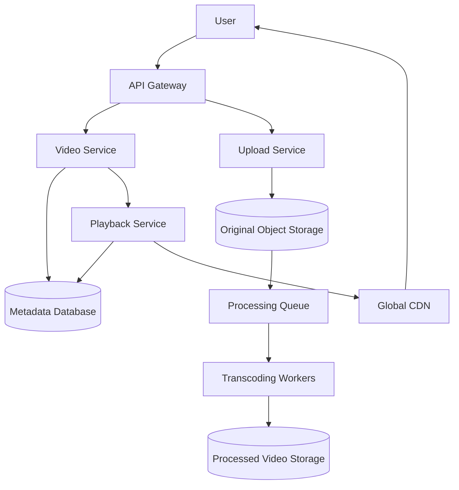
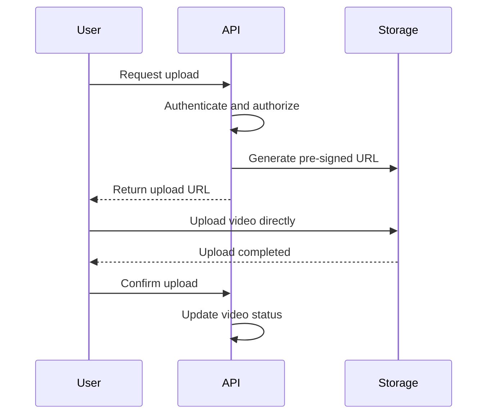
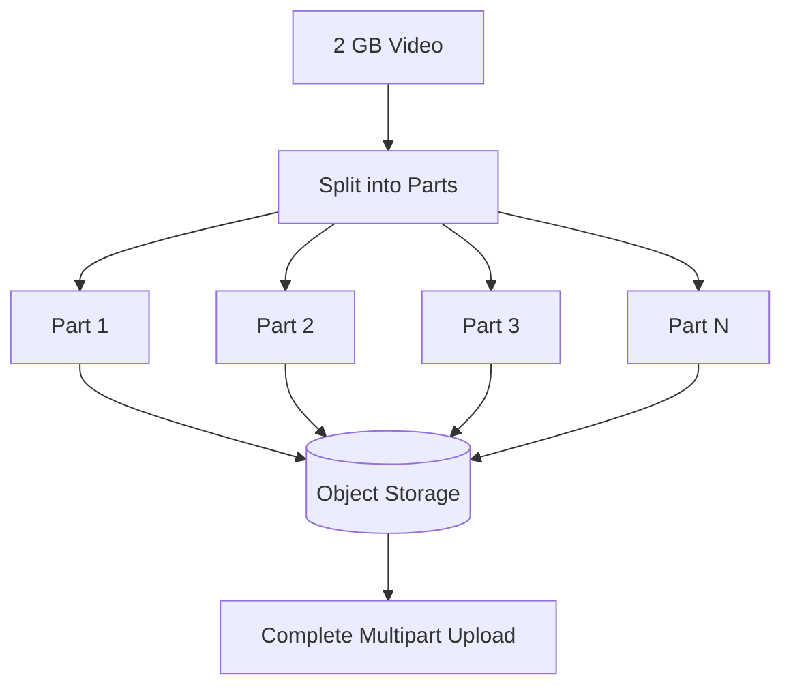
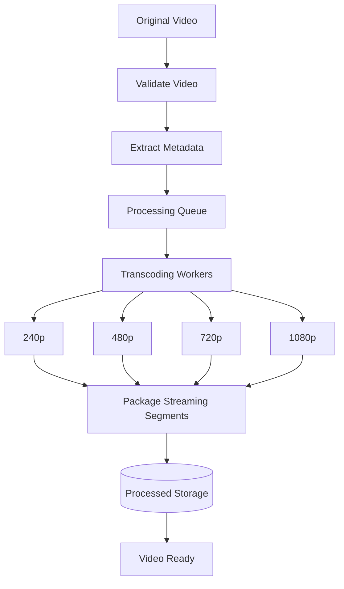
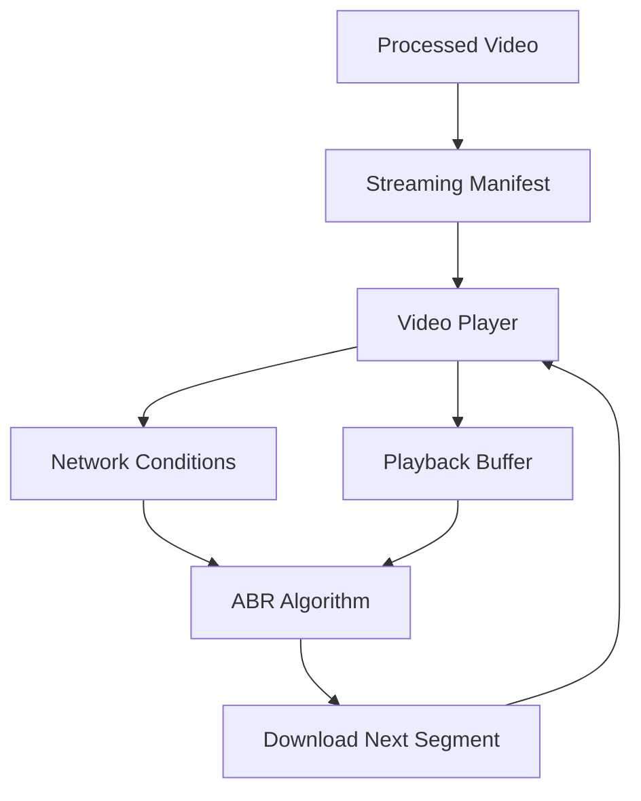
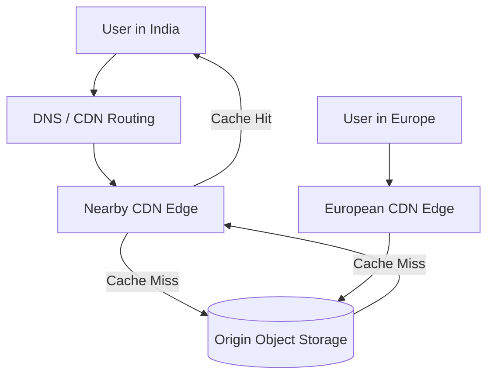
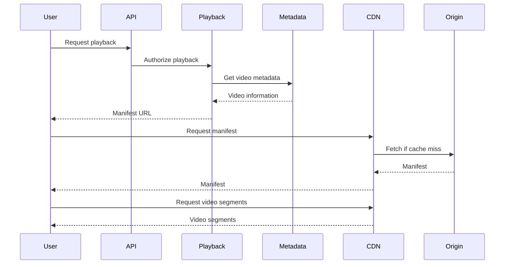
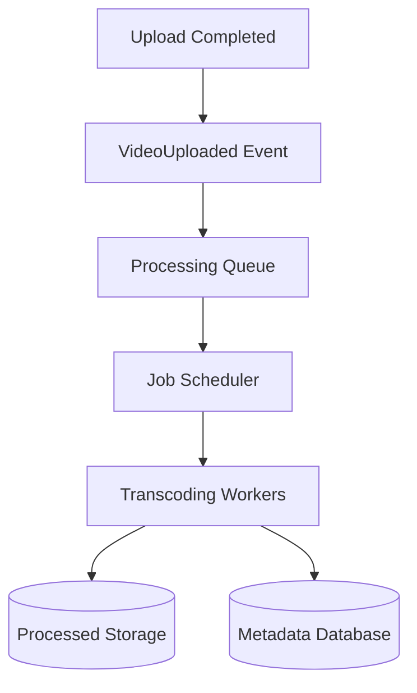
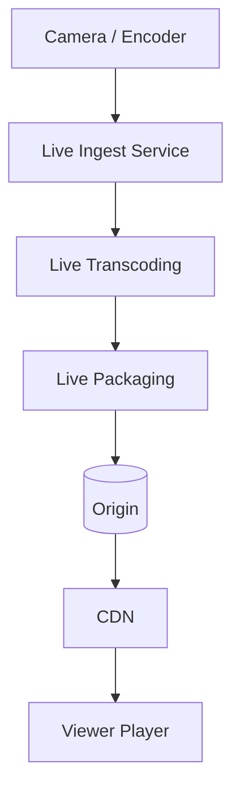
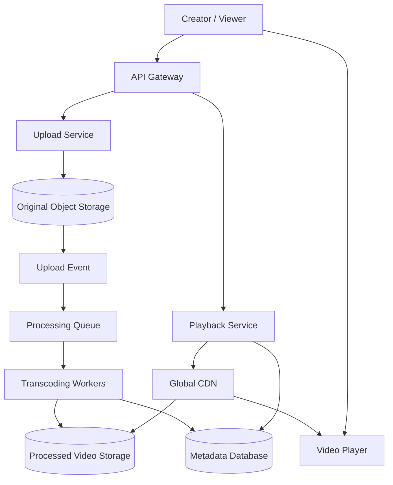

# Lesson 35 — System Design of a Video Streaming Platform
## Uploads, Transcoding, Adaptive Bitrate Streaming, CDN, and Playback

Video streaming platforms such as YouTube and Netflix serve billions of video playback sessions. Their challenge is not simply storing video files and sending them to users.

A production-ready video streaming platform must handle:

- Large video uploads.
- Video validation and processing.
- Multiple resolutions and formats.
- Global content delivery.
- Adaptive bitrate streaming.
- Millions of concurrent viewers.
- Playback reliability.
- Content protection and access control.

In this lesson, we'll design a scalable video streaming platform and understand how its major components work together.

---

## 1. Problem Statement

Design a video streaming platform where users can:

1. Upload videos.
2. Watch videos on demand.
3. Stream videos at different resolutions.
4. Pause, resume, and seek.
5. Receive personalized video recommendations.
6. Access videos from different geographical regions.
7. Upload private, unlisted, or public videos.

We'll primarily focus on the video upload and playback architecture.

### Functional requirements

| Requirement | Description |
|---|---|
| Video upload | Users upload video files |
| Video processing | Convert videos into multiple resolutions |
| Video playback | Stream videos on demand |
| Adaptive streaming | Adjust video quality based on network conditions |
| Seeking | Jump to a specific timestamp |
| Metadata | Store title, description, duration, and other details |
| Access control | Public, private, and restricted videos |
| Recommendations | Suggest relevant videos |

### Non-functional requirements

| Requirement | Goal |
|---|---|
| Availability | Playback should remain available |
| Scalability | Handle millions of viewers |
| Low latency | Start playback quickly |
| Reliability | Avoid playback interruptions |
| Durability | Uploaded videos should not be lost |
| Global delivery | Serve users from nearby locations |
| Cost efficiency | Optimize storage and bandwidth |

---

## 2. Capacity Estimation

Let's make some assumptions.

| Metric | Estimate |
|---|---:|
| Daily active users | 50 million |
| Videos uploaded per day | 1 million |
| Average original video size | 500 MB |
| Average viewing sessions per user | 5/day |
| Average video duration | 10 minutes |
| Average viewing duration | 5 minutes |

### Upload storage

```text
1 million videos × 500 MB

= 500 million MB

≈ 500 TB/day
```

This is the original upload volume, before considering transcoded versions, replicas, and derived media.

If we retain the original videos and create multiple processed versions, storage requirements can become significantly higher.

### Playback sessions

```text
50 million users × 5 sessions

= 250 million playback sessions/day
```

Average playback session rate:

```text
250 million / 86,400

≈ 2,894 sessions/second
```

With a peak factor of 5:

```text
Peak playback sessions

≈ 14,470 sessions/second
```

### Concurrent viewers

Assume 250 million daily playback sessions, each averaging 5 minutes.

Total viewing time:

```text
250 million × 5 minutes

= 1.25 billion minutes/day
```

Average concurrent viewers:

```text
1.25 billion / 1,440

≈ 868,056 concurrent viewers
```

At a peak factor of 3:

```text
Peak concurrent viewers

≈ 2.6 million
```

This illustrates why video delivery requires infrastructure beyond ordinary API servers.

### Important observation

The application API does not need to transmit all video bytes itself.

Video files should be delivered through object storage and a CDN, while application services handle metadata, authorization, playback sessions, and related business logic.

---

## 3. High-Level Architecture



### Component responsibilities

| Component | Responsibility |
|---|---|
| API Gateway | Authentication, routing, and rate limiting |
| Upload Service | Initiate and manage uploads |
| Object Storage | Store original and processed video files |
| Processing Queue | Schedule video-processing jobs |
| Transcoding Workers | Generate multiple video formats and resolutions |
| Metadata Database | Store video information and processing status |
| Playback Service | Authorize playback and provide streaming information |
| CDN | Deliver video segments close to viewers |

---

## 4. Video Upload Architecture

Uploading a large video directly through an application server is usually inefficient.

Imagine a user uploading a 2 GB video.

If the upload passes through the API server:

```text
User
  |
  v
API Server
  |
  v
Object Storage
```

The application server must handle a large amount of incoming data.

This creates problems:

- High memory and network consumption.
- Long-running HTTP connections.
- Increased application server costs.
- Reduced capacity for ordinary API requests.
- Greater risk of upload failures.

### Better approach: Direct-to-Object-Storage Upload

Use pre-signed upload URLs.



### Step-by-step

1. User requests permission to upload a video.
2. API authenticates the user.
3. API creates a video record with `UPLOADING` status.
4. API generates a pre-signed upload URL.
5. Client uploads directly to object storage.
6. Storage confirms successful upload.
7. Client or storage event notifies the application.
8. Video status changes to `UPLOADED`.
9. A processing job is scheduled.

### Why pre-signed URLs?

A pre-signed URL provides temporary permission to upload to a specific storage location.

Benefits:

- Application servers do not handle video bytes.
- Upload traffic goes directly to storage.
- Access can be restricted by expiration and permissions.
- Upload infrastructure can scale independently.

Important: A pre-signed URL is a bearer capability. Anyone possessing it may be able to use it within its permissions and validity period.

---

## 5. Multipart Upload

What happens if the upload is interrupted?

Suppose a user uploads a 2 GB video and the connection fails at 1.8 GB.

Restarting the entire upload is wasteful.

Multipart upload solves this problem.

### How it works

Divide the file into smaller parts.

Example:

```text
Original file: 2 GB

Part 1: 100 MB
Part 2: 100 MB
Part 3: 100 MB
...
Part 20: 100 MB
```

Each part is uploaded independently.



### Advantages

- Failed parts can be retried independently.
- Uploads can run in parallel.
- Large files are easier to upload reliably.
- Upload progress can be tracked.

### Important considerations

- Limit concurrent upload parts.
- Validate checksums.
- Expire abandoned multipart uploads.
- Complete the upload only after all required parts succeed.
- Ensure the final object is validated before processing.

---

## 6. Video Transcoding

A user uploads one original video.

But viewers have different:

- Internet speeds.
- Devices.
- Screen sizes.
- Browser capabilities.
- Playback requirements.

A single original video format is not suitable for every viewer.

This is where transcoding comes in.

### What is transcoding?

Transcoding converts a video from one encoding or format into another.

It may involve:

- Changing video codec.
- Changing resolution.
- Changing bitrate.
- Changing frame rate.
- Changing audio format.
- Creating thumbnails and previews.

### Example

Original upload:

```text
Resolution: 3840 × 2160
Codec: H.265
Bitrate: 20 Mbps
```

Generated versions:

| Resolution | Example bitrate |
|---|---:|
| 240p | 400 Kbps |
| 360p | 800 Kbps |
| 480p | 1.2 Mbps |
| 720p | 2.5 Mbps |
| 1080p | 5 Mbps |
| 1440p | 10 Mbps |
| 2160p | 20 Mbps |

These are illustrative values. Actual bitrates depend on codec, content complexity, frame rate, and quality targets.

### Transcoding pipeline



### Why multiple resolutions?

Suppose a viewer has a slow internet connection.

A 1080p stream may buffer continuously.

A 360p version may provide smoother playback.

By preparing multiple renditions, the platform can choose the most appropriate quality.

---

## 7. Adaptive Bitrate Streaming (ABR)

Adaptive Bitrate Streaming is one of the most important concepts in video streaming.

Instead of downloading one large video file, the player downloads smaller segments.

The player can switch between different quality levels based on network conditions and buffer health.

### Example

A video is available in:

```text
240p
480p
720p
1080p
```

A user starts watching on a slow connection.

The player selects 240p.

As the connection improves, the player may switch to 480p and then 720p.

If the network becomes slower, it can return to 480p.

### How does it work?



### Important components

**Manifest**

Contains information about available streams and segment locations.

**Segments**

Small portions of the video that can be downloaded independently.

**ABR algorithm**

Chooses an appropriate rendition based on available bandwidth, buffer health, and playback conditions.

**Playback buffer**

Stores upcoming video segments to reduce interruptions.

### Why not simply choose the highest quality?

Because network bandwidth changes.

A high-resolution stream may exceed the available bandwidth and cause buffering.

The goal is not always maximum quality.

The goal is the best sustainable viewing experience.

---

## 8. HLS and MPEG-DASH

Two widely used adaptive streaming protocols are HLS and MPEG-DASH.

### HLS

HTTP Live Streaming was developed by Apple.

It uses a playlist manifest, commonly an `.m3u8` file, describing available media streams and segments.

Example:

```text
master.m3u8
    |
    +-- 240p/index.m3u8
    |
    +-- 480p/index.m3u8
    |
    +-- 720p/index.m3u8
    |
    +-- 1080p/index.m3u8
```

### MPEG-DASH

Dynamic Adaptive Streaming over HTTP uses an XML-based Media Presentation Description (MPD).

Example:

```text
manifest.mpd
    |
    +-- 240p segments
    |
    +-- 480p segments
    |
    +-- 720p segments
    |
    +-- 1080p segments
```

### Comparison

| Feature | HLS | MPEG-DASH |
|---|---|---|
| Manifest | M3U8 | MPD |
| Format | M3U8 playlist | XML |
| Transport | HTTP | HTTP |
| Adaptive bitrate | Yes | Yes |
| CDN support | Yes | Yes |
| Ecosystem | Broad device support | Broad device support |

Both are suitable for adaptive video delivery.

The choice depends on device support, encoding pipeline, DRM requirements, and platform compatibility.

---

## 9. Video Segmentation

Instead of delivering an entire video as one file, the system divides it into smaller segments.

For example, a 10-minute video can be divided into 4-second segments.

```text
Video duration: 600 seconds
Segment duration: 4 seconds

600 / 4 = 150 segments
```

A segment might look like:

```text
segment_0001.ts
segment_0002.ts
segment_0003.ts
...
segment_0150.ts
```

Other segment formats, such as fragmented MP4, are also common.

### Why use segments?

- Faster playback startup.
- Efficient seeking.
- Adaptive bitrate switching.
- CDN caching.
- Independent segment downloads.
- Better recovery from network interruptions.

### Segment alignment

For smooth switching between quality levels, segments should generally align on compatible timestamps and switching boundaries.

Otherwise, switching between renditions can cause playback problems.

---

## 10. CDN Architecture

Imagine the video is stored in a data center in the United States.

A viewer in India requests the same video.

Without a CDN:

```text
India User
    |
    v
US Data Center
    |
    v
Video Data
```

This creates high network latency and long-distance data transfer.

A CDN solves this by caching content at geographically distributed edge locations.

### CDN flow



### Cache hit

The requested video segment already exists at the edge.

The CDN serves it directly.

### Cache miss

The edge requests the segment from the origin.

The segment is returned to the user and may be cached for future requests.

### Why CDN is critical

- Reduces playback latency.
- Reduces origin bandwidth consumption.
- Improves global delivery.
- Handles high traffic spikes.
- Reduces load on application infrastructure.

### Cache headers

Video segments are usually immutable once published.

They can therefore use long cache lifetimes.

For example:

```http
Cache-Control: public, max-age=31536000, immutable
```

This is suitable only when the URL uniquely identifies an immutable asset.

Manifests may change more frequently and generally need a different caching policy.

---

## 11. Video Playback Architecture

Let's bring everything together.



### Step-by-step

1. User selects a video.
2. Client requests playback authorization.
3. Playback service checks access permissions.
4. Service returns a manifest URL or playback configuration.
5. Video player downloads the manifest.
6. Player selects an initial rendition.
7. Player downloads segments from the CDN.
8. ABR algorithm adjusts quality as conditions change.
9. Player continues requesting segments until playback finishes.

### Important principle

The application API should not proxy every video segment.

The player should retrieve media directly from the CDN.

This keeps application servers focused on control-plane operations rather than high-volume media delivery.

---

## 12. Video Metadata Model

A relational database can store video metadata.

```sql
CREATE TABLE videos (
    id BIGINT PRIMARY KEY,
    owner_id BIGINT NOT NULL,
    title VARCHAR(255) NOT NULL,
    description TEXT,
    duration_seconds INTEGER,
    status VARCHAR(30) NOT NULL,
    visibility VARCHAR(20) NOT NULL,
    original_storage_key TEXT,
    created_at TIMESTAMP NOT NULL,
    updated_at TIMESTAMP NOT NULL
);
```

### Example processing states

```text
UPLOADING
    |
    v
UPLOADED
    |
    v
PROCESSING
    |
    v
READY
```

Failure states:

```text
UPLOAD_FAILED
PROCESSING_FAILED
REJECTED
```

### Rendition metadata

```sql
CREATE TABLE video_renditions (
    id BIGINT PRIMARY KEY,
    video_id BIGINT NOT NULL,
    resolution VARCHAR(20) NOT NULL,
    bitrate INTEGER NOT NULL,
    codec VARCHAR(30),
    storage_key TEXT NOT NULL,
    status VARCHAR(20) NOT NULL
);
```

This allows the platform to track which versions have been successfully generated.

---

## 13. Asynchronous Video Processing

Transcoding is CPU-intensive and sometimes GPU-intensive.

It should not happen inside the upload API request.

Instead, use a message queue and worker infrastructure.



### Why asynchronous processing?

A 10-minute video may take several minutes to transcode depending on:

- Resolution.
- Codec.
- Hardware.
- Encoding settings.
- Number of output renditions.

Making the user wait for all processing inside an HTTP request would be inefficient.

### Worker scaling

Workers can scale based on:

- Queue depth.
- Oldest queued job age.
- CPU utilization.
- GPU utilization.
- Processing duration.

### Idempotency

A processing job may execute more than once because of retries.

Workers should therefore be idempotent.

For example:

```text
video_id + resolution + codec + pipeline_version
```

can act as a deterministic processing identity.

Before publishing a rendition as complete, verify that the expected output exists and is valid.

---

## 14. Handling Large Processing Backlogs

Imagine a major creator uploads thousands of videos at once.

The processing queue grows rapidly.

Potential problems:

- Delayed video availability.
- High infrastructure costs.
- Worker exhaustion.
- Increased storage consumption.

### Solutions

1. Use priority queues for urgent processing.
2. Scale workers based on queue depth.
3. Apply per-user upload quotas.
4. Limit concurrent jobs per account.
5. Use separate queues for different processing classes.
6. Retry failed jobs with exponential backoff.
7. Send repeatedly failing jobs to a dead-letter queue.

### Processing priority example

| Priority | Job |
|---|---|
| High | Generate initial low-resolution playback |
| Medium | Generate 720p and 1080p renditions |
| Low | Generate additional formats and thumbnails |

This allows a video to become watchable before every possible rendition has completed, if the product supports progressive availability.

---

## 15. Storage Architecture

A video platform usually needs several types of storage.

| Data | Storage |
|---|---|
| Original video | Object storage |
| Transcoded renditions | Object storage |
| Video metadata | Relational database |
| Playback configuration | Cache or metadata store |
| Thumbnails | Object storage/CDN |
| User information | Relational or distributed database |
| Analytics events | Message broker and analytical storage |

### Why object storage?

Video files are large binary objects.

Object storage provides:

- High durability.
- Scalable capacity.
- Efficient large-object storage.
- Lifecycle policies.
- Integration with CDNs.

### Storage lifecycle

Not all video data needs the same storage class forever.

For example:

```text
Recently uploaded
       |
       v
Frequently accessed storage
       |
       v
Older, rarely accessed videos
       |
       v
Lower-cost archival storage
```

Storage lifecycle policies can reduce costs, but archival storage may have higher retrieval latency and costs.

It should not be used for content requiring immediate playback.

---

## 16. Bandwidth Estimation

Video delivery bandwidth is one of the largest costs in streaming systems.

Assume:

- 1 million concurrent viewers.
- Average selected bitrate: 2 Mbps.

Total bandwidth:

```text
1,000,000 × 2 Mbps

= 2,000,000 Mbps

= 2 Tbps
```

This is a massive delivery requirement.

If all traffic comes directly from the origin, the infrastructure becomes extremely expensive.

### CDN impact

The CDN serves most video segments from edge locations.

The origin only needs to supply cache misses and newly requested content.

If the CDN cache hit ratio is 95%, approximately 5% of cacheable segment requests require origin retrieval.

Important: A request hit ratio is not necessarily the same as a bandwidth hit ratio. Large and small segments can have different byte volumes.

---

## 17. Playback Performance Metrics

A streaming platform should measure the actual playback experience.

| Metric | Meaning |
|---|---|
| Time to first frame | Time from play request until video begins |
| Rebuffering ratio | Time spent buffering compared with playback time |
| Playback startup failure | Percentage of sessions that fail to start |
| Bitrate | Current playback quality |
| Quality switches | Number of rendition changes |
| CDN cache hit ratio | Percentage of requests served from cache |
| Segment download time | Time required to download a segment |
| Playback completion rate | Percentage of sessions that reach completion |

### Example

Suppose a user watches a 10-minute video.

Total playback time:

```text
600 seconds
```

Buffering time:

```text
12 seconds
```

Rebuffering ratio:

\[
\frac{12}{600} \times 100 = 2\%
\]

A lower rebuffering ratio generally indicates a smoother playback experience.

---

## 18. Security and Content Protection

A video platform must protect private content and prevent unauthorized access.

### Common security controls

| Threat | Mitigation |
|---|---|
| Unauthorized playback | Playback authorization |
| Hotlinking | Signed URLs or signed cookies |
| Upload abuse | Authentication and quotas |
| Malicious uploads | File validation and scanning |
| Content theft | DRM where required |
| Account abuse | Rate limiting and abuse detection |
| Private video exposure | Access-control checks |

### Signed URLs

A signed URL can provide temporary access to a specific media resource.

Example:

```text
https://cdn.example.com/video/123/segment001.m4s
?expires=1790000000
&signature=...
```

The signature is validated by the CDN or authorization layer.

The URL should expire after an appropriate period.

However, signed URLs are bearer credentials. They can be shared while valid, so expiration, scope, and leakage controls matter.

### DRM

Digital Rights Management can protect premium content.

Examples include:

- Widevine.
- FairPlay.
- PlayReady.

DRM typically involves encrypted media, license servers, and compatible playback clients.

DRM increases complexity and is not necessary for every video platform.

---

## 19. Live Streaming vs Video on Demand

So far, we have focused primarily on Video on Demand (VOD).

In VOD, videos are uploaded, processed, stored, and watched later.

Live streaming has a different architecture.

| VOD | Live Streaming |
|---|---|
| Video already exists | Video is generated continuously |
| Full processing can happen before playback | Processing happens while the event is live |
| Segments are usually immutable | Live manifests and segments keep updating |
| Users can start from the beginning | Users often join the current live position |
| Processing can tolerate more delay | End-to-end latency is important |

### Live streaming architecture



Live streaming introduces additional challenges:

- Low-latency delivery.
- Continuous manifest updates.
- Stream synchronization.
- Encoder failure recovery.
- Live DVR functionality.
- Real-time monitoring.

---

## 20. Failure Scenarios

| Failure | Impact | Mitigation |
|---|---|---|
| Upload interrupted | Incomplete video | Multipart upload and retry |
| Object storage unavailable | Upload or retrieval failure | Replication and resilient storage |
| Transcoding worker crashes | Processing job fails | Retry and idempotent workers |
| Queue unavailable | Processing delayed | Durable queues and outbox |
| CDN edge failure | Regional playback issues | CDN routing and origin fallback |
| Origin unavailable | Cache misses fail | Origin redundancy and replication |
| Manifest unavailable | Playback cannot start | Replicate manifests and monitor publication |
| One rendition missing | Limited quality options | Serve available renditions |
| Authorization service unavailable | Playback authorization delayed | Carefully designed short-lived authorization policies |

### Graceful degradation

If 1080p processing fails but 480p and 720p are available, the platform can still allow playback.

If the recommendation service fails, users should still be able to access videos directly.

If a CDN edge fails, requests can be routed to another edge or origin, depending on the CDN configuration.

The goal is to preserve the core playback experience even when non-critical components fail.

---

## 21. Complete Architecture Summary



### Recommended design decisions

| Area | Recommended approach |
|---|---|
| Upload | Direct-to-object-storage |
| Large uploads | Multipart upload |
| Original videos | Object storage |
| Processing | Asynchronous workers |
| Transcoding | Multiple renditions |
| Streaming | HLS or MPEG-DASH |
| Playback | Adaptive bitrate |
| Delivery | CDN |
| Metadata | Relational database |
| Authorization | Signed URLs or cookies |
| Processing reliability | Durable queue + idempotent workers |
| Monitoring | Playback QoE metrics |

---

## 22. Common System Design Mistakes

1. **Uploading large videos through application servers.**  
   This wastes application server resources.

2. **Processing videos synchronously.**  
   Transcoding can take significant time and should use background workers.

3. **Serving videos directly from the application server.**  
   Use object storage and CDN delivery.

4. **Generating only one resolution.**  
   Different network conditions require different quality levels.

5. **Ignoring segment alignment.**  
   Poorly aligned segments can make adaptive switching unreliable.

6. **Caching mutable manifests for too long.**  
   Clients may receive stale playback information.

7. **Not validating uploaded files.**  
   Malicious or malformed files can cause processing and security issues.

8. **Ignoring CDN cache policies.**  
   Poor cache configuration can increase origin load and delivery costs.

9. **Treating upload completion as processing completion.**  
   A successfully uploaded video may still be unavailable for playback.

10. **Ignoring playback experience metrics.**  
    Server uptime alone does not tell us whether users can watch videos smoothly.

---

## 23. Design Checklist

### Upload
- [ ] Direct upload architecture designed.
- [ ] Pre-signed URL authorization implemented.
- [ ] Multipart upload supported.
- [ ] Checksums and file validation handled.
- [ ] Abandoned uploads cleaned up.

### Processing
- [ ] Upload completion triggers processing.
- [ ] Processing uses asynchronous workers.
- [ ] Multiple renditions generated.
- [ ] Processing jobs are idempotent.
- [ ] Failed jobs have retry and dead-letter handling.

### Playback
- [ ] HLS or DASH selected.
- [ ] Manifest generated.
- [ ] Video segments stored.
- [ ] Adaptive bitrate supported.
- [ ] Seeking and playback resume supported.

### Delivery
- [ ] CDN configured.
- [ ] Cache policies defined.
- [ ] Origin protection implemented.
- [ ] Regional delivery considered.

### Security and reliability
- [ ] Access control enforced.
- [ ] Signed media access considered.
- [ ] Upload abuse prevented.
- [ ] Storage durability considered.
- [ ] CDN and origin failures handled.
- [ ] Playback quality monitored.

---

## 24. Revision Questions

1. Why should large video uploads bypass application servers?
2. What is a pre-signed URL?
3. How does multipart upload work?
4. What is video transcoding?
5. Why do we generate multiple video resolutions?
6. What is Adaptive Bitrate Streaming?
7. What is the difference between HLS and MPEG-DASH?
8. Why divide videos into segments?
9. What role does a manifest play?
10. Why is a CDN essential for video streaming?
11. What happens during a CDN cache miss?
12. Why should video processing be asynchronous?
13. How would you handle a transcoding worker failure?
14. What is the difference between VOD and live streaming?
15. How do signed URLs help protect video content?
16. Which metrics help measure playback quality?

---

## 25. Practical Exercise

Design a video streaming platform with these requirements:

- 50 million daily active users.
- 1 million uploads per day.
- Average original video size: 500 MB.
- Average video duration: 10 minutes.
- Approximately 2.6 million peak concurrent viewers.
- Support 240p, 480p, 720p, and 1080p.
- Global playback.
- Private and public videos.
- Target a smooth playback experience.

### Task 1 — Capacity planning

Calculate:

- Daily original upload volume.
- Monthly original upload volume.
- Average playback concurrency.
- Bandwidth requirements at 2 Mbps average bitrate.
- Approximate CDN origin traffic at a 95% byte-cache hit ratio.

State your assumptions.

### Task 2 — Upload architecture

Explain how you would implement:

- Pre-signed upload URLs.
- Multipart upload.
- Upload completion verification.
- Processing job creation.

### Task 3 — Transcoding

Design a pipeline that generates multiple resolutions.

Explain:

- Worker allocation.
- Queue management.
- Retry behavior.
- Processing status transitions.
- Idempotency.

### Task 4 — Playback architecture

Explain the complete process from clicking Play to receiving the first video segment.

Include:

- Playback authorization.
- Manifest retrieval.
- CDN lookup.
- Segment downloads.
- Adaptive bitrate decisions.

### Task 5 — Scaling

A popular creator publishes a video that receives 10 million views in one hour.

Explain how you would handle:

- CDN caching.
- Origin bandwidth.
- Concurrent viewers.
- Segment delivery.
- Storage and metadata traffic.

### Task 6 — Reliability

Explain what happens if:

- A transcoding worker crashes.
- The processing queue becomes unavailable.
- A CDN region fails.
- The origin storage becomes unavailable.
- One resolution is missing.

### Final challenge

A user is watching a 1080p video on a mobile network. Their bandwidth suddenly drops from 10 Mbps to 500 Kbps.

Explain how the player should react, what happens to the buffer, how the ABR algorithm selects another rendition, and how the system avoids repeated buffering.

---

## 26. Practice Focus

Focus on understanding these concepts deeply:

1. **Direct uploads:** Understand why object storage should receive large video files directly.
2. **Transcoding:** Understand why one uploaded file becomes multiple playback renditions.
3. **Adaptive bitrate streaming:** Understand how the player selects quality based on network conditions and buffer health.
4. **CDN:** Understand how edge caching reduces origin load and playback latency.
5. **Asynchronous processing:** Understand how queues and workers make expensive video processing scalable.
6. **Playback quality:** Understand why measuring buffering and startup time matters as much as measuring server availability.

Try to explain the complete journey of a video: from upload, through processing and storage, to playback on a user's device.

---

## Key Takeaway

A video streaming platform is a distributed media-processing and delivery system.

The upload path uses direct object storage, the processing path uses asynchronous transcoding workers, and the playback path uses adaptive bitrate streaming through a global CDN.

The most important architectural principle is to separate the control plane (metadata, authorization, and playback configuration) from the data plane (large video uploads and segment delivery).

This separation allows the platform to scale application operations independently from massive media traffic.
