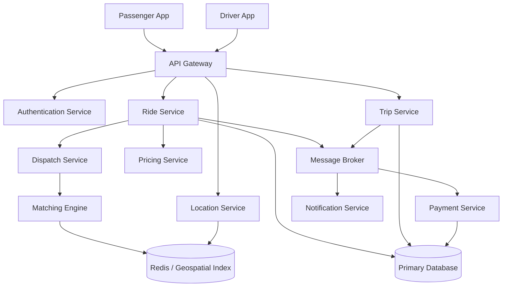
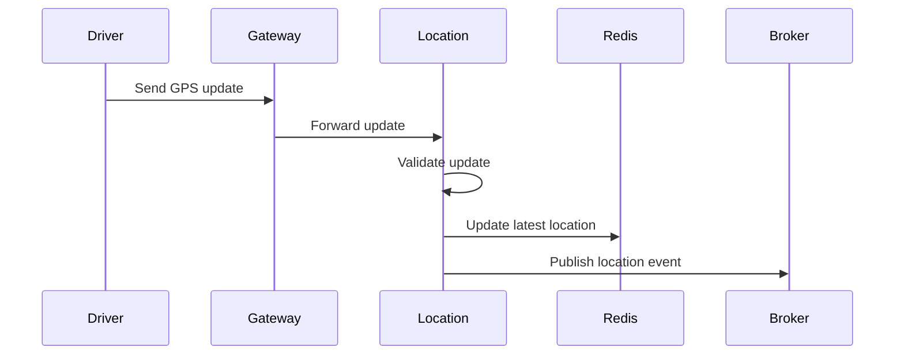
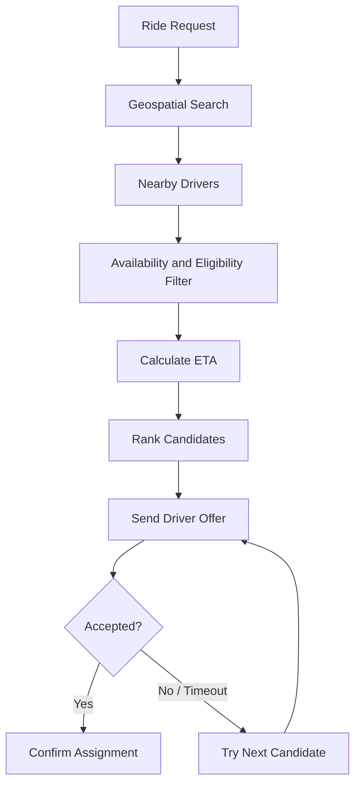
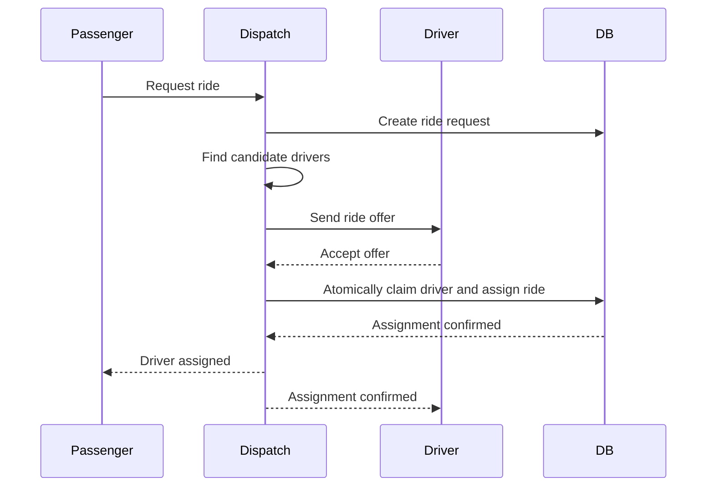
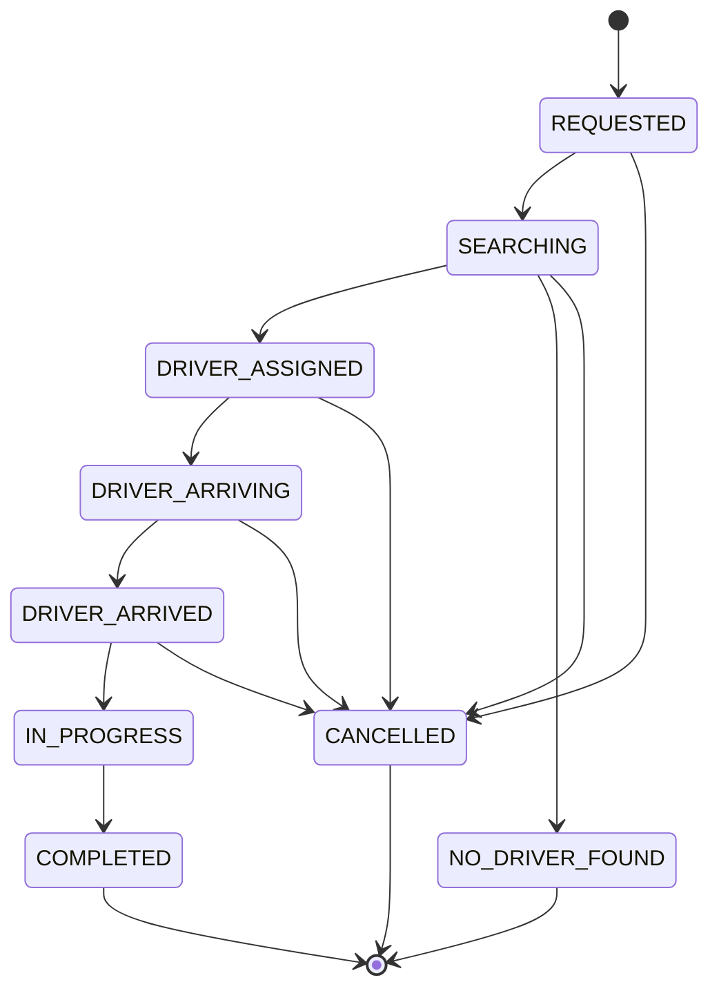
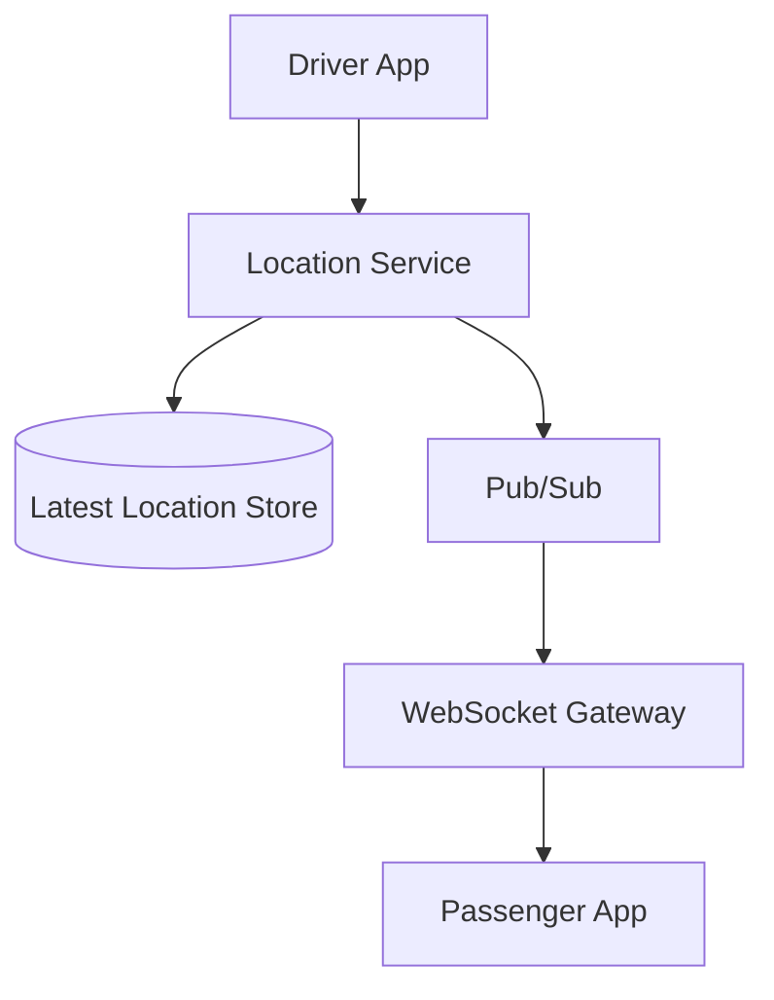
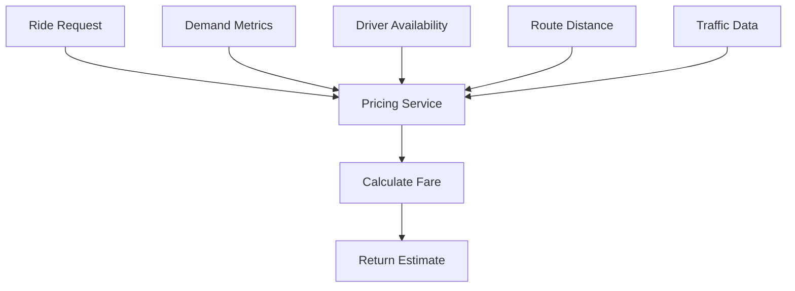
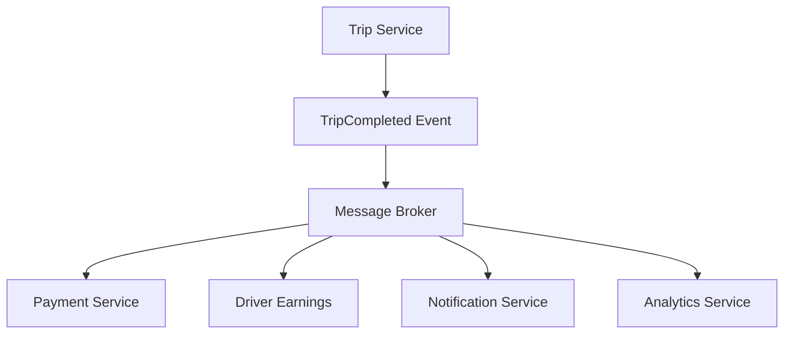
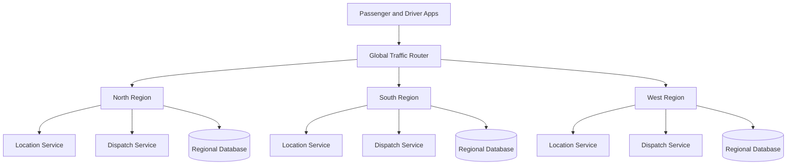
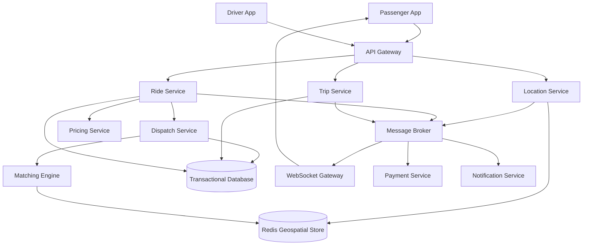

# Lesson 36 — System Design of a Ride-Hailing Platform
## Driver Matching, Geospatial Indexing, Real-Time Location Tracking, and Trip Lifecycle

A ride-hailing platform like Uber or Lyft looks simple from the user's perspective:

1. A passenger requests a ride.
2. The system finds nearby drivers.
3. A driver accepts the request.
4. The passenger tracks the driver.
5. The trip starts and eventually completes.

Behind this simple experience is a complex distributed system involving real-time location tracking, geospatial queries, driver matching, concurrent requests, distributed state management, payment processing, and event-driven communication.

In this lesson, we'll design a scalable ride-hailing platform and understand how these components work together.

---

## 1. Problem Statement

Design a ride-hailing platform where passengers can request rides and drivers can accept and complete them.

### Functional requirements

| Requirement | Description |
|---|---|
| Passenger registration | Register and manage passenger accounts |
| Driver registration | Register drivers and manage availability |
| Ride request | Passenger requests a ride |
| Driver discovery | Find nearby available drivers |
| Driver matching | Select and offer a ride to suitable drivers |
| Ride acceptance | Driver accepts or rejects an offer |
| Live tracking | Passenger tracks the driver's location |
| Trip lifecycle | Start, update, and complete trips |
| Fare calculation | Calculate estimated and final fare |
| Payment | Process ride payments |
| Notifications | Send ride and trip status updates |
| Cancellation | Support passenger and driver cancellation |

### Non-functional requirements

| Requirement | Goal |
|---|---|
| Low latency | Find drivers quickly |
| High availability | Ride requests should remain available |
| Scalability | Handle millions of passengers and drivers |
| Real-time updates | Deliver location and trip updates quickly |
| Consistency | Prevent multiple drivers from accepting the same trip |
| Fault tolerance | Recover from service and network failures |
| Accuracy | Maintain reliable location and trip state |

### Scope

We'll focus primarily on:

- Driver location tracking.
- Geospatial indexing.
- Driver discovery.
- Matching and dispatch.
- Concurrent ride requests.
- Real-time communication.
- Trip lifecycle.
- Scaling and reliability.

---

## 2. Capacity Estimation

Let's make some assumptions.

| Metric | Estimate |
|---|---:|
| Registered passengers | 50 million |
| Registered drivers | 2 million |
| Daily active passengers | 10 million |
| Daily active drivers | 1 million |
| Ride requests per day | 5 million |
| Active drivers sending location updates | 1 million |
| Location update interval | 5 seconds |

### Ride request traffic

```text
5 million requests / 86,400 seconds

≈ 58 ride requests/second
```

Assuming a peak factor of 5:

```text
58 × 5

≈ 290 ride requests/second
```

### Driver location update traffic

One million active drivers send a location update every 5 seconds.

```text
1,000,000 / 5

= 200,000 location updates/second
```

This is a much larger traffic volume than ride creation.

### Location update volume per day

```text
200,000 × 86,400

= 17.28 billion updates/day
```

This illustrates an important architectural point:

**Real-time driver location tracking is one of the highest-throughput components of a ride-hailing platform.**

We should not store every location update as a permanent database record.

Instead, we need a dedicated real-time location infrastructure.

---

## 3. High-Level Architecture



### Component responsibilities

| Component | Responsibility |
|---|---|
| API Gateway | Authentication, routing, and rate limiting |
| Ride Service | Manage ride requests |
| Location Service | Receive and distribute driver locations |
| Dispatch Service | Coordinate driver selection and offers |
| Matching Engine | Find and rank suitable drivers |
| Trip Service | Manage trip lifecycle |
| Pricing Service | Calculate fare estimates and final fares |
| Payment Service | Process payments |
| Notification Service | Send push and in-app notifications |
| Redis | Store frequently updated driver locations and availability |
| Database | Persist trips, bookings, users, and payments |
| Message Broker | Distribute asynchronous events |

---

## 4. Core Data Model

We need to model passengers, drivers, rides, and trips.

### Passengers

```sql
CREATE TABLE passengers (
    id BIGINT PRIMARY KEY,
    name VARCHAR(150) NOT NULL,
    phone VARCHAR(30),
    created_at TIMESTAMP NOT NULL
);
```

### Drivers

```sql
CREATE TABLE drivers (
    id BIGINT PRIMARY KEY,
    name VARCHAR(150) NOT NULL,
    status VARCHAR(30) NOT NULL,
    vehicle_id BIGINT,
    created_at TIMESTAMP NOT NULL
);
```

Possible driver statuses:

```text
OFFLINE
AVAILABLE
OFFERED
ON_TRIP
SUSPENDED
```

These are business states, not necessarily the complete internal state machine.

### Rides

```sql
CREATE TABLE rides (
    id BIGINT PRIMARY KEY,
    passenger_id BIGINT NOT NULL,
    pickup_latitude DOUBLE PRECISION NOT NULL,
    pickup_longitude DOUBLE PRECISION NOT NULL,
    dropoff_latitude DOUBLE PRECISION NOT NULL,
    dropoff_longitude DOUBLE PRECISION NOT NULL,
    status VARCHAR(30) NOT NULL,
    estimated_fare DECIMAL(10,2),
    created_at TIMESTAMP NOT NULL
);
```

### Trips

```sql
CREATE TABLE trips (
    id BIGINT PRIMARY KEY,
    ride_id BIGINT NOT NULL,
    driver_id BIGINT NOT NULL,
    started_at TIMESTAMP,
    completed_at TIMESTAMP,
    actual_fare DECIMAL(10,2),
    status VARCHAR(30) NOT NULL
);
```

### Important distinction

A ride request and a trip are related but conceptually different.

- A **ride request** represents the passenger's request for transportation.
- A **trip** represents the actual transportation assignment and execution.

Separating these concepts makes cancellations, reassignment, and trip history easier to manage.

---

## 5. Driver Location Tracking

Location tracking is a fundamental component of a ride-hailing platform.

Drivers continuously send GPS coordinates from their mobile devices.

Example:

```json
{
  "driverId": "driver_123",
  "latitude": 28.6139,
  "longitude": 77.2090,
  "heading": 180,
  "speed": 32,
  "timestamp": "2026-10-30T10:30:00Z"
}
```

### Location update flow



### Why Redis?

Driver locations change frequently.

A relational database is not ideal for storing every incoming GPS update as a permanent record.

Redis can maintain the latest location for each active driver.

Example:

```text
driver:123:location

{
  latitude: 28.6139,
  longitude: 77.2090,
  heading: 180,
  timestamp: ...
}
```

A new update replaces the previous location.

### Current state vs historical data

We should distinguish two requirements:

| Requirement | Storage approach |
|---|---|
| Find driver's latest location | Redis or another low-latency location store |
| Show driver's movement during a trip | Time-series or event storage |
| Analyze historical driver routes | Data warehouse or analytical storage |
| Recover current trip state | Durable database |

Not every GPS update needs to be retained forever.

---

## 6. WebSockets vs HTTP for Location Updates

There are multiple ways to send driver location updates.

### Option 1: HTTP polling or periodic requests

The driver app sends an HTTP request every few seconds.

```text
POST /api/drivers/location
```

Advantages:

- Simple implementation.
- Easy to operate.
- Works with ordinary HTTP infrastructure.

Disadvantages:

- Repeated request overhead.
- More connection and request processing.
- Less efficient for frequent bidirectional communication.

### Option 2: WebSockets

The driver establishes a persistent connection.

```text
Driver App
    |
    | WebSocket connection
    |
Backend
```

The connection can carry frequent location updates.

Advantages:

- Persistent communication.
- Lower per-message overhead.
- Supports server-to-client messages.
- Useful for live location and trip events.

Disadvantages:

- Connection management complexity.
- Reconnection and heartbeat handling.
- Connection distribution across servers.
- Requires connection lifecycle management.

### Option 3: MQTT

MQTT is a lightweight publish/subscribe protocol often used in IoT environments.

It can be useful when devices have constrained network conditions and messaging patterns fit the broker model.

### Recommendation

For a mobile ride-hailing platform, WebSockets are a strong option when bidirectional real-time communication is required.

HTTP can also work for periodic location uploads, particularly when simplicity is more important than persistent connections.

The choice depends on update frequency, mobile network behavior, connection cost, and infrastructure capabilities.

---

## 7. Geospatial Indexing

Now comes one of the most important problems.

A passenger requests a ride from a particular location.

We need to find available drivers nearby.

A naive solution would be:

```text
Get all available drivers
        |
        v
Calculate distance to pickup
        |
        v
Sort by distance
        |
        v
Select nearest driver
```

This is inefficient when there are millions of drivers.

We need a geospatial index.

### What is geospatial indexing?

A geospatial index organizes geographic coordinates so that nearby locations can be discovered efficiently.

Common approaches include:

1. Geohash.
2. Quadtrees.
3. R-trees.
4. H3.
5. S2 Geometry.

### Geohash

Geohash converts latitude and longitude into a string.

Example:

```text
Latitude: 28.6139
Longitude: 77.2090

Geohash: tttk...
```

Nearby coordinates often share common Geohash prefixes.

A geohash cell represents a geographic area.

Longer hashes represent smaller areas.

### Geohash precision

| Precision | Approximate cell size |
|---|---|
| 4 | 39 km × 20 km |
| 5 | 4.9 km × 4.9 km |
| 6 | 1.2 km × 0.6 km |
| 7 | 153 m × 153 m |
| 8 | 38 m × 19 m |

These are approximate dimensions and vary by latitude and direction.

### How nearby search works

Suppose a passenger requests a ride.

```text
Pickup Location
      |
      v
Calculate Geohash
      |
      v
Find Current Cell
      |
      v
Search Nearby Cells
      |
      v
Retrieve Available Drivers
```

Searching only the current cell is insufficient because a nearby driver may be located just across a cell boundary.

The search must include neighboring cells or use a geospatial query that accounts for the full search radius.

### Important distinction

Geohash identifies geographic regions. It does not calculate actual road travel distance.

Two drivers may be geographically close but separated by a river, highway barrier, or restricted road.

Therefore, use geospatial indexing for candidate discovery and a routing service for more accurate ETA estimation.

---

## 8. Redis Geospatial Indexing

Redis supports geospatial operations.

For example:

```text
GEOADD drivers:locations 77.2090 28.6139 driver:123
```

Search nearby drivers:

```text
GEOSEARCH drivers:locations
  FROMLONLAT 77.2090 28.6139
  BYRADIUS 5 km
  ASC
```

This returns drivers within a specified geographic radius.

### Advantages

- Fast nearby-location lookup.
- Simple integration.
- Useful for frequently changing driver locations.
- Supports distance-based sorting.

### Important limitation

A geospatial index alone does not represent the complete business state of a driver.

We still need to consider:

- Availability.
- Vehicle type.
- Driver eligibility.
- Current trip assignment.
- Location freshness.
- Service area.
- Driver restrictions.

A nearby driver is not automatically an eligible driver.

---

## 9. Driver Discovery and Matching

Finding nearby drivers is only the first step.

The system must select the most suitable driver.

### Basic matching algorithm

Suppose a passenger requests a ride.

The system:

1. Gets pickup coordinates.
2. Searches nearby geospatial cells.
3. Retrieves candidate drivers.
4. Filters unavailable drivers.
5. Calculates estimated arrival times.
6. Ranks eligible drivers.
7. Sends an offer to the best candidate.



### Candidate ranking

A basic ranking model could consider:

- Estimated pickup time.
- Distance.
- Driver availability.
- Vehicle type.
- Driver rating.
- Cancellation history.
- Service area restrictions.

Example:

\[
Score = w_1 ETA + w_2 Distance - w_3 Rating
\]

The actual scoring function should be calibrated to the platform's business objectives.

Lower scores could represent better candidates in this example.

### Distance vs ETA

Consider two drivers:

| Driver | Straight-line distance | Estimated road ETA |
|---|---:|---:|
| Driver A | 1 km | 12 minutes |
| Driver B | 2 km | 5 minutes |

Driver B is farther away geographically but may reach the passenger sooner.

Therefore, the matching engine should prefer road ETA over straight-line distance when reliable routing data is available.

### Progressive search radius

A useful strategy is to expand the search radius when there are not enough candidates.

```text
Search radius: 2 km
       |
       v
Not enough drivers?
       |
       v
Expand to 5 km
       |
       v
Not enough drivers?
       |
       v
Expand to 10 km
```

The exact values should depend on city density and vehicle availability.

---

## 10. The Most Important Problem: Concurrent Driver Assignment

Imagine two passengers request rides at almost the same time.

Both requests find Driver A.

Both dispatch processes send an offer.

Driver A accepts both offers.

Now the system has assigned one driver to two rides.

This is a concurrency problem.

### Incorrect approach

```text
Request 1:
Check driver available → Yes

Request 2:
Check driver available → Yes

Request 1:
Assign driver

Request 2:
Assign driver
```

The problem is that checking availability and assigning the driver are separate operations.

### Solution: Atomic Assignment

The system must ensure that only one ride can claim the driver.

One approach is an atomic conditional update.

```sql
UPDATE drivers
SET status = 'OFFERED'
WHERE id = 123
  AND status = 'AVAILABLE';
```

Then check the number of affected rows.

```text
Affected rows = 1
    → Driver successfully claimed

Affected rows = 0
    → Driver is no longer available
```

This operation must be executed within the appropriate transaction and coordinated with the ride assignment.

### Another approach: Redis atomic operation

A Redis lock or atomic state transition can also be used.

However, distributed locks require careful handling of:

- Lock expiration.
- Ownership tokens.
- Network partitions.
- Process crashes.
- Stale lock holders.

A database transaction or conditional state transition is often a simpler starting point when the driver assignment and trip records share a database.

### Important principle

**Finding a driver and claiming a driver are two different operations.**

The matching engine can identify candidates, but assignment must be protected by an atomic consistency mechanism.

---

## 11. Driver Offer and Acceptance Flow

A typical dispatch system does not immediately assign the first nearby driver.

It sends an offer and waits for a response.



### Offer timeout

Suppose the driver does not respond within 15 seconds.

The system may:

1. Expire the offer.
2. Release the driver's temporary reservation.
3. Select the next candidate.
4. Send a new offer.

The timeout value is a product and operational decision.

### Simultaneous offers

There are two common strategies.

**Sequential dispatch**

Offer the ride to one driver at a time.

Advantages:
- Easier assignment control.
- Less unnecessary driver interruption.

Disadvantages:
- Longer matching time.

**Batch dispatch**

Offer the ride to several drivers simultaneously.

Advantages:
- Potentially faster acceptance.

Disadvantages:
- Multiple drivers may accept at nearly the same time.
- Requires strong atomic assignment and offer cancellation logic.

In either strategy, only one driver can win the assignment.

---

## 12. Trip Lifecycle and State Machine

A ride-hailing platform needs a reliable trip lifecycle.

Example:



A production state machine also needs explicit rules for:

- Driver cancellation.
- Passenger cancellation.
- Reassignment.
- No-show.
- Payment failure.
- Trip recovery after a service restart.

### Why a state machine?

Without explicit states, different services may perform invalid transitions.

For example:

```text
COMPLETED → IN_PROGRESS
```

should not normally be allowed.

State transitions should be validated by the service responsible for trip lifecycle management.

### Example conditional update

```sql
UPDATE rides
SET status = 'IN_PROGRESS'
WHERE id = 1001
  AND status = 'DRIVER_ARRIVED';
```

If no row is updated, the transition was not valid under the current state.

This helps prevent conflicting operations.

---

## 13. Real-Time Passenger Tracking

Once the driver is assigned, the passenger wants to see the driver's live location.

This requires bidirectional or server-to-client real-time communication.

### Architecture



### Flow

1. Driver app sends GPS updates.
2. Location service validates the update.
3. Latest location is stored.
4. An event is published.
5. WebSocket gateway receives the event.
6. Passenger receives the new location.
7. Map marker updates.

### Important optimization

Do not send every GPS update to every passenger.

Only send updates to users who are authorized to observe that driver during an active trip or relevant pre-trip stage.

### Location update frequency

The update interval should depend on:

- Vehicle speed.
- Distance to pickup.
- Network conditions.
- Battery usage.
- Tracking requirements.

For example:

| Situation | Possible update interval |
|---|---|
| Driver idle | No frequent passenger-facing updates |
| Driver approaching pickup | 2–5 seconds |
| Active trip | 3–5 seconds |
| Poor network | Adaptive buffering and retry |

These are illustrative intervals, not universal standards.

---

## 14. Handling Stale and Out-of-Order Location Updates

Mobile networks are unreliable.

A driver may send:

```text
Update 1: 10:00:05
Update 2: 10:00:10
Update 3: 10:00:15
```

But due to network delays, the backend receives:

```text
Update 1
Update 3
Update 2
```

If the backend blindly overwrites the latest location, an older update can replace a newer one.

### Solution: Timestamp or Sequence Validation

Store the timestamp or a monotonically increasing sequence number.

Only accept updates newer than the currently stored version.

Conceptually:

```text
Incoming sequence = 105
Stored sequence   = 104

Accept update
```

But:

```text
Incoming sequence = 103
Stored sequence   = 104

Reject update
```

### Stale location detection

If the last location update is older than an allowed threshold, mark the location as stale.

Example:

```text
Last update: 2 minutes ago

Driver location status: STALE
```

Do not present stale coordinates as though they were live.

---

## 15. ETA Calculation

ETA means Estimated Time of Arrival.

The platform may need to calculate:

- Driver arrival time at pickup.
- Passenger arrival time at destination.

### Basic ETA flow

```text
Current Driver Location
          |
          v
Pickup Coordinates
          |
          v
Routing Engine
          |
          v
Road Distance + Traffic
          |
          v
Estimated Travel Time
```

A simple distance/speed formula is:

\[
ETA = \frac{Distance}{AverageSpeed}
\]

However, this is not sufficient for production ETA because real travel time depends on:

- Road network.
- Traffic conditions.
- Turns and intersections.
- Road closures.
- Vehicle restrictions.
- Pickup and drop-off access.

A routing engine or mapping provider should calculate realistic road travel times.

### ETA updates

ETA should be recalculated when meaningful conditions change, not necessarily on every raw GPS event.

Possible triggers:

- Driver location changes significantly.
- Traffic conditions change.
- Route changes.
- Driver deviates from the planned route.

This avoids excessive routing API calls.

---

## 16. Surge Pricing and Fare Calculation

Ride-hailing platforms may adjust prices based on demand and supply.

Suppose:

```text
Available drivers: 10
Ride requests: 100
```

Demand is much higher than supply.

A pricing system may apply surge pricing.

### Basic fare model

\[
Fare = BaseFare + DistanceFare + TimeFare + AdditionalCharges
\]

Surge-adjusted fare:

\[
FinalFare = BaseFareComponents \times SurgeMultiplier
\]

Example:

```text
Base fare:          ₹50
Distance component: ₹100
Time component:     ₹30

Subtotal:           ₹180
Surge multiplier:   1.5

Final estimate:     ₹270
```

This is a simplified example.

### Pricing architecture



### Important consideration

The quoted fare and final fare may differ depending on the product's pricing rules.

The system should store the pricing inputs and calculation version so that fare disputes can be investigated.

---

## 17. Event-Driven Architecture

A ride-hailing platform generates many business events.

Examples:

```text
RideRequested
DriverFound
DriverOfferSent
DriverAccepted
DriverAssigned
DriverArrived
TripStarted
TripCompleted
PaymentRequested
PaymentCompleted
```

These events can be published through a message broker.

### Why event-driven architecture?

Suppose a trip is completed.

Several operations may follow:

- Calculate final fare.
- Process payment.
- Send passenger receipt.
- Update driver earnings.
- Update analytics.
- Trigger ratings and feedback.

The Trip Service should not synchronously call every downstream service.

Instead:



### Transactional outbox

The trip completion update and its event should not be two unrelated writes.

Use a transactional outbox:

```text
Database Transaction
       |
       +-- Update Trip Status
       |
       +-- Insert TripCompleted Event
       |
       +-- Commit
```

A separate publisher sends the event to the broker.

Consumers should be idempotent because messages may be delivered more than once.

---

## 18. Database Scaling

A ride-hailing system has several different data access patterns.

| Data | Access pattern |
|---|---|
| Driver profiles | Occasional reads and updates |
| Driver locations | Very frequent writes and nearby reads |
| Ride requests | Transactional writes |
| Trip history | Frequent reads and writes |
| Payments | Durable transactional records |
| Location history | Time-series or analytical queries |

### Why one database is not enough?

Using a single database for everything creates resource contention.

For example:

- Millions of GPS updates compete with trip transactions.
- Historical location queries affect operational queries.
- Analytics workloads consume resources needed by dispatch.

Separate storage systems according to access patterns.

### Possible storage architecture

| Data | Storage choice |
|---|---|
| Users and drivers | PostgreSQL |
| Rides and trips | PostgreSQL |
| Latest driver locations | Redis |
| Real-time events | Kafka or another broker |
| Historical location data | Time-series or analytical storage |
| Analytics | Data warehouse |

### Partitioning

Trips can be partitioned by creation date or another suitable key.

Location history can be partitioned by time and possibly region.

For driver discovery, use a dedicated geospatial index instead of scanning historical trip tables.

---

## 19. Multi-Region Architecture

A ride-hailing platform operates across multiple cities and countries.

Location updates and matching requests should generally be processed close to the relevant city or service area.



### Why regional processing?

- Lower network latency.
- Better location processing performance.
- Regional traffic isolation.
- Improved fault containment.
- Easier city-specific configuration.

### Important challenge

A driver should not be assigned to two trips by two different regional dispatch systems.

Driver ownership and assignment authority must be clear.

One approach is to assign each driver to a home dispatch region and route assignment operations to that authoritative region.

Cross-region failover must preserve assignment correctness.

---

## 20. Failure Scenarios

| Failure | Impact | Mitigation |
|---|---|---|
| Driver loses network | Location becomes stale | Reconnection and stale-location detection |
| Redis unavailable | Nearby search degraded | Replication and controlled fallback |
| Location service unavailable | GPS updates delayed | Redundant instances and buffering |
| Matching worker crashes | Ride matching delayed | Queue retries and recovery |
| Two drivers accept simultaneously | Assignment conflict | Atomic assignment |
| Message broker unavailable | Downstream events delayed | Transactional outbox |
| Routing service unavailable | ETA unavailable | Cached estimates or fallback |
| Payment provider unavailable | Payment delayed | Retry and reconciliation |
| WebSocket disconnects | Live updates stop | Reconnection and state resynchronization |

### Graceful degradation

If live tracking is unavailable, the passenger should still be able to see the last known location with a stale indicator.

If the routing provider is unavailable, the system may provide a clearly identified approximate ETA or temporarily omit it.

If analytics fails, trip execution should continue.

The system should preserve the core ride lifecycle even when secondary services fail.

---

## 21. Observability

A ride-hailing platform needs monitoring across both technical and business operations.

### Technical metrics

| Metric | Purpose |
|---|---|
| Location updates per second | Track ingestion capacity |
| Location processing latency | Measure update delay |
| Stale driver percentage | Detect tracking problems |
| Geospatial query latency | Measure nearby-driver discovery |
| Matching latency | Measure dispatch speed |
| Driver offer acceptance rate | Understand matching quality |
| WebSocket connection count | Monitor connection infrastructure |
| Queue lag | Detect processing backlog |
| Database transaction latency | Monitor assignment operations |

### Business metrics

- Average time to assign a driver.
- Percentage of rides with no driver found.
- Driver cancellation rate.
- Passenger cancellation rate.
- Average driver arrival time.
- Trip completion rate.
- Payment success rate.

### Distributed tracing

A trace should connect:

```text
Ride Request
     |
     v
Driver Discovery
     |
     v
Candidate Ranking
     |
     v
Driver Offer
     |
     v
Driver Acceptance
     |
     v
Trip Assignment
```

This helps identify whether delays originate from geospatial search, routing, driver response, or database assignment.

---

## 22. Complete Architecture Summary



### Recommended design decisions

| Area | Recommended approach |
|---|---|
| Location ingestion | HTTP or WebSockets |
| Latest location | Redis |
| Nearby search | Geospatial indexing |
| Candidate selection | ETA-based ranking |
| Driver assignment | Atomic conditional state transition |
| Dispatch | Sequential or controlled batch offers |
| Real-time updates | WebSockets |
| Trip lifecycle | Explicit state machine |
| Events | Durable message broker |
| Dual-write protection | Transactional outbox |
| Historical tracking | Time-series or analytical storage |
| Primary transactions | Relational database |
| Scaling | Regional dispatch and location infrastructure |

---

## 23. Common System Design Mistakes

1. **Storing every GPS update in the primary relational database.**  
   This creates unnecessary write pressure.

2. **Using straight-line distance as the only matching criterion.**  
   Road ETA is generally more useful for driver selection.

3. **Searching all drivers for every ride request.**  
   Use geospatial indexes to reduce the candidate set.

4. **Treating nearby-driver discovery as driver assignment.**  
   Assignment requires an atomic consistency mechanism.

5. **Allowing multiple drivers to claim the same ride.**  
   Protect assignment with conditional updates or transactions.

6. **Sending every location update to every passenger.**  
   Apply trip-level authorization and targeted subscriptions.

7. **Ignoring stale and out-of-order location updates.**  
   Use timestamps or sequence numbers.

8. **Using synchronous calls for every trip-completion operation.**  
   Publish events and let independent consumers process them.

9. **Ignoring trip state transitions.**  
   Use an explicit state machine and validate every transition.

10. **Treating Redis as the source of truth for every business operation.**  
    Keep durable trip and assignment records in transactional storage.

---

## 24. Design Checklist

### Location tracking
- [ ] Location ingestion architecture selected.
- [ ] Latest location stored separately.
- [ ] Stale location detection implemented.
- [ ] Out-of-order updates rejected.
- [ ] Location access authorized.

### Driver discovery
- [ ] Geospatial index selected.
- [ ] Neighboring search areas considered.
- [ ] Availability filtering implemented.
- [ ] Search radius expansion defined.
- [ ] ETA-based ranking considered.

### Dispatch
- [ ] Candidate ranking defined.
- [ ] Offer expiration implemented.
- [ ] Sequential or batch dispatch selected.
- [ ] Driver assignment is atomic.
- [ ] Duplicate acceptance handled.

### Trip lifecycle
- [ ] State machine defined.
- [ ] Invalid transitions rejected.
- [ ] Cancellation rules defined.
- [ ] Reassignment behavior defined.
- [ ] Trip events published reliably.

### Reliability
- [ ] Transactional outbox considered.
- [ ] Workers are idempotent.
- [ ] WebSocket reconnection handled.
- [ ] Queue retries and dead-letter handling defined.
- [ ] Regional failure scenarios considered.

---

## 25. Revision Questions

1. Why is driver location tracking a high-throughput system?
2. Why should latest driver locations be stored separately from trip history?
3. What is geospatial indexing?
4. How does Geohash work?
5. Why is searching only one Geohash cell insufficient?
6. What is the difference between geospatial distance and road ETA?
7. How does Redis GEOSEARCH help driver discovery?
8. Why is nearby-driver discovery different from driver assignment?
9. How can two passengers accidentally get assigned the same driver?
10. How does an atomic conditional update prevent duplicate assignment?
11. What is the celebrity or hot-key problem in a different context, and how does high traffic affect location infrastructure?
12. Why use WebSockets for real-time tracking?
13. How do you handle out-of-order GPS updates?
14. Why should trip lifecycle be modeled as a state machine?
15. How does the transactional outbox pattern help trip event delivery?
16. How would you scale dispatch across multiple regions?

---

## 26. Practical Exercise

Design a ride-hailing platform with these requirements:

- 50 million registered passengers.
- 2 million registered drivers.
- 1 million daily active drivers.
- 5 million ride requests per day.
- Driver location updates every 5 seconds.
- Nearby-driver discovery within a few seconds.
- Live passenger tracking.
- Support multiple cities and regions.

### Task 1 — Capacity planning

Calculate:

- Average ride requests per second.
- Average driver location updates per second.
- Daily location update volume.
- Approximate concurrent WebSocket connections.
- Storage requirements for retaining selected location history.

State your assumptions.

### Task 2 — Geospatial indexing

Compare:

- Geohash.
- Redis GEO.
- H3.
- Quadtree.

Choose an approach and explain how you would find nearby drivers.

### Task 3 — Driver matching

Design a matching algorithm that considers:

- Distance.
- ETA.
- Driver availability.
- Vehicle type.
- Driver eligibility.
- Search radius expansion.

Explain how the system handles drivers who do not respond.

### Task 4 — Concurrency

Two passengers request rides simultaneously and both receive Driver A as a candidate.

Explain how you would guarantee that Driver A can be assigned to only one ride.

### Task 5 — Real-time tracking

Explain how driver GPS updates reach the passenger app.

Include:

- Location ingestion.
- Redis.
- Message broker.
- WebSocket gateway.
- Reconnection.
- Stale location detection.

### Task 6 — Trip lifecycle

Design the state machine for:

- Ride requested.
- Searching.
- Driver assigned.
- Driver arriving.
- Driver arrived.
- Trip started.
- Trip completed.
- Cancellation.

Explain which transitions are allowed and which service owns them.

### Task 7 — Reliability

Explain what happens if:

- Redis becomes unavailable.
- A driver loses network connectivity.
- Two drivers accept simultaneously.
- A dispatch worker crashes.
- The message broker becomes unavailable.
- The payment provider fails.

### Final challenge

A major event finishes in a stadium.

Suddenly:

- 50,000 passengers request rides.
- 10,000 drivers are available nearby.
- Millions of location updates arrive.
- Road traffic increases significantly.

Explain how your architecture handles:

1. Location ingestion spikes.
2. Geospatial query load.
3. Driver matching and dispatch.
4. Driver assignment concurrency.
5. ETA recalculation.
6. Regional traffic isolation.

---

## 27. Practice Focus

Focus on understanding these six concepts deeply:

1. **Geospatial indexing:** Understand how to find nearby drivers without scanning every driver.
2. **Driver matching:** Understand why ETA and eligibility matter more than simple geographic distance.
3. **Atomic assignment:** Understand how to prevent one driver from being assigned to multiple rides.
4. **Real-time location tracking:** Understand location ingestion, WebSockets, stale updates, and targeted delivery.
5. **Trip state machine:** Understand how to enforce valid lifecycle transitions.
6. **Event-driven architecture:** Understand how trip events trigger payments, notifications, and analytics independently.

The most important architectural lesson is that finding a nearby driver is a search problem, while assigning that driver is a consistency problem. They require different solutions.

---

## Key Takeaway

A ride-hailing platform is a real-time, geospatial, distributed transaction system.

Its most challenging components are handling high-volume GPS updates, discovering nearby drivers efficiently, matching drivers based on ETA, and ensuring that concurrent ride requests cannot claim the same driver.

A successful architecture separates location ingestion, geospatial discovery, dispatch, trip lifecycle, and downstream event processing while maintaining strong consistency around critical assignments.
