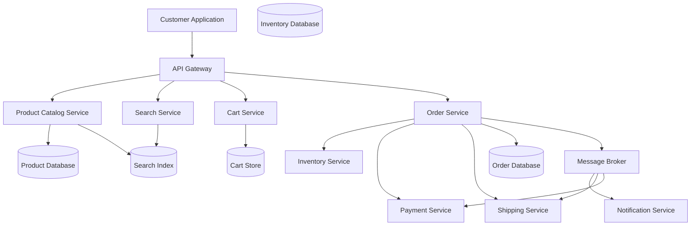
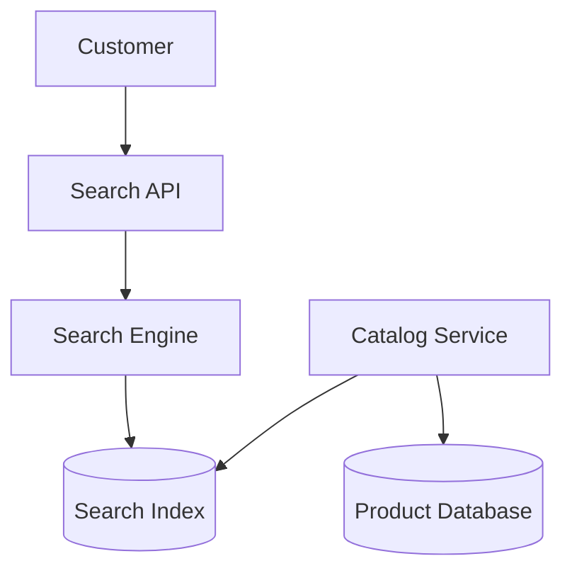
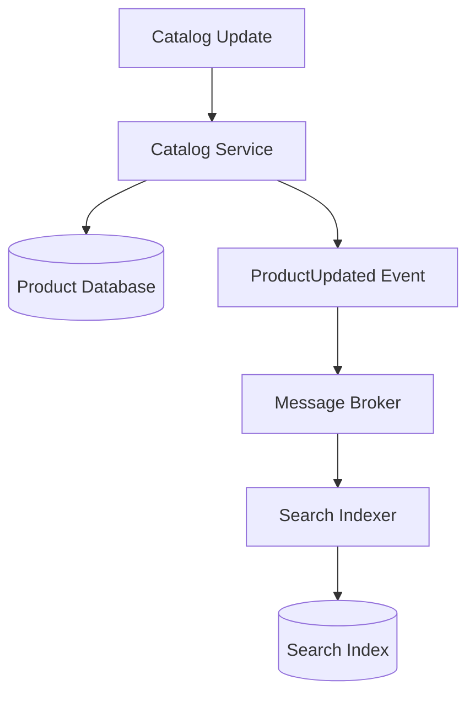
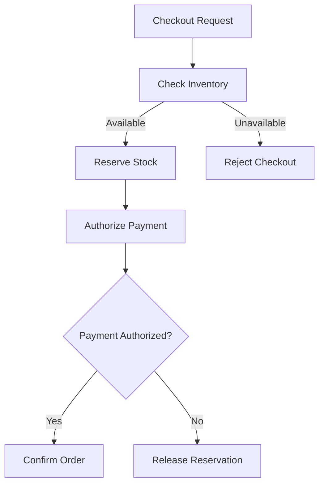
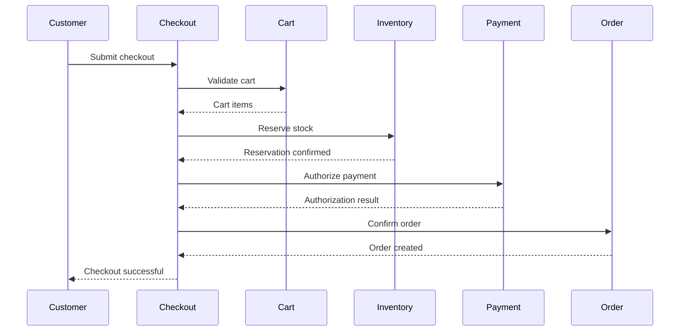
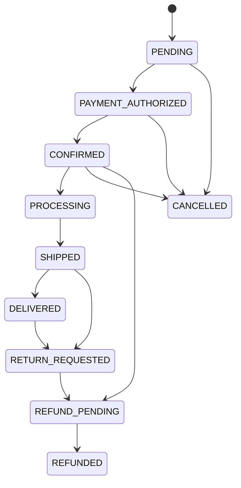
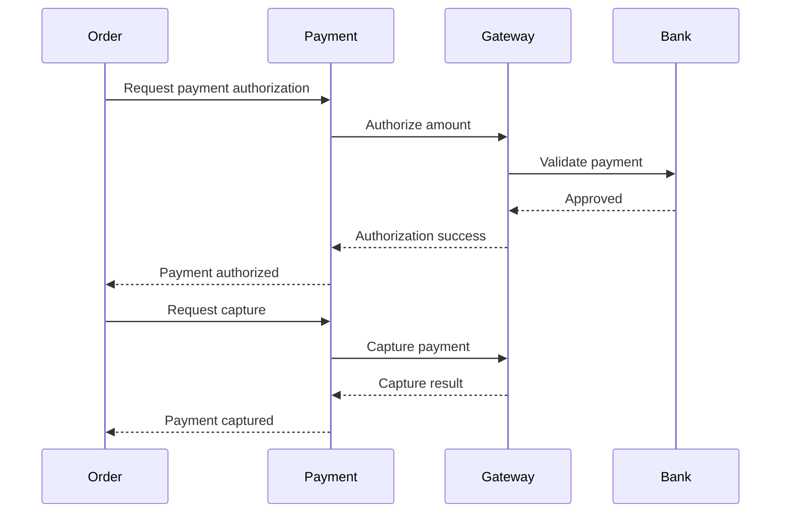
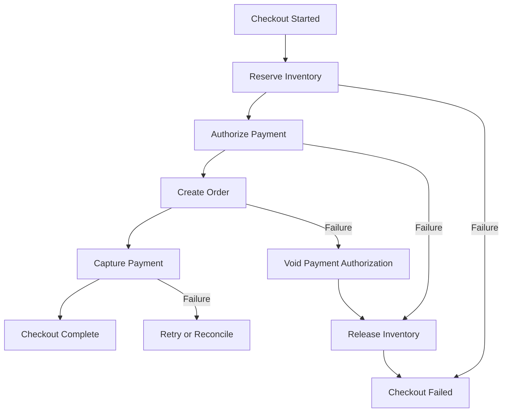
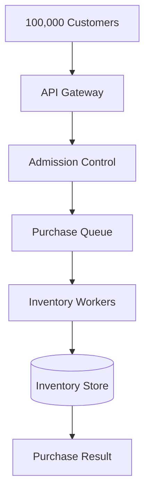
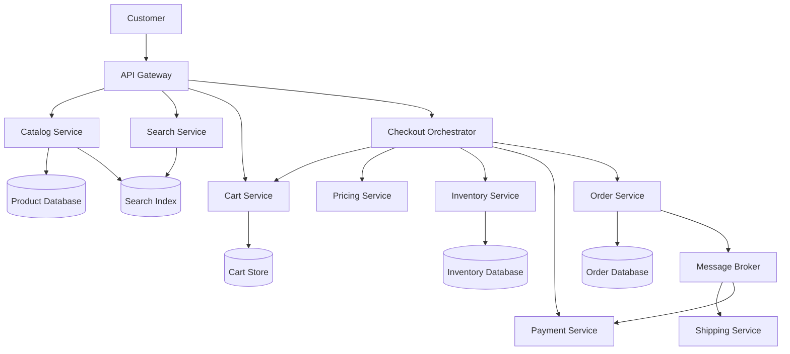

# Lesson 37 — System Design of an E-Commerce Platform
## Product Catalog, Inventory Management, Shopping Cart, Order Processing, and Checkout

An e-commerce platform like Amazon or Flipkart may look like a collection of product pages, shopping carts, and checkout screens.

But behind this experience is a complex distributed system.

Consider a flash sale where 100,000 customers try to purchase the same product, but only 1,000 units are available.

The platform must:
- Display accurate product information.
- Handle millions of product searches.
- Maintain shopping carts.
- Prevent inventory overselling.
- Process orders reliably.
- Coordinate payments.
- Handle cancellations and refunds.
- Survive traffic spikes.

In this lesson, we'll design a scalable e-commerce platform and explore the architectural decisions behind catalog management, inventory reservation, checkout, and order processing.

---

## 1. Problem Statement

Design an e-commerce platform where customers can browse products, add items to their carts, place orders, and complete payments.

### Functional requirements

| Requirement | Description |
|---|---|
| Product catalog | Display products and their details |
| Product search | Search and filter products |
| Product details | Show descriptions, images, and prices |
| Shopping cart | Add, remove, and update items |
| Inventory | Track available product quantities |
| Checkout | Validate cart and create an order |
| Payment | Process customer payments |
| Order management | Track order status |
| Cancellation | Cancel eligible orders |
| Refunds | Process refunds |
| Notifications | Send order and payment updates |

### Non-functional requirements

| Requirement | Goal |
|---|---|
| Availability | Shopping should remain available |
| Scalability | Support millions of customers |
| Consistency | Prevent inventory overselling |
| Durability | Orders and payments must not be lost |
| Performance | Fast product browsing and checkout |
| Reliability | Recover from partial failures |
| Security | Protect customer and payment information |

### Scope

We'll focus on:

- Product catalog architecture.
- Search and product discovery.
- Shopping cart.
- Inventory management.
- Checkout workflow.
- Payment orchestration.
- Order lifecycle.
- Flash sale handling.
- Reliability and scaling.

---

## 2. Capacity Estimation

Assume the following:

| Metric | Estimate |
|---|---:|
| Registered customers | 100 million |
| Daily active customers | 20 million |
| Product catalog | 10 million products |
| Product views per day | 500 million |
| Cart operations per day | 100 million |
| Orders per day | 5 million |
| Average order items | 3 |

### Product read traffic

```text
500 million product views / 86,400

≈ 5,787 requests/second
```

Assuming a 5x peak factor:

```text
5,787 × 5

≈ 28,935 requests/second
```

### Cart operation traffic

```text
100 million / 86,400

≈ 1,157 operations/second
```

### Order creation traffic

```text
5 million / 86,400

≈ 58 orders/second
```

At a 10x peak factor:

```text
58 × 10

≈ 580 orders/second
```

### Important observation

The platform has different traffic characteristics:

- Product browsing is read-heavy.
- Shopping carts involve frequent updates.
- Inventory requires strong concurrency control.
- Checkout involves multiple services and transactional workflows.
- Search requires specialized indexing.

We should not use one storage strategy for every component.

---

## 3. High-Level Architecture



### Component responsibilities

| Component | Responsibility |
|---|---|
| API Gateway | Routing, authentication, rate limiting |
| Catalog Service | Product information |
| Search Service | Product discovery |
| Cart Service | Shopping cart management |
| Inventory Service | Stock availability and reservation |
| Order Service | Order creation and lifecycle |
| Payment Service | Payment authorization and capture |
| Shipping Service | Delivery and fulfillment |
| Notification Service | Email, SMS, and push notifications |
| Message Broker | Asynchronous event distribution |

---

## 4. Product Catalog Architecture

The product catalog stores information about products.

Example:

```json
{
  "productId": "P1001",
  "name": "Wireless Headphones",
  "description": "Noise cancelling wireless headphones",
  "category": "Electronics",
  "brand": "Example Brand",
  "price": 2999,
  "currency": "INR",
  "images": [
    "https://cdn.example.com/products/P1001/image1.jpg"
  ],
  "status": "ACTIVE"
}
```

### Product data model

```sql
CREATE TABLE products (
    id BIGINT PRIMARY KEY,
    name VARCHAR(255) NOT NULL,
    description TEXT,
    category_id BIGINT,
    brand VARCHAR(150),
    status VARCHAR(30) NOT NULL,
    created_at TIMESTAMP NOT NULL,
    updated_at TIMESTAMP NOT NULL
);
```

### Product variants

Many products have multiple variants.

For example:

```text
T-Shirt
  |
  +-- Small / Red
  +-- Medium / Red
  +-- Large / Red
  +-- Small / Blue
  +-- Medium / Blue
  +-- Large / Blue
```

Each variant may have its own:

- SKU.
- Price.
- Inventory.
- Barcode.
- Dimensions.
- Availability.

A useful model separates the product from its sellable variants.

```sql
CREATE TABLE product_variants (
    id BIGINT PRIMARY KEY,
    product_id BIGINT NOT NULL,
    sku VARCHAR(100) UNIQUE NOT NULL,
    attributes JSONB,
    price DECIMAL(12,2) NOT NULL,
    status VARCHAR(30) NOT NULL
);
```

**Important:** Inventory should generally be tracked against the sellable SKU or variant, not only the parent product.

---

## 5. Product Search Architecture

A customer may search for:

```text
wireless headphones under 3000
```

A database query can support simple searches, but large product catalogs need specialized search capabilities.

### Search architecture



Common search technologies include:

- Elasticsearch.
- OpenSearch.
- Apache Solr.

### Why not search directly in the primary database?

Search engines provide specialized functionality:

- Full-text search.
- Relevance scoring.
- Fuzzy matching.
- Faceted filtering.
- Sorting.
- Autocomplete.
- Synonyms.

### Search indexing flow

When a product is created or updated:



The search index is typically an eventually consistent read model.

A product update may take some time to appear in search results.

### Important principle

The search index should not be the source of truth for price or inventory during checkout.

Checkout must validate current authoritative data.

---

## 6. Shopping Cart Architecture

A shopping cart stores products a customer intends to purchase.

Example:

```json
{
  "customerId": "U100",
  "items": [
    {
      "variantId": "V101",
      "quantity": 2
    },
    {
      "variantId": "V205",
      "quantity": 1
    }
  ],
  "updatedAt": "2026-10-30T10:30:00Z"
}
```

### Cart data model

```sql
CREATE TABLE carts (
    id BIGINT PRIMARY KEY,
    customer_id BIGINT UNIQUE NOT NULL,
    updated_at TIMESTAMP NOT NULL
);

CREATE TABLE cart_items (
    id BIGINT PRIMARY KEY,
    cart_id BIGINT NOT NULL,
    variant_id BIGINT NOT NULL,
    quantity INTEGER NOT NULL,
    updated_at TIMESTAMP NOT NULL,
    UNIQUE(cart_id, variant_id)
);
```

### Why Redis for carts?

Redis can be useful when:

- Cart reads and writes are frequent.
- Low latency is important.
- Cart expiration is required.
- Cart data is relatively temporary.

However, Redis should be configured with appropriate durability and recovery settings if it is used as the primary cart store.

A relational database is also a reasonable choice, especially when cart durability and transactional behavior are important.

### Cart operations

Typical APIs:

```http
GET    /api/cart
POST   /api/cart/items
PATCH  /api/cart/items/{itemId}
DELETE /api/cart/items/{itemId}
```

### Should the cart reserve inventory?

Usually, no.

A customer may add an item to the cart and leave the application for several hours.

Reserving stock for every cart item would allow abandoned carts to lock inventory unnecessarily.

A more practical approach is:

- Cart indicates purchase intent.
- Inventory is checked during checkout.
- Stock is temporarily reserved during the order process.

Some platforms may introduce short reservations for limited products, but they need explicit expiration and cleanup rules.

---

## 7. Inventory Management

Inventory is one of the most critical components of an e-commerce platform.

Suppose:

```text
Available stock = 1

Customer A requests 1 unit.
Customer B requests 1 unit.
```

Both customers attempt to purchase at the same time.

We must ensure only one customer gets the item.

### Inventory data model

```sql
CREATE TABLE inventory (
    variant_id BIGINT PRIMARY KEY,
    available_quantity INTEGER NOT NULL,
    reserved_quantity INTEGER NOT NULL DEFAULT 0,
    updated_at TIMESTAMP NOT NULL
);
```

A useful inventory interpretation is:

```text
Physical sellable stock
       |
       +-- Available quantity
       |
       +-- Reserved quantity
```

The precise definition of physical stock and sellable stock depends on the fulfillment operation.

### Incorrect inventory update

```sql
SELECT available_quantity
FROM inventory
WHERE variant_id = 101;
```

Then application code checks the quantity and later performs an update.

This creates a race condition.

Two transactions can both read the same available quantity before either updates it.

### Safer approach: Atomic conditional update

```sql
UPDATE inventory
SET available_quantity = available_quantity - 1
WHERE variant_id = 101
  AND available_quantity >= 1;
```

Check the number of affected rows.

```text
Affected rows = 1
    → Stock successfully decremented

Affected rows = 0
    → Insufficient stock
```

This is a useful way to prevent overselling for a simple immediate-decrement model.

For a reservation-based model, we need to move quantity from available to reserved instead.

---

## 8. Inventory Reservation

Why reserve inventory rather than immediately decrementing it permanently?

Because checkout may take several steps:

1. Validate cart.
2. Reserve inventory.
3. Authorize payment.
4. Confirm order.
5. Capture payment.

If payment fails, the inventory should become available again.

### Inventory reservation flow



### Example

Initial inventory:

```text
Available: 10
Reserved: 0
```

Customer A reserves 2 units:

```text
Available: 8
Reserved: 2
```

Payment succeeds:

```text
Available: 8
Reserved: 0
Sold: 2
```

Payment fails:

```text
Available: 10
Reserved: 0
```

### Reservation table

```sql
CREATE TABLE inventory_reservations (
    id BIGINT PRIMARY KEY,
    order_id BIGINT NOT NULL,
    variant_id BIGINT NOT NULL,
    quantity INTEGER NOT NULL,
    status VARCHAR(30) NOT NULL,
    expires_at TIMESTAMP NOT NULL,
    created_at TIMESTAMP NOT NULL
);
```

Possible reservation states:

```text
ACTIVE
CONFIRMED
RELEASED
EXPIRED
```

### Reservation expiration

Suppose a customer reserves an item but never completes payment.

The reservation should expire after a defined period.

A background worker can release expired reservations.

However, the expiration timestamp must also be checked during relevant inventory operations. Do not depend exclusively on a scheduled cleanup job.

---

## 9. Checkout Architecture

Checkout coordinates multiple services.

It is not simply an API call that creates an order.

A typical checkout requires:

- Cart validation.
- Price validation.
- Inventory reservation.
- Shipping validation.
- Payment authorization.
- Order confirmation.

### Checkout flow



This is a conceptual flow. In a production distributed system, checkout coordination is usually asynchronous and must handle timeouts, retries, and partial failures.

### Important validation

The checkout service should not blindly trust the cart.

It must revalidate:

- Product availability.
- Current price.
- Variant status.
- Quantity limits.
- Promotion eligibility.
- Shipping availability.
- Tax and delivery charges.

The client should not be allowed to determine the authoritative final price.

---

## 10. Order Management

An order represents the customer's purchase commitment.

### Order data model

```sql
CREATE TABLE orders (
    id BIGINT PRIMARY KEY,
    customer_id BIGINT NOT NULL,
    status VARCHAR(30) NOT NULL,
    subtotal DECIMAL(12,2) NOT NULL,
    tax_amount DECIMAL(12,2) NOT NULL,
    shipping_amount DECIMAL(12,2) NOT NULL,
    total_amount DECIMAL(12,2) NOT NULL,
    currency VARCHAR(3) NOT NULL,
    created_at TIMESTAMP NOT NULL
);
```

### Order items

```sql
CREATE TABLE order_items (
    id BIGINT PRIMARY KEY,
    order_id BIGINT NOT NULL,
    variant_id BIGINT NOT NULL,
    product_name VARCHAR(255) NOT NULL,
    sku VARCHAR(100) NOT NULL,
    quantity INTEGER NOT NULL,
    unit_price DECIMAL(12,2) NOT NULL
);
```

### Why snapshot product information?

Suppose a customer buys a product for ₹2,999.

The next day, the product price changes to ₹3,499.

The historical order must still show the original purchase price.

Therefore, order items should preserve relevant product and pricing information at the time of purchase.

Do not depend on the current catalog price to reconstruct historical orders.

---

## 11. Order Lifecycle

An order passes through several states.



This is an illustrative state machine. Real systems often have separate payment, fulfillment, cancellation, and return state machines.

### Why separate state machines?

An order may be confirmed while payment capture is still pending.

A shipment may be in transit while a refund process is being initiated.

Combining every business process into one status field can create an unmanageable state model.

A more robust design separates:

- Order state.
- Payment state.
- Inventory reservation state.
- Shipment state.
- Refund state.

---

## 12. Payment Architecture

Payment processing involves external payment gateways.

Examples include:

- Razorpay.
- Stripe.
- PayPal.
- Adyen.

### Payment authorization vs capture

These are different operations.

**Authorization**

The payment provider confirms that the payment method can cover the amount and may place a hold.

**Capture**

The authorized amount is actually collected.

A platform may authorize first and capture later, depending on its business model and payment provider capabilities.

### Payment flow



### Idempotency

Suppose the customer clicks Pay twice because the first request appears slow.

Without idempotency, the system may initiate duplicate payment operations.

Use an idempotency key:

```http
POST /api/payments
Idempotency-Key: checkout_123_attempt_1
```

The payment service should return the result of the original operation when the same key is retried, rather than creating a duplicate charge.

The key must be associated with the operation and its request parameters.

### Webhooks

Payment gateways may send asynchronous webhook notifications.

Example:

```json
{
  "event": "payment.captured",
  "paymentId": "pay_123",
  "orderId": "order_456",
  "amount": 5998,
  "currency": "INR"
}
```

Webhook handling should:

- Verify signatures.
- Validate event identity.
- Deduplicate repeated events.
- Update payment state safely.
- Handle out-of-order notifications.
- Avoid trusting client-side payment success alone.

---

## 13. Distributed Transactions and the Saga Pattern

Checkout touches multiple services:

- Inventory.
- Payment.
- Order.
- Shipping.

These services usually have independent databases.

A single ACID transaction cannot easily cover all of them.

This is where the Saga pattern becomes useful.

### Checkout saga



### Important nuance

Not every operation can be perfectly reversed.

For example:

- Inventory reservation can usually be released.
- Payment authorization can often be voided.
- A captured payment may require a refund.
- A shipped product cannot simply be unshipped.

This is why Saga compensating actions are business operations, not literal database rollbacks.

### Orchestration vs choreography

**Saga orchestration**

A central coordinator controls the workflow.

```text
Checkout Orchestrator
   |
   +-- Inventory
   |
   +-- Payment
   |
   +-- Order
```

Advantages:
- Central workflow visibility.
- Easier to understand complex checkout steps.
- Clear timeout and compensation handling.

Disadvantages:
- Orchestrator becomes an important component.
- Workflow logic can become centralized and complex.

**Saga choreography**

Services react to events and trigger the next step.

```text
InventoryReserved
       |
       v
Payment Service
       |
       v
PaymentAuthorized
       |
       v
Order Service
```

Advantages:
- Services are more independent.
- Event-driven architecture.

Disadvantages:
- Workflow is harder to visualize.
- Failure handling can become distributed.
- Debugging may be more difficult.

For complex checkout workflows, orchestration is often easier to operate initially.

---

## 14. Flash Sale Architecture

Now consider the most challenging scenario.

A product has 1,000 units available.

A flash sale begins.

100,000 customers attempt to purchase it simultaneously.

### The problem

The inventory service receives a massive number of competing requests for the same SKU.

This creates:

- Database contention.
- Lock contention.
- High request latency.
- Failed checkout attempts.
- Potential overselling if inventory updates are incorrect.

### Basic solution: Atomic inventory reservation

Use a conditional update or transactional reservation operation.

Only successful reservations should proceed.

### Advanced solution: Queue-based admission

Instead of sending all requests directly to the inventory database:



The queue controls the rate at which inventory reservations are attempted.

However, queueing does not eliminate the need for atomic inventory updates.

### Another approach: Atomic counters

For a highly constrained flash sale, a carefully designed Redis atomic operation can reserve a limited quantity.

Example concept:

```text
if available_quantity > 0:
    decrement quantity
    create reservation
else:
    reject
```

This must be implemented atomically, for example using a Lua script or another atomic primitive.

A durable reservation record and reconciliation mechanism are still required.

Redis should not become an unprotected source of truth for completed orders and payments.

### Fairness and duplicate requests

Flash sale systems should also consider:

- One purchase per customer.
- Duplicate request protection.
- Bot detection.
- Rate limiting.
- Waiting-room admission.
- Purchase limits.
- Reservation expiration.

---

## 15. Inventory Consistency Across Warehouses

Large e-commerce platforms may have multiple warehouses.

Example:

| Warehouse | Stock |
|---|---:|
| Delhi | 100 |
| Mumbai | 150 |
| Bengaluru | 80 |

Total stock:

```text
100 + 150 + 80 = 330
```

But a customer in Delhi may need the product from the Delhi warehouse to meet delivery expectations.

Inventory decisions must consider:

- Warehouse location.
- Available stock.
- Reserved stock.
- Safety stock.
- Delivery promise.
- Warehouse fulfillment capacity.

### Inventory model

A more detailed inventory system might track:

```text
Physical stock
    |
    +-- Available stock
    |
    +-- Reserved stock
    |
    +-- Damaged stock
    |
    +-- Safety stock
```

The exact quantities depend on warehouse operations.

### Reservation key

Inventory should be reserved against an appropriate combination:

```text
SKU + Warehouse ID
```

This prevents two concurrent orders from claiming the same warehouse stock.

---

## 16. Pricing and Promotions

Pricing can become a separate domain.

The catalog price is not necessarily the final checkout price.

The final amount may include:

- Product price.
- Discounts.
- Coupons.
- Taxes.
- Shipping.
- Handling charges.
- Promotional offers.

### Pricing calculation

\[
Total =
Subtotal - Discounts + Taxes + Shipping
\]

Example:

```text
Product subtotal: ₹5,000
Discount:         ₹500
Tax:              ₹810
Shipping:         ₹50

Total:            ₹5,360
```

### Why separate pricing from catalog?

The catalog answers:

"What is the listed price of this product?"

The pricing service answers:

"What price should this customer pay for this cart right now?"

Pricing may depend on:

- Customer segment.
- Location.
- Promotion eligibility.
- Coupon limits.
- Time-limited offers.
- Seller rules.

### Important consideration

The checkout service should calculate the final price on the server.

Never trust a price supplied by the browser.

---

## 17. Search, Catalog, and Inventory Consistency

A common mistake is assuming search results always reflect current inventory.

Imagine:

1. Search index shows 5 units available.
2. Another customer purchases all 5.
3. Search index has not yet updated.
4. A new customer opens the product page.

The product may still appear available in search.

This is acceptable if checkout performs authoritative validation.

### Data ownership

| Information | Source of truth |
|---|---|
| Product description | Catalog Service |
| Product price | Pricing Service or authoritative price store |
| Inventory quantity | Inventory Service |
| Order status | Order Service |
| Payment status | Payment Service |
| Search relevance | Search index |

Search results are discovery data, not an inventory reservation.

---

## 18. Caching Strategy

Product browsing is read-heavy, so caching is important.

### Product detail caching

```text
Key:
product:P1001

Value:
Product metadata
```

### Search caching

Popular search queries can be cached.

Example:

```text
search:wireless-headphones:page1
```

### Cart caching

Customer-specific cart data may be cached using:

```text
cart:user:1001
```

### What should not be blindly cached?

Inventory availability and final pricing are time-sensitive.

You may cache them briefly for display, but checkout must revalidate them.

### Cache invalidation

When product data changes:

1. Update the authoritative catalog.
2. Publish a product update event.
3. Invalidate or update caches.
4. Update the search index asynchronously.

For inventory changes, avoid treating cached stock values as guaranteed availability.

---

## 19. Observability

An e-commerce platform needs both technical and business monitoring.

### Technical metrics

| Metric | Purpose |
|---|---|
| Product API latency | Measure browsing performance |
| Search latency | Measure search performance |
| Cart operation latency | Monitor cart experience |
| Inventory reservation latency | Monitor checkout bottlenecks |
| Payment authorization success | Monitor payment health |
| Queue lag | Detect processing backlogs |
| Database lock waits | Detect contention |
| Cache hit ratio | Measure caching effectiveness |

### Business metrics

- Conversion rate.
- Cart abandonment rate.
- Checkout success rate.
- Payment failure rate.
- Inventory reservation failure rate.
- Order cancellation rate.
- Refund rate.
- Average order value.

### Distributed tracing

A checkout trace should connect:

```text
Checkout Request
      |
      v
Cart Validation
      |
      v
Price Calculation
      |
      v
Inventory Reservation
      |
      v
Payment Authorization
      |
      v
Order Confirmation
      |
      v
Payment Capture
```

This makes it easier to identify where checkout latency or failures originate.

---

## 20. Failure Scenarios

| Failure | Impact | Mitigation |
|---|---|---|
| Search engine unavailable | Product discovery affected | Cached popular results and database fallback |
| Redis unavailable | Cache misses or cart disruption | Durable fallback and controlled load |
| Inventory service unavailable | Checkout cannot reserve stock | Retry and reject safely rather than oversell |
| Payment gateway unavailable | Checkout delayed | Retry with idempotency and reconciliation |
| Order service crashes | Order confirmation delayed | Durable events and workflow recovery |
| Message broker unavailable | Downstream events delayed | Transactional outbox |
| Reservation worker crashes | Reservations may remain active | Expiration and reconciliation |
| Duplicate payment webhook | Incorrect duplicate processing | Event deduplication |
| Warehouse unavailable | Fulfillment disrupted | Reallocation or customer notification |

### Graceful degradation

If search is unavailable, customers may still access direct product links.

If recommendations fail, product browsing should continue.

If payment processing fails, the platform should not mark the order as paid.

If inventory reservation fails, checkout must stop safely.

The priority is to preserve financial and inventory correctness.

---

## 21. Complete Architecture Summary



### Recommended design decisions

| Area | Recommended approach |
|---|---|
| Product catalog | Relational database |
| Product search | Elasticsearch or OpenSearch |
| Product media | Object storage + CDN |
| Cart | Redis or relational database |
| Inventory | Transactional database |
| Inventory reservation | Atomic conditional update |
| Checkout | Saga orchestration |
| Orders | Relational database |
| Payments | Payment provider + idempotency |
| Events | Durable message broker |
| Flash sales | Admission control + queue + atomic reservation |
| Caching | Redis |
| Reliability | Outbox, retries, reconciliation |

---

## 22. Common System Design Mistakes

1. **Treating the shopping cart as an inventory reservation.**  
   This can unnecessarily lock stock for abandoned carts.

2. **Trusting search index inventory data during checkout.**  
   Search indexes are eventually consistent.

3. **Reading and updating inventory in separate unprotected operations.**  
   This creates race conditions and overselling.

4. **Trusting client-side product prices.**  
   Final pricing must be calculated on the server.

5. **Treating checkout as one database transaction across all services.**  
   Use a distributed workflow such as a Saga.

6. **Ignoring payment idempotency.**  
   Network retries can create duplicate payment attempts.

7. **Capturing payments without a recovery strategy.**  
   Payment failures and uncertain outcomes require reconciliation.

8. **Using Redis as the only durable inventory source without appropriate guarantees.**  
   Critical inventory and order state require durable recovery mechanisms.

9. **Ignoring reservation expiration.**  
   Abandoned checkout attempts can permanently lock stock.

10. **Overengineering ordinary product browsing.**  
    Keep read-heavy catalog operations separate from critical inventory transactions.

---

## 23. Design Checklist

### Catalog and search
- [ ] Product and variant models defined.
- [ ] Product search index designed.
- [ ] Search indexing is asynchronous.
- [ ] Product media stored separately.
- [ ] Catalog and inventory ownership separated.

### Cart
- [ ] Cart persistence strategy selected.
- [ ] Duplicate cart item handling defined.
- [ ] Cart quantity limits implemented.
- [ ] Inventory not reserved indefinitely.

### Inventory
- [ ] Atomic stock updates implemented.
- [ ] Reservation model defined.
- [ ] Reservation expiration implemented.
- [ ] Warehouse-level inventory considered.
- [ ] Overselling prevention tested.

### Checkout and payment
- [ ] Checkout workflow defined.
- [ ] Price revalidated.
- [ ] Inventory reserved before confirmation.
- [ ] Payment authorization and capture distinguished.
- [ ] Idempotency keys implemented.
- [ ] Payment webhooks verified and deduplicated.
- [ ] Saga compensation defined.

### Reliability
- [ ] Transactional outbox considered.
- [ ] Queue retries and dead-letter handling defined.
- [ ] Reservation reconciliation implemented.
- [ ] Payment reconciliation implemented.
- [ ] Flash sale admission control designed.

---

## 24. Revision Questions

1. Why should product catalog and inventory be separate domains?
2. Why use a search engine instead of relying only on database queries?
3. Why should the search index not be the source of truth for inventory?
4. Should adding a product to the cart reserve stock?
5. How does an atomic conditional update prevent overselling?
6. What is inventory reservation?
7. Why should reservations expire?
8. What is the difference between payment authorization and capture?
9. Why are idempotency keys important in payment processing?
10. What is the Saga pattern?
11. What is the difference between Saga orchestration and choreography?
12. Why should order items preserve historical product and pricing information?
13. How would you handle 100,000 customers competing for 1,000 items?
14. How would you manage inventory across multiple warehouses?
15. How do you handle duplicate payment webhooks?
16. Why is reconciliation important in distributed checkout workflows?

---

## 25. Practical Exercise

Design an e-commerce platform with these requirements:

- 100 million registered customers.
- 10 million products.
- 20 million daily active customers.
- 5 million orders per day.
- Multiple warehouses.
- Multiple payment methods.
- Flash sale support.
- Inventory overselling must be prevented.

### Task 1 — Capacity planning

Calculate:

- Average product views per second.
- Average cart operations per second.
- Average order creations per second.
- Peak order traffic.
- Approximate inventory update volume.

State your assumptions.

### Task 2 — Catalog architecture

Explain how you would:

- Store products and variants.
- Index product data.
- Handle product updates.
- Serve product images.
- Keep search data synchronized.

### Task 3 — Shopping cart

Design a cart service.

Explain:
- Storage selection.
- Cart persistence.
- Cart expiration.
- Duplicate items.
- Price changes after adding to cart.

### Task 4 — Inventory

Design an inventory reservation system.

Explain:
- Atomic updates.
- Reservation expiration.
- Concurrent purchases.
- Multiple warehouses.
- Inventory reconciliation.

### Task 5 — Checkout

Design the complete checkout workflow.

Include:
- Cart validation.
- Price calculation.
- Inventory reservation.
- Payment authorization.
- Order creation.
- Payment capture.
- Failure compensation.

### Task 6 — Flash sale

A product has 1,000 available units and 100,000 customers attempt to buy it simultaneously.

Explain:
- How you control incoming traffic.
- How you prevent overselling.
- How you handle duplicate requests.
- How you expire abandoned reservations.
- How you provide fair access.

### Final challenge

A customer clicks Pay, the payment provider processes the payment, but the response times out.

The customer retries checkout.

Explain how your system prevents duplicate charges, determines the actual payment outcome, updates order state, and handles inventory reservation.

---

## 26. Practice Focus

Focus on mastering these six concepts:

1. **Catalog vs inventory:** Understand why product information and stock availability have different consistency requirements.
2. **Inventory reservation:** Understand how atomic operations prevent overselling.
3. **Checkout orchestration:** Understand how multiple services coordinate a purchase.
4. **Payment idempotency:** Understand how retries avoid duplicate financial operations.
5. **Saga pattern:** Understand compensation when distributed checkout steps fail.
6. **Flash sale architecture:** Understand admission control, queueing, and inventory contention.

The most important lesson is that an e-commerce platform must balance availability and performance without sacrificing correctness around inventory and payments.

---

## Key Takeaway

An e-commerce platform is a distributed transaction system built around product discovery, inventory correctness, and reliable order processing.

Product browsing can tolerate caching and eventual consistency. Inventory reservation and payment operations require stronger correctness guarantees.

The architecture should separate catalog, search, cart, inventory, checkout, orders, and payments, while coordinating critical purchase workflows through reliable distributed transactions and idempotent operations.