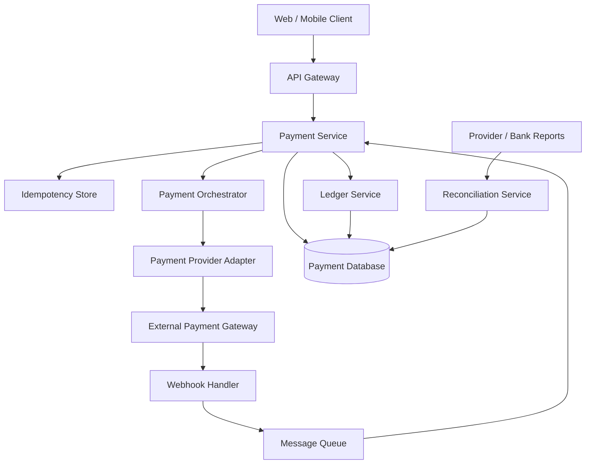
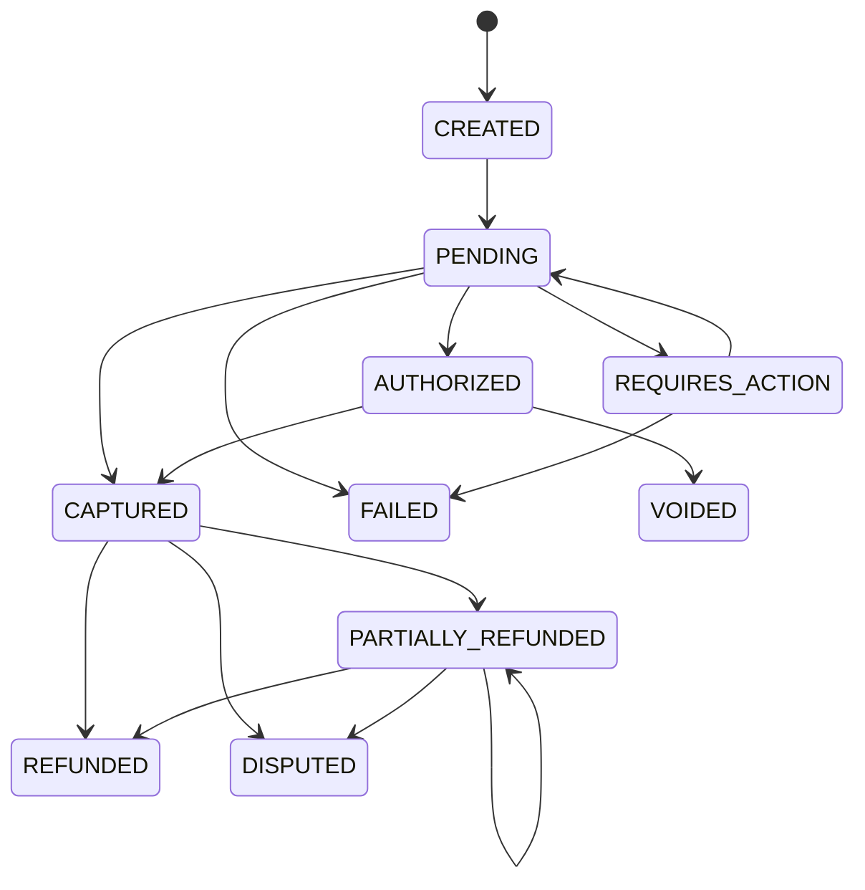
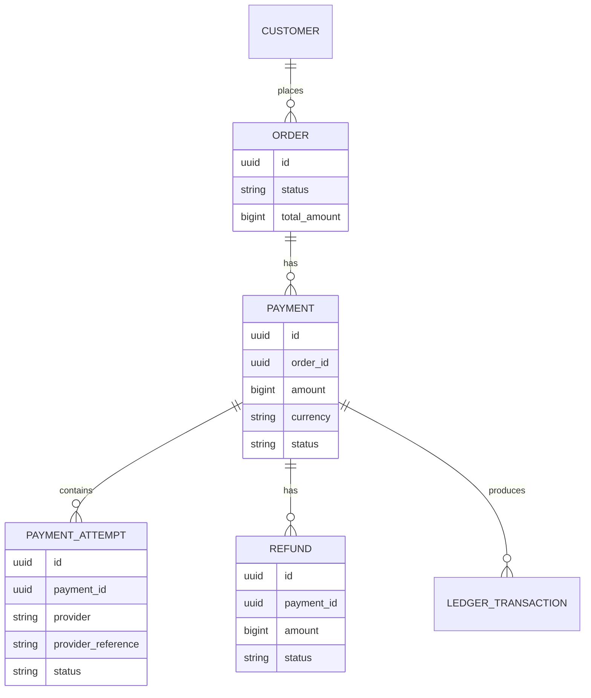
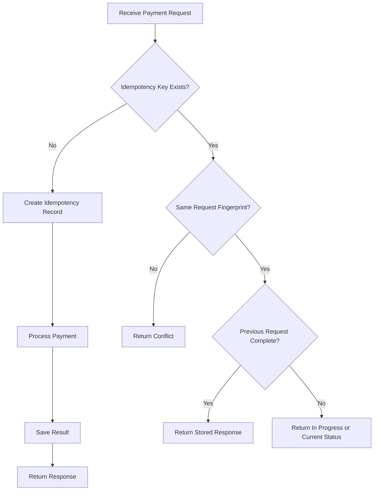
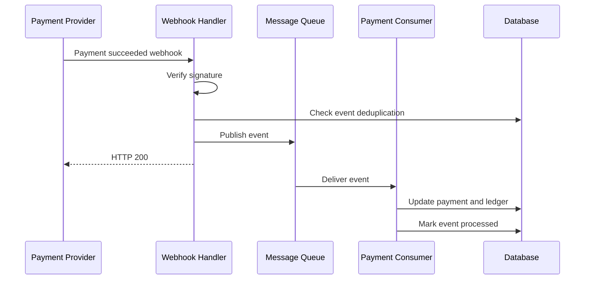
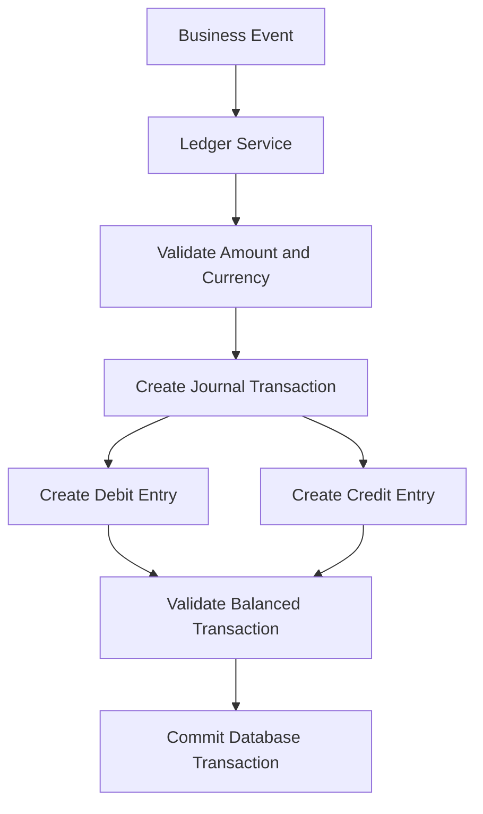
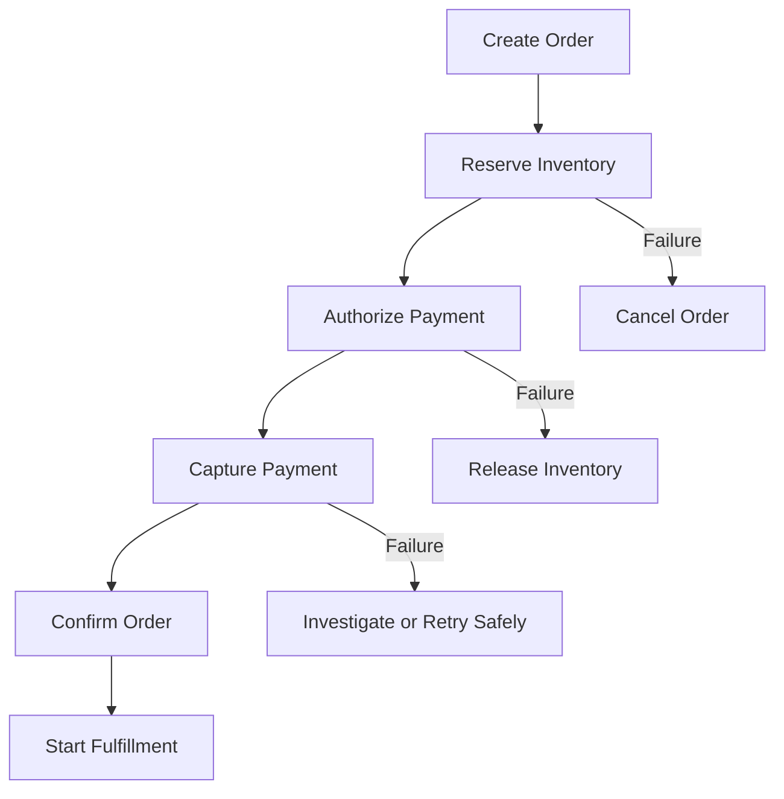
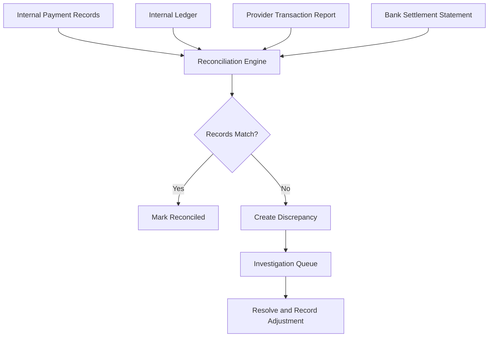
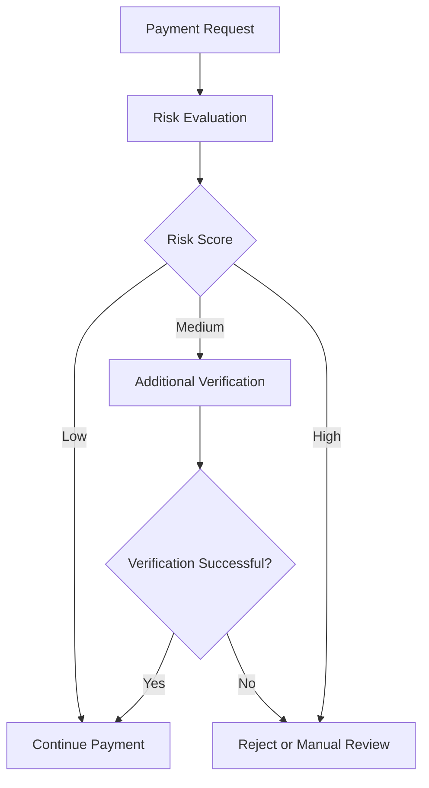

# Lesson 38: System Design of a Payment Platform

## 1. Introduction

A payment platform is responsible for moving money between customers, merchants, payment providers, and financial institutions.

Examples include:

- A customer paying for an e-commerce order.
- A passenger paying for a ride.
- A merchant receiving a settlement.
- A customer requesting a refund.
- A business processing subscriptions.

At first glance, payment processing looks straightforward:

1. Customer clicks Pay.
2. Payment provider processes the transaction.
3. Application marks the order as paid.

However, real payment systems must handle much more complicated scenarios:

- The payment provider processes a payment, but our API times out.
- The customer clicks Pay multiple times.
- A webhook arrives twice.
- A payment succeeds, but the order update fails.
- A customer gets charged, but the application displays payment failure.
- A refund succeeds at the provider, but our database doesn't reflect it.
- The payment provider and our internal records disagree.

The biggest challenge is not simply processing a payment. It is ensuring that **financial records remain correct even when systems fail, requests are duplicated, and events arrive out of order.**

---

## 2. Requirements

Before designing the system, let's identify its requirements.

### 2.1 Functional requirements

| Requirement | Description |
|---|---|
| Initiate payment | Accept payment requests from customers |
| Authorize payment | Reserve funds without necessarily capturing them |
| Capture payment | Collect the authorized amount |
| Refund payment | Return all or part of a payment |
| Payment status | Allow customers and merchants to check payment status |
| Payment history | Maintain a history of transactions |
| Provider integration | Integrate with multiple payment providers |
| Webhook handling | Process asynchronous provider notifications |
| Settlement | Transfer collected funds to merchants |
| Reconciliation | Compare internal records with provider and bank records |
| Fraud detection | Identify suspicious transactions |

### 2.2 Non-functional requirements

| Requirement | Goal |
|---|---|
| Financial correctness | Never create or lose money through incorrect bookkeeping |
| Idempotency | Duplicate requests must not create duplicate charges |
| Availability | Payment APIs should remain available during partial failures |
| Durability | Financial records must survive failures |
| Security | Protect payment credentials and sensitive data |
| Auditability | Every financial movement must be traceable |
| Consistency | Ledger entries must remain balanced |
| Scalability | Handle payment traffic spikes |

### 2.3 Important design principle

For payment systems, correctness is more important than blindly maximizing availability.

If we cannot determine whether a provider has charged a customer, we should not simply retry the charge with a new identifier.

We must first resolve the uncertain outcome.

---

## 3. High-Level Architecture

A payment platform typically contains several independent components.



### Component responsibilities

| Component | Responsibility |
|---|---|
| API Gateway | Authentication, routing, rate limiting |
| Payment Service | Manages payment requests and lifecycle |
| Idempotency Store | Prevents duplicate processing |
| Payment Orchestrator | Coordinates provider interactions |
| Provider Adapter | Hides provider-specific APIs |
| Webhook Handler | Receives asynchronous payment updates |
| Message Queue | Decouples asynchronous processing |
| Ledger Service | Records financial movements |
| Reconciliation Service | Detects financial mismatches |

A key architectural decision is to separate payment lifecycle management from the financial ledger.

The payment service answers:

> What happened to this payment?

The ledger answers:

> Where did the money move?

These are related, but they are not the same thing.

---

## 4. Understanding the Payment Lifecycle

A payment is not simply successful or failed. It can move through several states.

### 4.1 Payment states

| State | Meaning |
|---|---|
| CREATED | Payment request created |
| PENDING | Processing has started |
| REQUIRES_ACTION | Customer must complete an additional step |
| AUTHORIZED | Funds have been reserved |
| CAPTURED | Funds have been collected |
| FAILED | Payment definitively failed |
| VOIDED | Authorization has been cancelled |
| PARTIALLY_REFUNDED | Some amount has been refunded |
| REFUNDED | Full amount has been refunded |
| DISPUTED | Customer or issuer has disputed the payment |

The exact state model depends on the provider and payment method.

### 4.2 Payment state machine



Not every transition is valid.

For example:

- A failed payment cannot normally be captured.
- A voided authorization cannot be captured.
- A refunded payment should not be refunded again beyond its remaining refundable amount.
- A captured payment can move into a dispute workflow.

Enforce valid transitions in the payment service rather than allowing arbitrary status updates.

### 4.3 Authorization vs capture

These are two different operations.

**Authorization**

The payment provider confirms that the customer has sufficient available funds and reserves the amount.

**Capture**

The merchant actually collects the authorized amount.

Example:

A customer books a ride with an estimated fare of ₹500.

1. Authorize ₹500.
2. Complete the ride.
3. Calculate the final fare as ₹450.
4. Capture ₹450, if the provider supports partial capture.
5. Release any unused authorization according to provider rules.

Some payment methods use immediate capture instead of separate authorization and capture.

---

## 5. Payment Records vs Payment Attempts vs Orders

These concepts should not be mixed together.

Consider a customer placing one order but attempting payment twice.

- First attempt: Card declined.
- Second attempt: Payment successful.

There is one order, one logical payment, and two payment attempts.

### Suggested data model



A simplified SQL structure:

```sql
CREATE TABLE payments (
    id UUID PRIMARY KEY,
    order_id UUID NOT NULL,
    amount BIGINT NOT NULL,
    currency VARCHAR(3) NOT NULL,
    status VARCHAR(30) NOT NULL,
    created_at TIMESTAMPTZ DEFAULT NOW()
);

CREATE TABLE payment_attempts (
    id UUID PRIMARY KEY,
    payment_id UUID NOT NULL REFERENCES payments(id),
    provider VARCHAR(50) NOT NULL,
    provider_reference VARCHAR(255),
    status VARCHAR(30) NOT NULL,
    created_at TIMESTAMPTZ DEFAULT NOW()
);
```

Why separate attempts?

Because provider interactions can fail independently without changing the identity of the logical payment.

---

## 6. Idempotency: Preventing Duplicate Payments

This is one of the most important concepts in payment system design.

Imagine a customer clicks Pay.

The client sends:

```http
POST /payments
```

The server sends a request to the payment provider.

The provider successfully charges the customer, but the response gets lost because of a network timeout.

The client doesn't know whether the payment succeeded.

It retries the request.

Without protection, the customer might be charged twice.

### 6.1 What is idempotency?

An operation is idempotent when repeating the same operation produces the same logical result as performing it once.

For payment APIs, we commonly use an idempotency key.

Example:

```http
POST /payments
Idempotency-Key: order-123-payment-001
Content-Type: application/json
```

Request:

```json
{
  "orderId": "order-123",
  "amount": 50000,
  "currency": "INR",
  "paymentMethodToken": "pm_token_123"
}
```

Here, `50000` represents ₹500 when using paise as the smallest currency unit.

If the client retries with the same key and same request, the server returns the original logical result rather than creating another payment.

### 6.2 Idempotency flow



### 6.3 Idempotency table

```sql
CREATE TABLE idempotency_keys (
    id UUID PRIMARY KEY,
    key VARCHAR(255) NOT NULL,
    scope VARCHAR(100) NOT NULL,
    request_hash VARCHAR(64) NOT NULL,
    status VARCHAR(30) NOT NULL,
    response JSONB,
    created_at TIMESTAMPTZ DEFAULT NOW(),
    expires_at TIMESTAMPTZ,
    UNIQUE(scope, key)
);
```

The scope can include the merchant or customer identity so that unrelated customers cannot collide on the same key.

### 6.4 Important implementation details

1. Store the key before performing the external operation.
2. Use a database uniqueness constraint to handle concurrent requests.
3. Store a request fingerprint.
4. Reject reuse of the same key with a different request payload.
5. Return the stored response for completed requests.
6. Handle in-progress requests explicitly.
7. Define a retention policy based on business and provider requirements.

**Important:** Idempotency does not mean every network operation happens exactly once. It means duplicate requests are mapped to the same logical operation.

For external provider calls, use the same provider idempotency key whenever the provider supports it.

---

## 7. Payment Provider Integration

A payment platform may integrate with multiple providers.

Examples include:

- Stripe
- Razorpay
- Adyen
- PayPal

The application should avoid spreading provider-specific logic throughout the codebase.

### 7.1 Provider abstraction

Define a common interface.

```typescript
interface PaymentProvider {
  createPayment(
    request: CreatePaymentRequest
  ): Promise<PaymentResult>;

  authorize(
    request: AuthorizePaymentRequest
  ): Promise<PaymentResult>;

  capture(
    paymentReference: string,
    amount: number
  ): Promise<PaymentResult>;

  refund(
    paymentReference: string,
    amount: number
  ): Promise<RefundResult>;

  getPaymentStatus(
    paymentReference: string
  ): Promise<PaymentResult>;
}
```

Implement provider-specific adapters.

```typescript
class StripeProvider implements PaymentProvider {
  async createPayment(request: CreatePaymentRequest) {
    // Stripe-specific implementation
  }

  async authorize(request: AuthorizePaymentRequest) {
    // Stripe-specific implementation
  }

  async capture(paymentReference: string, amount: number) {
    // Stripe-specific implementation
  }

  async refund(paymentReference: string, amount: number) {
    // Stripe-specific implementation
  }

  async getPaymentStatus(paymentReference: string) {
    // Stripe-specific implementation
  }
}
```

The payment service works with the common interface.

```typescript
class PaymentService {
  constructor(
    private provider: PaymentProvider
  ) {}

  async processPayment(request: CreatePaymentRequest) {
    return this.provider.createPayment(request);
  }
}
```

This makes it easier to add or replace providers.

However, don't force every provider into identical behavior. Some providers support different authorization, capture, refund, and settlement capabilities.

Keep provider-specific capabilities explicit.

---

## 8. Handling Timeouts and Uncertain Payment Outcomes

This is one of the most dangerous failure scenarios.

Consider:

1. Our service sends a charge request.
2. Provider processes the payment successfully.
3. Network connection times out.
4. Our service receives no response.

What is the payment status?

It is not necessarily failed.

It is **unknown or pending verification**.

### Incorrect approach

```typescript
try {
  await provider.charge(request);
} catch {
  await markPaymentAsFailed();
}
```

This can incorrectly mark a successful payment as failed.

### Better approach

```typescript
try {
  const result = await provider.charge(request);

  await updatePaymentStatus(result.status);
} catch (error) {
  await markPaymentAsPendingVerification();

  await enqueuePaymentStatusCheck();
}
```

A reconciliation or status-check worker can query the provider using the original provider reference or idempotency key.

### Recommended behavior

| Scenario | Action |
|---|---|
| Provider definitively declines | Mark failed |
| Provider confirms success | Mark captured/successful |
| Network timeout | Mark pending verification |
| Provider returns temporary server error | Retry safely using the same idempotency identity |
| Provider status cannot be determined | Keep pending and reconcile |
| Duplicate webhook | Deduplicate and ignore repeated processing |

Never interpret every timeout as a payment failure.

---

## 9. Webhooks and Asynchronous Payment Updates

Payment providers often notify us through webhooks.

Example:

```http
POST /webhooks/payment-provider
```

Payload:

```json
{
  "eventId": "evt_123",
  "eventType": "payment.succeeded",
  "paymentReference": "pay_456",
  "amount": 50000,
  "currency": "INR"
}
```

A webhook might arrive after the customer has already closed the browser.

### Webhook processing architecture



### Webhook best practices

- Verify the provider's webhook signature.
- Validate the event structure and merchant/account identity.
- Persist the event or durably enqueue it before acknowledging receipt.
- Deduplicate events using the provider's event ID.
- Handle out-of-order events.
- Make processing idempotent.
- Avoid trusting the browser redirect as proof of payment.
- Use provider status APIs when an event's validity or ordering is uncertain.

### Event deduplication

```sql
CREATE TABLE processed_webhook_events (
    provider VARCHAR(50) NOT NULL,
    event_id VARCHAR(255) NOT NULL,
    received_at TIMESTAMPTZ DEFAULT NOW(),
    processed_at TIMESTAMPTZ,
    PRIMARY KEY (provider, event_id)
);
```

The unique constraint prevents the same provider event from being processed as a new event multiple times.

However, deduplication alone is not enough. Different events can describe the same underlying payment transition. The payment state machine must also validate transitions.

---

## 10. Double-Entry Bookkeeping: The Financial Source of Truth

This is the foundation of a reliable financial system.

A common mistake is storing only a payment status and a balance.

For example:

```text
Customer paid ₹500
Merchant balance = ₹500
```

But this doesn't explain where the money came from, what fees were deducted, or whether the funds have settled.

A proper payment platform uses a ledger.

### 10.1 What is double-entry bookkeeping?

Every financial transaction creates at least two ledger entries.

For every transaction:

**Total debits = Total credits**

Money doesn't simply appear or disappear. It moves between accounts.

### 10.2 Example: Customer pays ₹500

Assume a customer pays ₹500.

Our ledger might record:

| Account | Debit | Credit |
|---|---:|---:|
| Payment processor receivable | ₹500 | — |
| Customer payment clearing | — | ₹500 |
| **Total** | **₹500** | **₹500** |

This represents money the processor owes us, with an offsetting clearing liability or control account.

The exact account names and accounting treatment depend on the business's accounting model.

### 10.3 Example: Provider fee of ₹10

When the provider deducts ₹10:

| Account | Debit | Credit |
|---|---:|---:|
| Payment processing expense | ₹10 | — |
| Payment processor receivable | — | ₹10 |
| **Total** | **₹10** | **₹10** |

The remaining receivable is ₹490.

### 10.4 Example: Merchant settlement of ₹490

When ₹490 is transferred to the merchant:

| Account | Debit | Credit |
|---|---:|---:|
| Merchant payable | ₹490 | — |
| Bank account | — | ₹490 |
| **Total** | **₹490** | **₹490** |

These are simplified illustrative entries. A production ledger must define account ownership, asset/liability classification, and the precise accounting events.

### 10.5 Ledger architecture



### 10.6 Ledger data model

```sql
CREATE TABLE ledger_accounts (
    id UUID PRIMARY KEY,
    account_code VARCHAR(50) UNIQUE NOT NULL,
    account_type VARCHAR(30) NOT NULL,
    currency VARCHAR(3) NOT NULL
);

CREATE TABLE ledger_transactions (
    id UUID PRIMARY KEY,
    reference_type VARCHAR(50) NOT NULL,
    reference_id UUID NOT NULL,
    created_at TIMESTAMPTZ DEFAULT NOW()
);

CREATE TABLE ledger_entries (
    id UUID PRIMARY KEY,
    transaction_id UUID NOT NULL
        REFERENCES ledger_transactions(id),
    account_id UUID NOT NULL
        REFERENCES ledger_accounts(id),
    entry_type VARCHAR(10) NOT NULL,
    amount BIGINT NOT NULL,
    currency VARCHAR(3) NOT NULL,
    created_at TIMESTAMPTZ DEFAULT NOW()
);
```

Use integer minor units for amounts, such as paise or cents.

A production implementation should enforce:

- Positive entry amounts.
- Valid debit/credit types.
- Same-currency balancing within a journal transaction, unless explicitly modeling FX conversions with separate currency legs.
- At least two entries per financial transaction.
- Atomic journal posting.
- Unique references to prevent duplicate financial postings.

### 10.7 Why should ledger entries be immutable?

Suppose we accidentally record a ₹500 payment as ₹5,000.

We should not silently edit the historical ledger entry.

Instead:

1. Record the original transaction.
2. Create a reversing transaction.
3. Record the corrected transaction.

This creates a complete audit trail.

**Golden rule: Never silently modify historical financial entries. Use compensating ledger entries.**

---

## 11. Available Balance vs Pending Balance vs Settled Balance

A merchant might have three different balances.

| Balance | Meaning |
|---|---|
| Pending | Payments received but not yet eligible for withdrawal |
| Available | Funds eligible for payout |
| Settled | Funds transferred to the merchant's bank |

Example:

A merchant receives ₹10,000 in payments.

- ₹10,000 is pending.
- After the settlement eligibility period, ₹9,800 becomes available.
- ₹200 is withheld for fees.
- After payout, the merchant's settled amount increases by ₹9,800.

These balances should be derived from ledger entries and business rules, not maintained as unrelated numbers that can drift apart.

For performance, a system may maintain cached balance projections, but the ledger remains the authoritative financial record.

---

## 12. Distributed Transactions and Sagas in Payment Processing

A payment workflow may involve several services:

- Order Service
- Inventory Service
- Payment Service
- Notification Service
- Fulfillment Service

We cannot usually wrap all these services in one database transaction.

Instead, use a Saga or workflow orchestration approach.

### Example: E-commerce checkout



The exact compensation depends on the point of failure.

### Compensation examples

| Operation | Possible compensation |
|---|---|
| Reserve inventory | Release inventory |
| Authorize payment | Void authorization |
| Capture payment | Refund payment |
| Create shipment | Cancel shipment if possible |
| Confirm order | Cancel or create a corrective workflow |

A refund is not a true rollback of a captured payment. The original payment happened. A refund is a separate financial transaction.

This distinction is extremely important.

---

## 13. Refunds and Partial Refunds

A refund is a new financial operation linked to the original payment.

Example:

Original payment: ₹1,000

First refund: ₹200

Second refund: ₹300

Remaining refundable amount: ₹500

Formula:

```text
Remaining Refundable Amount =
Captured Amount - Successful Refund Amounts
```

A refund request must validate the remaining refundable amount atomically.

Example:

```typescript
async function refundPayment(
  paymentId: string,
  amount: number
) {
  const payment = await getPayment(paymentId);

  const refundedAmount =
    await getSuccessfulRefundTotal(paymentId);

  const remaining =
    payment.capturedAmount - refundedAmount;

  if (amount <= 0 || amount > remaining) {
    throw new Error("Invalid refund amount");
  }

  // Create an idempotent refund operation.
  // Submit it to the provider.
  // Confirm its final outcome.
  // Record the corresponding ledger entries.
}
```

In production, the validation and reservation of the refundable amount must be concurrency-safe. Two simultaneous refund requests must not both spend the same remaining refundable balance.

---

## 14. Reconciliation: Matching Internal Records with External Records

Even a well-designed payment platform can experience discrepancies.

Examples:

- Provider processed payment, but our database shows pending.
- Our system shows captured, but provider report shows failed.
- Provider deducted unexpected fees.
- Bank settlement amount differs from our expected amount.
- Refund was completed externally but not recorded internally.

This is why reconciliation is essential.

### 14.1 What is reconciliation?

Reconciliation is the process of comparing financial records from independent sources and resolving differences.

Typically, compare:

1. Internal payment database.
2. Internal financial ledger.
3. Payment provider transaction reports.
4. Bank settlement statements.

### 14.2 Reconciliation architecture



### 14.3 Reconciliation example

| Transaction | Internal | Provider | Result |
|---|---:|---:|---|
| Payment A | ₹500 | ₹500 | Match |
| Payment B | ₹300 | ₹300 | Match |
| Payment C | ₹200 | ₹0 | Mismatch |
| Payment D | ₹400 | ₹400 | Match |

Payment C needs investigation.

Possible reasons:

- Provider report is delayed.
- Payment was rejected.
- The internal system recorded an incorrect state.
- The transaction is missing from the provider report.

Do not automatically mark it failed or create a second charge.

### 14.4 Reconciliation strategies

- Run reconciliation regularly, often daily.
- Compare transaction IDs, amounts, currencies, fees, and settlement references.
- Support partial and delayed settlement.
- Store unmatched transactions for investigation.
- Use suspense accounts for unresolved accounting differences where appropriate.
- Make repair operations idempotent.
- Keep a complete audit history of adjustments.

Reconciliation is not merely an operational report. It is a core financial correctness mechanism.

---

## 15. Money Representation and Multi-Currency Support

Never use floating-point numbers for financial calculations.

Incorrect:

```typescript
const amount = 0.1 + 0.2;

console.log(amount); // 0.30000000000000004
```

Floating-point representation can introduce precision errors.

### Use integer minor units

For INR:

```typescript
const amountInPaise = 50000; // ₹500
```

For USD:

```typescript
const amountInCents = 5000; // $50
```

However, not every currency has two decimal places. Some currencies have zero or three minor-unit decimal places.

A robust implementation should use currency metadata to determine the correct exponent.

### Multi-currency considerations

A payment might involve:

- Customer pays in INR.
- Merchant receives USD.
- Provider settles in a different currency.
- Exchange rate changes between authorization and settlement.

Record:

- Original amount and currency.
- Converted amount and currency.
- Exchange rate.
- Exchange rate timestamp or source.
- Fees.
- Rounding adjustments.

Do not simply add balances in different currencies.

Each currency needs its own ledger accounting, with explicit FX entries when conversion occurs.

---

## 16. Security and Compliance

Payment systems process highly sensitive information.

Important security practices include:

### 16.1 Tokenization

Instead of storing raw card details, use payment provider tokens.

The application stores a token or provider reference, not the full card credentials.

### 16.2 PCI DSS

PCI DSS applies to organizations that store, process, or transmit payment card data, with scope depending on the architecture and integration.

Reduce PCI scope by using provider-hosted payment pages or tokenization.

Never store CVV after authorization.

### 16.3 Other security controls

- Encrypt sensitive information in transit and at rest.
- Secure provider API keys and rotate them appropriately.
- Restrict access to financial operations.
- Verify webhook signatures.
- Use strong authentication and authorization.
- Maintain immutable audit logs.
- Avoid logging card data, secrets, or sensitive payment tokens.
- Apply rate limits and fraud detection.
- Protect administrative refund and payout operations.

Depending on geography and payment method, additional requirements such as 3-D Secure or Strong Customer Authentication may apply.

---

## 17. Fraud Detection and Risk Management

A payment system should not blindly accept every transaction.

Possible risk signals:

- Multiple failed payment attempts.
- Unusual transaction amount.
- New device or suspicious location.
- Repeated transactions within a short period.
- Multiple accounts using the same payment instrument.
- Unusual refund patterns.

A simple risk evaluation flow:



Fraud detection can use rules, machine learning, or third-party risk services.

The system should retain enough information to explain why a transaction was blocked or challenged.

---

## 18. Availability, Reliability, and Failure Handling

Payment systems need carefully designed failure behavior.

| Failure | Recommended handling |
|---|---|
| Payment provider unavailable | Queue or reject new attempts based on business policy |
| Network timeout | Mark outcome unknown and verify |
| Database unavailable | Do not claim payment success without durable records |
| Duplicate request | Return the existing logical result |
| Duplicate webhook | Deduplicate |
| Out-of-order webhook | Validate against current state and provider status |
| Queue unavailable | Persist incoming events before acknowledging |
| Ledger posting failure | Retry safely; do not mark financial posting complete |
| Reconciliation mismatch | Create an investigation item |

### Provider failover

Using multiple providers can improve availability, but failover must be handled carefully.

Suppose Provider A times out after receiving a charge request.

Switching immediately to Provider B could charge the customer twice if Provider A actually succeeded.

Before failing over:

1. Query Provider A using the original reference.
2. Check its idempotency or transaction status.
3. Resolve the uncertain outcome where possible.
4. Only initiate a new provider attempt when business rules establish that doing so is safe.

---

## 19. Scalability and Capacity Planning

Let's estimate a hypothetical payment platform.

Assumptions:

- 1 million payment attempts per day.
- Average request rate is distributed across 24 hours.
- Peak traffic is 5 times the average.
- Each payment generates 3 relevant internal events.

### Average requests per second

```text
1,000,000 / 86,400

≈ 11.6 requests/second
```

### Peak requests per second

```text
11.6 × 5

≈ 58 requests/second
```

### Daily event volume

```text
1,000,000 × 3

= 3,000,000 events/day
```

These numbers are illustrative. Real capacity planning should account for traffic bursts, retries, webhooks, refunds, reconciliation jobs, and provider-specific limits.

### Scaling strategies

- Keep payment APIs stateless where possible.
- Scale API instances horizontally.
- Use database indexes for payment and provider references.
- Use queues for asynchronous workflows.
- Partition high-volume event tables when necessary.
- Archive old operational data according to retention rules.
- Keep ledger writes transactional and strongly consistent.
- Separate reporting workloads from critical payment operations.
- Use read replicas for suitable read-heavy workloads, while respecting replication lag.

Do not sacrifice ledger correctness to increase throughput.

---

## 20. Observability and Monitoring

A payment system needs both technical and financial monitoring.

### Technical metrics

| Metric | Purpose |
|---|---|
| Payment API latency | Detect slow requests |
| Payment success rate | Measure provider performance |
| Payment timeout rate | Detect uncertain outcomes |
| Provider error rate | Monitor provider health |
| Webhook processing delay | Detect event backlog |
| Queue depth | Monitor asynchronous processing |
| Database transaction failures | Detect persistence problems |

### Financial metrics

| Metric | Purpose |
|---|---|
| Captured payment total | Track collected funds |
| Refund total | Monitor refunds |
| Settlement pending amount | Track unsettled funds |
| Reconciliation mismatch count | Detect discrepancies |
| Unbalanced ledger transaction count | Detect accounting defects |
| Duplicate charge incidents | Detect critical failures |

### Important alerts

- Unexpected increase in payment failures.
- Increase in payments stuck in pending state.
- Ledger posting failures.
- Reconciliation discrepancies.
- Webhook processing backlog.
- Provider latency or availability degradation.
- Duplicate financial posting attempts.

Use correlation IDs across the order, payment, provider request, webhook, and ledger transaction. Avoid putting sensitive payment data into logs or traces.

---

## 21. Common Design Mistakes

| Mistake | Why it is dangerous |
|---|---|
| Treating timeout as payment failure | Can cause duplicate charges |
| No idempotency keys | Repeated requests can create duplicate payments |
| Trusting client-side success redirects | Redirects do not prove provider-side success |
| Storing only payment status | Doesn't provide a complete financial audit trail |
| Updating balances directly | Makes financial history difficult to verify |
| Editing ledger entries | Destroys auditability |
| Ignoring duplicate webhooks | Can repeat financial operations |
| Ignoring out-of-order events | Can produce incorrect payment states |
| Blind provider failover | Can charge customers twice |
| Using floating-point money values | Can introduce precision errors |
| Treating refunds as rollbacks | Misrepresents the actual financial lifecycle |
| Ignoring reconciliation | Allows financial discrepancies to persist |

---

## 22. End-to-End Example: Customer Pays for a Ride

Let's combine the concepts.

A passenger completes a ride costing ₹450.

### Step 1: Initiate payment

The client sends:

```http
POST /payments
Idempotency-Key: ride-123-payment-001
```

```json
{
  "rideId": "ride-123",
  "amount": 45000,
  "currency": "INR"
}
```

### Step 2: Create payment

Payment Service:

- Validates the ride.
- Checks the amount.
- Checks the idempotency key.
- Creates the payment record.
- Creates a payment attempt.

### Step 3: Process payment

Payment Orchestrator sends the request to the selected provider.

### Step 4: Receive provider response

The provider confirms payment success.

The system records the provider reference and the confirmed result.

### Step 5: Record financial movement

Ledger Service creates the required balanced journal entries.

### Step 6: Update ride/order state

The ride service receives a reliable payment-confirmed event and updates the relevant business state.

### Step 7: Notify the customer

Notification Service sends the receipt or payment confirmation.

### Step 8: Reconcile

The reconciliation process later compares:

- Internal payment record.
- Ledger entries.
- Provider transaction report.
- Settlement report.

This gives us an auditable end-to-end payment lifecycle.

---

## 23. Production Design Checklist

### Payment lifecycle
- [ ] Explicit payment state machine.
- [ ] Separate payment records and payment attempts.
- [ ] Valid state transitions.
- [ ] Authorization and capture modeled separately where applicable.

### Idempotency
- [ ] Client idempotency key.
- [ ] Database uniqueness constraint.
- [ ] Request fingerprint validation.
- [ ] Provider-side idempotency where supported.
- [ ] Safe handling of concurrent retries.

### Ledger
- [ ] Double-entry accounting.
- [ ] Immutable journal entries.
- [ ] Atomic ledger posting.
- [ ] Debit and credit validation.
- [ ] Currency-aware accounting.
- [ ] Reversal entries rather than silent edits.

### Reliability
- [ ] Timeout and uncertain-outcome handling.
- [ ] Webhook signature verification.
- [ ] Webhook deduplication.
- [ ] Out-of-order event handling.
- [ ] Safe retry strategy.
- [ ] Provider status verification.

### Financial operations
- [ ] Refund and partial-refund support.
- [ ] Settlement tracking.
- [ ] Daily reconciliation.
- [ ] Discrepancy investigation workflow.
- [ ] Complete audit trail.

### Security
- [ ] Tokenization.
- [ ] No CVV storage.
- [ ] Encryption.
- [ ] Secrets management.
- [ ] Restricted financial permissions.
- [ ] PCI scope assessment.

---

## 24. Revision Questions

1. Why is a payment timeout not necessarily a payment failure?
2. What is idempotency, and how does it prevent duplicate charges?
3. Why should we separate payment records from payment attempts?
4. What is the difference between authorization and capture?
5. Why do payment platforms use double-entry bookkeeping?
6. Why should ledger entries be immutable?
7. What happens when a provider webhook arrives twice?
8. How should we handle out-of-order payment events?
9. Why is a refund not a rollback?
10. What is payment reconciliation?
11. Why should we avoid floating-point numbers for money?
12. Why is blindly switching providers after a timeout dangerous?
13. How do Sagas help coordinate payment and order workflows?
14. What is the difference between pending, available, and settled balances?

---

## 25. Practical Exercise

Design a payment platform for an e-commerce application.

### Scenario

A customer places an order worth ₹2,500.

The platform supports:

- Card payments.
- UPI payments.
- Two payment providers.
- Full and partial refunds.
- Merchant settlements.
- Provider webhooks.
- Daily reconciliation.

### Your tasks

**Task 1 — Architecture**

Draw the high-level architecture and identify the responsibility of each service.

**Task 2 — Database design**

Design tables for:

- Payments.
- Payment attempts.
- Idempotency keys.
- Refunds.
- Ledger accounts.
- Ledger transactions.
- Ledger entries.
- Webhook events.

**Task 3 — Idempotency**

Explain what happens when the customer clicks Pay three times and the first request times out after the provider successfully processes it.

**Task 4 — Financial ledger**

Create balanced ledger entries for:

- Customer payment of ₹2,500.
- Provider fee of ₹50.
- Merchant settlement of ₹2,450.

**Task 5 — Failure handling**

Explain how the platform handles:

- Provider timeout.
- Duplicate webhook.
- Out-of-order webhook.
- Ledger database failure.
- Provider unavailable.
- Refund request submitted twice.

**Task 6 — Reconciliation**

Design a process to identify payments that exist in provider reports but are missing from internal payment records.

### Practice focus

The most important part of this exercise is not drawing more services. It is demonstrating how your design prevents duplicate charges, preserves financial correctness, and recovers safely from uncertain outcomes.

---

## 26. Key Takeaways

1. Payment systems require financial correctness, not just successful API responses.
2. Idempotency prevents duplicate logical payment operations.
3. A timeout means the outcome may be unknown, not necessarily failed.
4. Authorization and capture are separate payment lifecycle operations.
5. Payment records, payment attempts, and orders should have separate responsibilities.
6. Double-entry bookkeeping ensures every financial movement is balanced.
7. Ledger entries should be immutable and auditable.
8. Webhooks must be verified, deduplicated, and processed safely.
9. Refunds are new financial transactions, not database rollbacks.
10. Reconciliation detects discrepancies between internal and external financial records.
11. Use integer minor units and explicit currency handling.
12. Provider failover must account for uncertain payment outcomes.

**The central principle of payment system design: Never assume that a payment happened just because an API returned success, and never assume it failed just because a request timed out. Build the system so every financial movement can be verified, recorded, and reconciled.**

